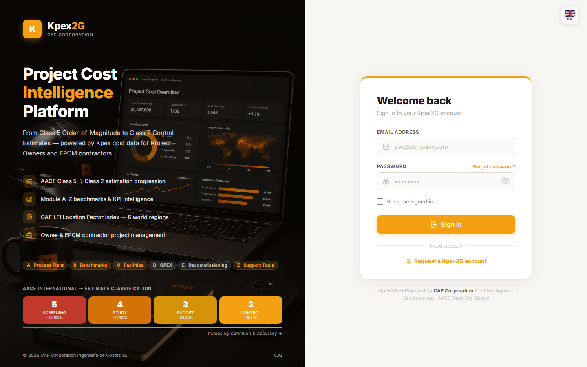

## In this lesson

- Why you need a Kpex account to follow the course.
- How to activate the access that comes with your enrolment.
- What to do if something goes wrong.

## Why you need an account

Almost every lesson ends with a **"Try it in Kpex"** task: a short exercise inside the platform. To do them, you need access to Kpex, and that access **comes with your enrolment**: when you buy the course, a Kpex **trial account** is created for you, lasting **15 days from your purchase**, designed so you can complete every exercise. When they are up, your access to the application expires, even if you have not finished the course; the course lessons stay available.

Kpex runs **entirely in your browser**: there is nothing to install. Any modern browser works: **Chrome, Edge, Firefox or Safari**. The Kpex interface is **English-only**; in this course you will see button and field names in English, in **bold**, with an explanation in English alongside.

## Activate your access

You don't need to register or pay separately: your Kpex account is created automatically when you buy the course. You just need to activate it:

1. **Look for the welcome email.** When you enrol, you receive an email from CAF Corporation with the access to your Kpex trial account. If you don't see it, check your spam folder.
2. **Open your access.** Follow the link in the email and, if prompted, **set your password**.
3. **Sign in at caf-corporation.com.** Enter your **Email Address** and **Password** and click **Sign In**. On your own computer you can tick **Keep me signed in**.
4. **Check that you land on the Dashboard.** It is Kpex's main screen; we walk through it in lesson 2.2.

## What your trial includes

Your trial account gives you access to the parts of Kpex this course uses. If you see a sidebar item with a **lock icon**, that feature belongs to a different membership tier; lesson 2.2 covers this in more detail.

## If something goes wrong

| Problem | What to do |
|---|---|
| The access email doesn't arrive | Check your spam folder and confirm you bought with the correct email |
| You forgot your password | On the sign-in screen, click **Forgot password?** |
| Any other access problem | Email **support@caf-corporation.com** |

## Key idea

> Your trial account is your **lab** for the course, and it comes with your enrolment. Activate it now, before moving on: the exercises start in Module 1, and the 15 days have been running since your purchase.

## Try it in Kpex (5 minutes)

1. Open the welcome email and activate your access following the steps in this lesson.
2. Sign in and check that you land on the **Dashboard**.
3. Sign out from the menu under your name, top right (**Sign Out**), then sign back in. That way you know your password works before you start Module 1.
