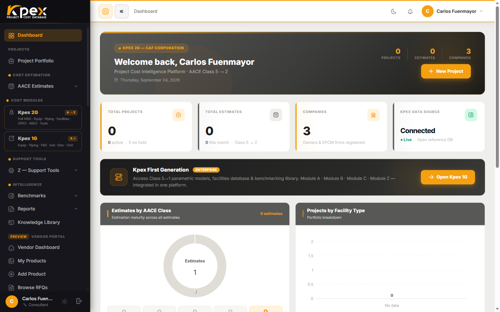

## In this lesson

- What Kpex is and the problem it solves.
- The five ideas that set Kpex apart from a traditional cost book.

## What is Kpex?

**Kpex** is a cloud-based **CAPEX cost intelligence platform** developed by CAF Corporation Ingeniería de Costes SL. It lets you prepare, validate and benchmark capital expenditure estimates to industry standards, entirely in your web browser, with nothing to install.

Most platforms follow **one** school. Kpex harmonises the profession's two main references:

- **AACE International**: Class 5 to Class 1 estimate classification (RP 18R-97) and the TCM Framework.
- **PMI**: the PMBOK cost chapter and the WBS Standard.

In practice, cost engineers and project managers work in the same tool and speak the same language.

## Five ideas that make Kpex different

### 1. A self-maintaining database: geography × time

A cost book starts ageing the day it is printed. In Kpex, every cost is anchored to a reference, the **US Gulf Coast** in a **base month**, and two engines adjust it **automatically every time you read it**:

| Engine | What it adjusts | How |
|---|---|---|
| **Z.4 · CAF Location Factor Index (LFI)** | **Geography** | Moves the cost to any of **197 countries**, from the model's country of origin to your project country |
| **Z.5 · Kpex Cost Index** | **Time** | Escalates it to the **current month** using monthly indices |

The result: your estimate is always **in today's money and your location**.

### 2. Depth: the largest structured CAPEX catalogue of its kind

- **700+ parametric equipment models** (Module A).
- **150 full facility models** (Module C).
- **653 historical cost curves** (Module B).

Every model states its capacity driver, valid range, cost basis and provenance.

### 3. The complete lifecycle: CAPEX, OPEX and ABEX

Modules **A, B and C** form the CAPEX estimating core. **Module D** adds operating expenditure (**OPEX**) and **Module E** adds abandonment and decommissioning (**ABEX**), a capability that is rare in the market. You can cover the asset from its first estimate to its decommissioning.

### 4. Metric ⇄ imperial, everywhere

Every input, range and result can be shown in **metric or imperial** with a single toggle, without touching the model. You can also read the estimate **in your own currency**, converted at the day's European Central Bank rate. The base is always kept in US dollars so benchmarks stay consistent.

### 5. Module Z: a toolbox no other estimator ships with

Tools that normally live in scattered spreadsheets or specialist consultancies: location factor, monthly cost index, labour and rental-equipment rates, engineering rates, and the full assessment suite (PDRI, PEI, CRI and Accuracy Rating).

## Key idea

> Kpex is not a cost book: it is a **living database** that recalibrates itself by **location** and **time**, inside an estimating environment that covers the asset's **whole lifecycle**.

## Try it in Kpex (2 minutes)

1. Log in to your Kpex trial account.
2. Walk down the sidebar and find the five groups: *Cost Estimation*, *Cost Modules*, *Support Tools (Z)*, *Intelligence* and *Kpex Exchange*.
3. Find a price in the catalogue that says **"current to"** followed by this month: that is the Cost Index at work.
