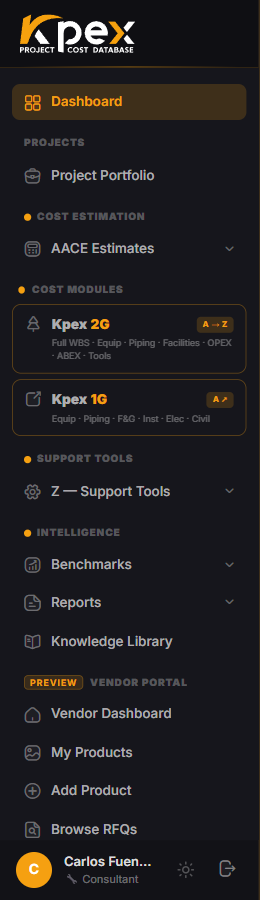

## In this lesson

- Kpex's five layers and what each one contains.
- Who works mainly in each layer.

## The five layers

Kpex is organised in five layers. Each one is a group in the sidebar, so learning the layers means learning to find your way around the platform.

| Layer | What it contains | Primary users |
|---|---|---|
| **Cost Estimation** | AACE Class 5–2 estimate wizard, WBS builder, PDF reports with full methodology traceability | Cost engineers, project managers, consultants |
| **Cost Modules A–E** | 700+ component models (A), historical benchmarks (B), 150 facility models (C), OPEX (D), ABEX and decommissioning (E), all escalated to today and metric/imperial | Estimators, feasibility teams |
| **Support Tools Z** | CAF LFI (197 countries), Kpex Cost Index (monthly, multi-region), engineering, labour and rental rates, PDRI/PEI/CRI assessments | Senior estimators, project controls |
| **Intelligence** | 653 benchmark curves, P10/P50/P90 ranges, portfolio and progression reports | Project directors, cost managers |
| **Kpex Exchange** | Marketplace: requests for quotation (RFQs), vendor pricing, data-partner contributions | Procurement, vendors, data partners |

## How the layers connect

Think of Kpex as a chain:

1. **Cost Modules** provide the **cost data**: a piece of equipment, a facility, a curve.
2. **Support Tools Z** **calibrate** it: to your country (LFI), to today (Cost Index) and to your level of definition (PDRI).
3. **Cost Estimation** **organises** it into an estimate with its AACE class and WBS.
4. **Intelligence** **compares** it against history and **reports** it.
5. **Kpex Exchange** **replaces** it with real vendor prices as the project matures.

<!-- kpex-videos:start -->
## Watch it in Kpex

Short tours of the real platform, recorded in Kpex itself. English voice — press CC in the player for English or Spanish subtitles.

<figure class="kpex-vid"><video controls preload="none" playsinline controlslist="nodownload" oncontextmenu="return false" poster="/wp-content/uploads/kpex-videos/Kpex_1G.jpg"><source src="/wp-content/uploads/kpex-videos/Kpex_1G.mp4" type="video/mp4"><track kind="subtitles" srclang="en" label="English" src="/wp-content/uploads/kpex-videos/Kpex_1G_EN.vtt" default><track kind="subtitles" srclang="es" label="Español" src="/wp-content/uploads/kpex-videos/Kpex_1G_ES.vtt"></video><figcaption><strong>Kpex 1G · Quick component estimator</strong> · 1:43</figcaption></figure>

<!-- kpex-videos:end -->

## Key idea

> **Data → calibration → estimate → benchmark → real price.** Each layer of Kpex is one link in that chain.

## Try it in Kpex (3 minutes)

Open one item from each sidebar group and write one line about what you see. Come back to this list at the end of the course: you will be surprised how much more you understand.
