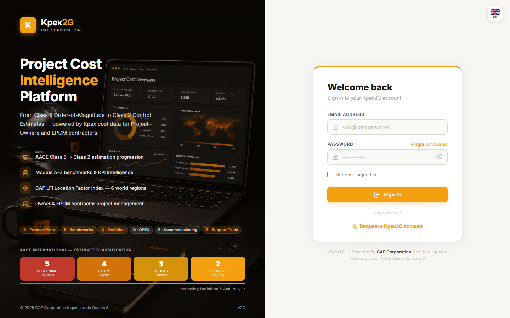

## In this lesson

- Where and how you access Kpex.
- The stages of signing up for a new account.
- How to sign in, reset your password and sign out.
- Which language the platform uses.

## Where Kpex lives

Kpex is a cloud platform. You access it at **kpex.caf-corporation.com** from any modern browser:

| Requirement | Detail |
|---|---|
| Browser | Chrome, Edge, Firefox or Safari |
| Installation | None: everything runs in the browser |
| First visit | Takes you to the registration page to create your account and choose a membership plan |

Because everything lives in the browser, you can work from any computer: your estimates sit in your account, not in a local file.

## The platform language

The **Kpex application interface is currently English-only**. A language selector is available on the public website and the sign-in page, but inside the application everything appears in English.

## Signing up for a new account

Sign-up has three stages, shown at the top of the form:

| Stage | What you do |
|---|---|
| **Choose Plan** | Pick your membership plan |
| **Account** | Create your account: **Full Name**, **Corporate Email**, **Password** and **Confirm Password**, and accept the **Terms of Service** and **Privacy Policy** |
| **Payment** | Review the order summary and continue to secure payment |

Between the **Account** stage and payment, Kpex asks you to **verify your email** with a **6-digit code** sent to your inbox.

Passwords need **at least 8 characters, including an uppercase letter and a number**. The terms checkbox is not ticked by default: you have to tick it explicitly.

> If you are following this course, you already activated your trial account in lesson 0.2. This section explains the full sign-up flow, which is useful if you later need to bring a colleague on board.

<!-- VERIFY: whether the student trial account goes through the Choose Plan and Payment stages or skips them -->

## Signing in

On the sign-in screen:

1. Enter your **Email Address** and **Password**.
2. On your own computer, tick **Keep me signed in** so you don't have to log in every time.
3. Click **Sign In**. You land on the **Dashboard**, which is the subject of the next lesson.

## Resetting your password

If you've forgotten it, click **Forgot password?** next to the password field. Kpex emails you a link to set a new one.

## Your account and signing out

Your name appears in the top right. Clicking it opens a menu with:

- **My Account**: your profile details.
- **Sign Out**: ends your session. Always use it on shared computers.

## Getting help

For access problems, feature questions or billing, write to **support@caf-corporation.com**.

## Key idea

> You don't install Kpex: you **open** it. With a browser and your account, the whole platform is available from any computer. The interface is in English, so get used to the menu names exactly as they appear on screen.

## Try it in Kpex (3 minutes)

1. Sign out using **Sign Out** in the menu under your name.
2. Sign back in at **kpex.caf-corporation.com**, this time ticking **Keep me signed in**.
3. Open **My Account** and check that your name and email are correct.
