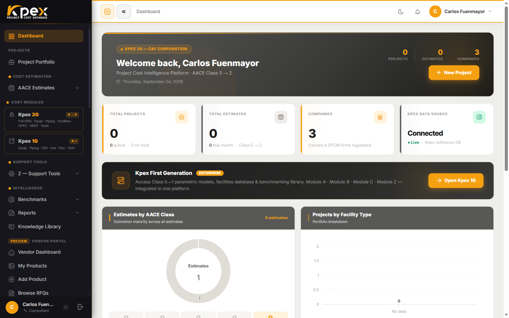

## In this lesson

- The three zones of the Kpex **Dashboard**.
- How the sidebar is organised and what the lock icon means.
- What the main area shows you and what sits in the top bar.

## Your starting point

Every time you sign in, you land on the **Dashboard**, your personal command centre. From here you can see where your work stands and reach any part of the platform. The screen has **three zones**:

| Zone | Where | What it's for |
|---|---|---|
| **1. Sidebar** | Left | Navigating every section of Kpex |
| **2. Main content area** | Centre | A summary of your projects and estimates |
| **3. Top bar** | Top right | Notifications, light or dark mode, and your account |

## Zone 1: the sidebar

Every section of the platform lives here, grouped by function. These are the same layers you met in lesson 1.2:

| Sidebar group | What you'll find |
|---|---|
| **Cost Estimation** | **AACE Estimates** and the Estimate Wizard |
| **Cost Modules** | Cost Modules A to E |
| **Support Tools** | The Module Z tools (**Z — Support Tools**) |
| **Intelligence** | **Benchmarks** and **Reports** |
| **Kpex Exchange** | The marketplace |

Above these groups are links to the **Dashboard** itself and your **Project Portfolio**. Depending on your membership tier, you will also see the **Knowledge Library**, with guides and reference documents.

### The lock icon 🔒

Some items appear **dimmed, with a lock icon**. That means the feature needs a **higher membership tier** than yours. Hover over it and you'll see **Upgrade to unlock**. The item stays visible on purpose, so you know the feature exists even if you don't have it yet.

## Zone 2: the main content area

The main area summarises your activity with cards and charts, including:

- **Total Projects** and **Total Estimates**: how many projects and estimates you have.
- **Estimates by AACE Class**: your estimates grouped by AACE class.
- **Projects by Facility Type**: your portfolio split by facility type.
- **Recent Projects** and **Recent Estimates**: what you worked on last, most recent first.

On a new account you'll see messages such as **No projects yet** or **No estimates yet**. That's expected: they fill up once you create your first estimate in Module 4.

The main area **adapts to your membership tier and profile type**, so two users may see different dashboards.

<!-- VERIFY: the guide mentions a Cost Index (CAI) summary card and quick access to the most-used tools; not found in dashboard/index.blade.php -->

## Zone 3: the top bar

In the top-right corner you have:

| Item | What it does |
|---|---|
| **Moon / sun** | Switches between light and dark mode (**Toggle dark / light mode**) |
| **Bell** | Opens your **Notifications** (shows the latest 20) |
| **Your name** | Opens the menu with **My Account** and **Sign Out** |

<!-- VERIFY: the guide mentions a quick help link and a membership tier badge next to the user's name; not found in the top bar of layouts/app.blade.php -->

Remember that the application interface is **English-only**: the language selector exists only on the public website and the sign-in page.

## Key idea

> The Dashboard has three zones: you **navigate** with the sidebar, **see where you stand** in the main area, and **manage your session** in the top bar. A lock isn't an error: it marks a feature from another membership tier.

## Try it in Kpex (4 minutes)

1. On the Dashboard, identify the three zones.
2. Go through the sidebar and note which items show a lock on your account.
3. Switch to dark mode with the top-bar button, then back to light mode.
4. Open the notifications bell and check whether you have any.
