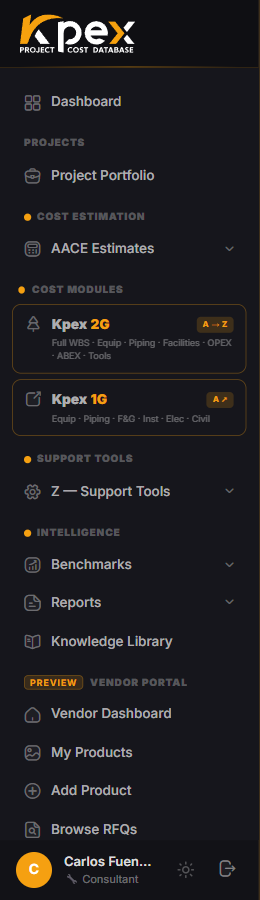

## In this lesson

- Kpex's four profile types.
- How the sidebar changes with your profile.
- Which profile you have, and why it matters for this course.

## One profile, one interface

Kpex adapts its interface to your **profile type**. Not every user does the same job: an estimator needs the whole toolbox, while a vendor only needs to list products and answer requests for quotation. So the sidebar shows each profile the sections that are useful to it.

## The four profiles

| Profile | Primary workflow | What you see in the sidebar |
|---|---|---|
| **Consultant / Estimator** | The full cost-estimation workflow: AACE classes, cost modules and tools | The full sidebar, every section |
| **Owner / Operator** | Reviewing EPC contractors' estimates and issuing requests for quotation (RFQs) through Kpex Exchange | Estimates and procurement |
| **Vendor** | Listing equipment and services and responding to RFQs | The **Vendor Portal** only |
| **Data Partner** | Contributing historical cost data | The **Data Partner** portal |

## What each profile sees

### Consultant / Estimator
Sees every group you met in lesson 2.2: **Cost Estimation**, **Cost Modules**, **Support Tools**, **Intelligence** and **Kpex Exchange**, plus their **Project Portfolio**. This is the profile for people who build estimates.

### Owner / Operator
Their sidebar focuses on two blocks: **EPC Cost Estimates** (with **All Estimates** and **Project Portfolio**) and **Procurement** (with **My RFQs** and **New RFQ**). This is the profile for people who receive and evaluate estimates and go to the market for prices.

### Vendor
Works in the **Vendor Portal**: managing products (**My Products**, **Add Product**) and reviewing open requests (**Browse RFQs**).

### Data Partner
Works in their own portal, contributing historical datasets (**My Datasets**) to the Kpex database.

Every profile has the **Dashboard** and the **Kpex Exchange** group, the marketplace that connects buyers and vendors. You'll explore it in lesson 7.3.

## Which profile do you have?

When someone signs up for Kpex on their own, they get the **Consultant / Estimator** profile. The **Data Partner** profile isn't chosen at sign-up: CAF Corporation assigns it by invitation.

<!-- VERIFY: the navigation guide says the profile is "set during registration", but the current code (AuthController) no longer asks for it at self-registration and defaults to Consultant. Confirm how Owner / Operator and Vendor profiles are assigned. -->

Your course trial account is a **Consultant / Estimator** profile, because that's the one that sees the whole platform and the one you need for the estimating exercises.

<!-- VERIFY: confirm the student trial account is created with the Consultant / Estimator profile -->

## Profile is not the same as membership

Keep these two ideas apart:

| Concept | What it determines |
|---|---|
| **Profile type** | **What kind of work** you do in Kpex, and therefore which sections you see |
| **Membership tier** | **How much** of each section is unlocked (the lock icons from lesson 2.2) |

Two estimators with the same profile can see different locks if they're on different tiers.

## Key idea

> Your **profile** decides **which sections** you see; your **membership** decides **which ones are unlocked**. Kpex shows each user only what their job needs.

## Try it in Kpex (3 minutes)

1. Compare your sidebar with the table in this lesson: which profile do you have?
2. Open the **Kpex Exchange** group and note which options it contains.
3. Think about your organisation: which profile would each of your colleagues, clients and suppliers have?
