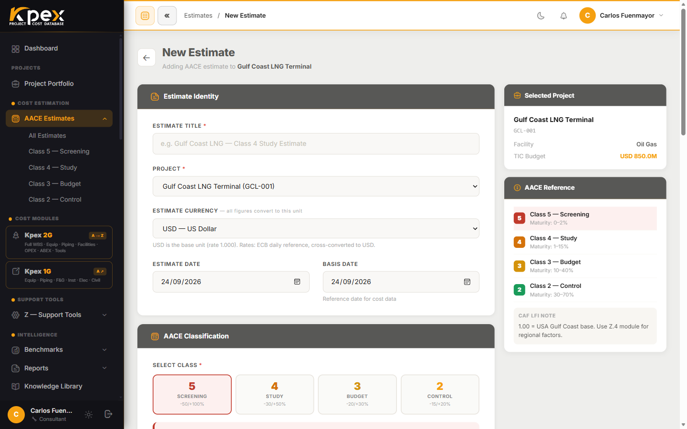

## In this lesson

- The five AACE 18R-97 estimate classes and what each one means.
- How each class maps to PMI estimating techniques.
- Why a class belongs to an **estimate**, not to a **project**.

## One standard, five levels of maturity

Kpex is built around **AACE International Recommended Practice 18R-97**, the global standard for cost estimate classification. Every estimate you create in Kpex carries an **AACE Class**, and that class defines two things: the **accuracy range** you can expect and the **level of project definition** you need to produce it.

The rule is simple: the better defined the project, the narrower the accuracy range. Classes count down from Class 5 (least defined) to Class 1 (most defined).

| AACE Class | Common name | Accuracy range | Project definition | Typical use |
|---|---|---|---|---|
| **Class 5** | Screening / Order of Magnitude | −50% to +100% | 0–2% complete | Concept screening, portfolio screening, pre-feasibility |
| **Class 4** | Study / Feasibility | −30% to +50% | 1–15% complete | Feasibility study, concept selection, business case |
| **Class 3** | Budget / Authorization | −20% to +30% | 10–40% complete | Authorization, FID (Final Investment Decision), budget approval |
| **Class 2** | Control Estimate | −15% to +20% | 30–75% complete | Change order evaluation, project control baseline |
| **Class 1** | Definitive / Check | −10% to +15% | 65–100% complete | Bid/tender, final budget, contract change management |

Two details worth noticing:

- The ranges are **asymmetric**: the risk of under-running is smaller than the risk of over-running, especially early on. A Class 5 number can end up doubling.
- The definition percentages **overlap** between classes. A class is a zone of maturity, not an exact figure.
- **Kpex works from Class 5 to Class 2.** Class 1 (definitive) is prepared from complete engineering and firm contractor bids, outside the platform's scope.

## The PMI mapping

A PMI-certified project manager rarely says "Class 4"; they say **parametric estimating**. Kpex bridges the two worlds by mapping AACE classes to the cost management concepts in **PMBOK Chapter 7**.

| AACE Class | PMI estimating technique (PMBOK Ch. 7) |
|---|---|
| **Class 5** | **Analogous** Estimating |
| **Class 4** | **Parametric** Estimating |
| **Class 3** | **Bottom-up** Estimating, initiation |
| **Classes 2–1** | **Bottom-up** Estimating with a **detailed MTO** (material take-off) |

Because of this dual alignment, AACE-trained estimators and PMI-certified PMs can each work from their native framework, on the same estimate.

## The class belongs to the estimate, not the project

People often say "this is a Class 3 project". In Kpex, **the AACE class belongs to an estimate**. One project can carry **several estimates at different classes** as its definition matures: a Class 5 screening today, a Class 3 later on.

That is why Kpex project pages and portfolio charts **group and count estimates by class** instead of stamping the project with a single one. It gives a truer picture of where the work actually stands.

## Key idea

> The AACE class tells you **how far you can trust a number** given **how much you know about the project**. As the project matures, it collects estimates at different classes.

## Try it in Kpex (3 minutes)

1. In the sidebar, open **Cost Estimation → AACE Estimates**.
2. Notice that estimates can be browsed **by class** (one entry per class, plus **All Estimates**).
3. Start a **New Estimate** and click each class card in the **AACE Classification** block: watch the **Accuracy Range** and **Definition Maturity** change. Cancel without saving.
