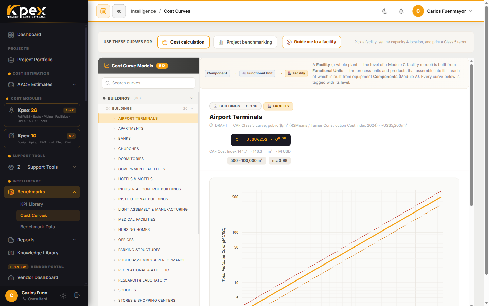

## In this lesson

- What Kpex does once you pick an estimate's class.
- The practical recipe: which part of Kpex to open to build each class.
- The calibration layer that works the same way at every class.

## What happens when you pick a class

When you create a new estimate, Kpex asks you to select the **target AACE Class**. From that choice, the platform:

1. **Activates the right module set.** For example, Class 5 uses the cost curves and the Module C facility models; Class 3 uses Module A component-level data.
2. **Applies the PDRI checklist** (via **Z.6.3**) to check that the project's definition level matches the class you chose.
3. **Tags the report** with the accuracy range and the class justification, ready for client delivery.

## The recipe: one primary tool per class

Each class is built with a different primary tool. The table below is the practical recipe: which part of Kpex to open, and in what order, for the level of definition you have.

| Class | Primary tool in Kpex | How to build it |
|---|---|---|
| **Class 5** · Order of magnitude | **Cost Curves** (Module B) + Module C facility model | Open **Intelligence → Benchmarks → Cost Curves**, pick the facility (or use the **Guide me to a facility** guided picker), enter the one driving **capacity** and press **Calculate**. Kpex returns the total installed cost with its ± band and plots your point on the curve. Set your project country (Z.4) and the cost already carries current escalation (Z.5). Print the one-page benchmarking report and cross-check it against the P10/P50/P90 ranges (B.2). |
| **Class 4** · Feasibility | **Equipment List Builder** (Module A, ISBL) + bulk by discipline (Module B) | Build the **equipment list**: add the major equipment from the **Module A ISBL library** (operating point, size and quantity) and Kpex completes the **ISBL bulk by discipline** (Module B) — foundations, piping and instruments from the take-off; structural, electrical, telecoms, insulation and painting from the P50 statistical allowance of its sub-family. Read the total installed cost broken down discipline by discipline. Flag OPEX (Module D) and ABEX (Module E) for the whole lifecycle. LFI and Cost Index apply automatically; run the PDRI check. |
| **Class 3** · Budget / FID | Module A components + MTO, bottom-up on the WBS | Create the estimate and build the **WBS**. Add major equipment from Module A with real sizing; add the bulk material take-off (piping, E&I, civil) via the **KPEX-HF** allowances; price construction labour with **Z.2**, rental equipment with **Z.3** and engineering/EPCM with **Z.1**. This is where the number stops being parametric and becomes built up. And it is here, not at Class 2, that **Procurement Contracts** starts: you import contractor offers, mark the *first-runner* and apply it to the WBS to begin replacing parametric costs with real offers. |
| **Class 2** · Control | Detailed MTO + consolidated real offers | Refine the take-off into a detailed MTO and consolidate the **real offers** you already loaded in **Procurement Contracts** back at Class 3 into the control baseline. Reconcile bids, freeze the baseline and use the **Estimate Progression** report to manage change. Note: the **Kpex Exchange (RFQ)** is a **separate marketplace** for requesting offers from vendors; it is distinct from the Procurement Contracts that lives inside the estimate. |

Notice the progression: from **one curve and one capacity figure** (Class 5) to an **equipment list with its statistical bulk** (Class 4), then the **detailed take-off on the WBS** (Class 3, where the first **real offers** already come in via Procurement Contracts) and finally the **consolidated real prices** (Class 2). It is the same *analogous → parametric → bottom-up* path you saw in the previous lesson.

## Same calibration layer at every class

Whatever class you work at, the two engines that keep the number current are **always on**:

- The **CAF Location Factor (Z.4)** moves the cost to your country.
- The **CAF Cost Index (Z.5)** escalates it to today.

You can also read and print the whole estimate **in your own currency and unit system**, and attach the **PDRI score** and the Reference & Accuracy statement to the report.

## Key idea

> Picking the class means picking the **tool**: curves for Class 5, facility models for Class 4, components and the WBS for Class 3, real quotes for Class 2. The **calibration** (location and time) is the same at every class.

## Try it in Kpex (4 minutes)

1. Open **Intelligence → Benchmarks → Cost Curves** and find the **Guide me to a facility** picker. Walk through sector → family → facility without calculating anything.
2. Back in the sidebar, find a **Module C** facility model and a **Module A** equipment item among the cost modules.
3. Write down which tool you would use for a **Class 5**, a **Class 4** and a **Class 3** estimate in your own industry.
