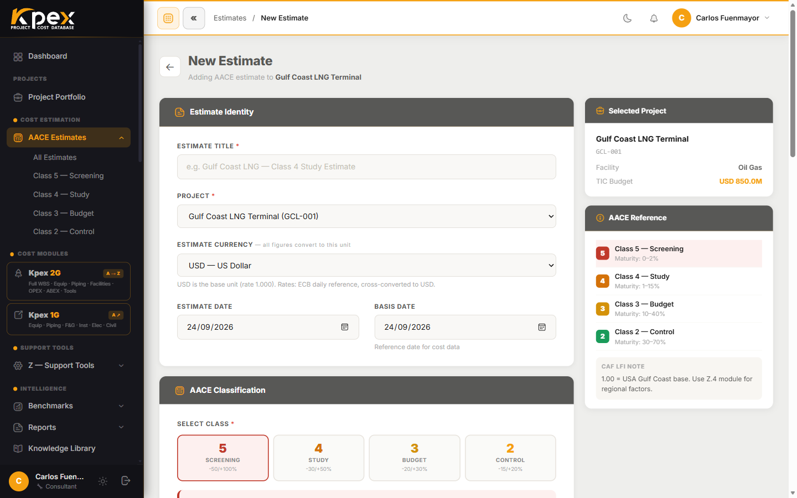

## In this lesson

- How to open the **Estimate Wizard**.
- What you decide on each of its five cards.
- The extra block that only appears for Class 5.

## Where to find the wizard

In the sidebar, open **Cost Estimation → AACE Estimates** and click **New Estimate**. A form opens with **five cards** on the left and a sticky reference panel on the right. If you start from a project, the estimate is already linked to it.

<!-- VERIFY: Navigation Guide v1.2 names the cards "Project Identification / Estimate Classification / Facility Definition / Cost Index Reference / Lifecycle Cost Scope"; this lesson uses the live names from estimates/create.blade.php. Confirm which should prevail. -->

## The five cards

| # | Card (UI) | What you decide |
|---|---|---|
| 1 | **Estimate Identity** | Estimate title, the project it belongs to, **Estimate Currency**, **Estimate Date** and the cost-data **Basis Date** |
| 2 | **AACE Classification** | The target AACE class. Click a class card and a banner shows its accuracy range and definition maturity |
| 3 | **Cost Data** | The base **TIC Total** (total installed cost before contingency), contingency % and escalation % |
| 4 | **Basis of Estimate** | The **Project Country**, which auto-fills the **CAF LFI (Z.4)** location factor; escalation from the **Cost Adjustment Index (CAI — Z.5)**; and your assumptions and exclusions notes |
| 5 | **Lifecycle Cost Scope** | Whether the estimate is CAPEX only or adds OPEX and/or ABEX, plus the plant lifetime |

### 1 · Estimate Identity
This is also where you choose the **currency**. Rates come from the European Central Bank daily reference; the estimate is always stored in US dollars and shown converted at a rate that is **frozen** on the estimate.

### 2 · AACE Classification
The selector shows cards for Classes **5, 4, 3 and 2**, each with its range (for example, Class 5: −50/+100%). There is no Class 1 card: Kpex covers Class 5 to Class 2.

### Class 5 only · Class 5 — Cost Curve Basis
Pick Class 5 and an extra block appears: select a **Cost Curve Model**, enter the **Plant Capacity** and the location factor, and click **Calculate from Curve**. Kpex shows the low (−50%), mid-point plus contingency and high (+100%) values, and **auto-fills the TIC** on card 3.

### 3 · Cost Data
If you are not coming from a curve, type the **TIC Total** here. Contingency and escalation are added on top in the estimate summary.

### 4 · Basis of Estimate
Pick the country and the **Location Factor** fills itself in (tagged **AUTO**), though you can override it. For escalation, choose the base year, the execution year and the index, then click **Fetch CAI**: Kpex works out the escalation percentage.

### 5 · Lifecycle Cost Scope
**CAPEX** is always included. Tick **OPEX** to add Module D and **ABEX** to add Module E; doing so reveals **Plant / Facility Lifetime**, used for NPV and ABEX discounting.

Finish with **Create Estimate**.

## Key idea

> The wizard pins down **what** you are estimating (identity and class), **how much** it costs to start with (Cost Data), **where and when** (Basis of Estimate) and **how much of the lifecycle** you cover (Lifecycle Cost Scope).

## Try it in Kpex (5 minutes)

1. Open **New Estimate** and pick a test project.
2. Select **Class 4**, then **Class 5**: check that the **Class 5 — Cost Curve Basis** block only shows up for Class 5.
3. In **Basis of Estimate**, pick a country and watch the **Location Factor** change.
4. Tick **OPEX** and **ABEX** and see which new field appears. You can cancel or create the estimate: you will use it in lesson 4.2.
