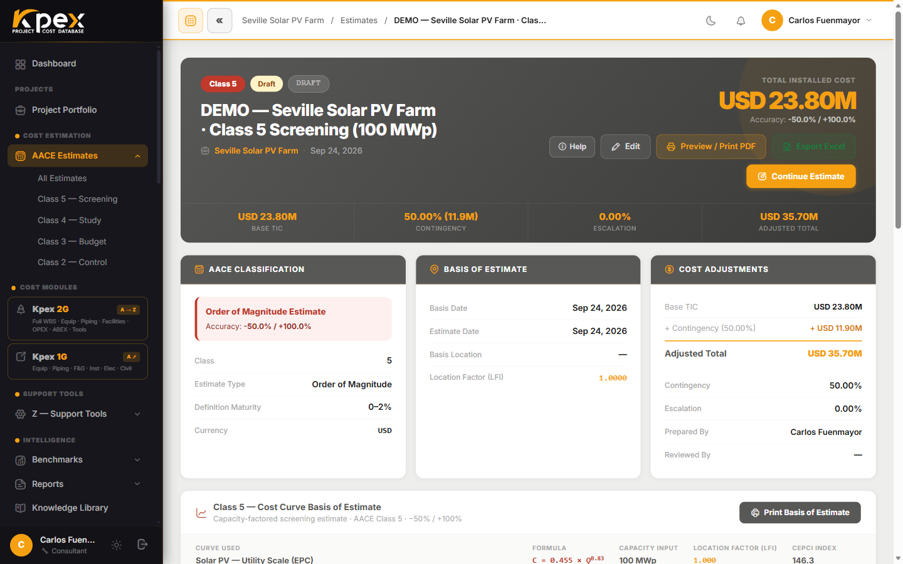

## In this lesson

- What you see when you open a freshly created estimate.
- How to add Module A equipment with the **Equipment List Builder**.
- How to organise line items in the **WBS**, and how location and escalation are applied.

## The estimate workspace

Once created, an estimate opens in its own workspace. Action buttons sit at the top; summary blocks sit below:

| Block (UI) | What it shows |
|---|---|
| **AACE Classification** | Class, accuracy range and estimate currency |
| **Basis of Estimate** | The dates, location and notes you set in the wizard |
| **Cost Adjustments** | The cost waterfall: **Base TIC** + contingency + escalation = **Adjusted Total** |
| **WBS Cost Breakdown** | The cost broken down along the Work Breakdown Structure |

The main buttons are:

- **Continue Estimate**: keeps building the **current** estimate; it takes you to the right tool for its class. For Class 5 it opens the curve-and-capacity form; for other classes it opens the **Equipment List Builder** (Module A). It does not change class.
- **Mature to Class N**: this is the button that **advances the class**. It creates the next (more detailed) class in the same project and carries the basis over — country, factor, currency and the previous total. Don't confuse it with *Continue Estimate*: one continues the current estimate, the other spawns the next class.
- **WBS Builder**: the line-item structure builder.
- **Edit**: changes the title, dates, contingency, escalation, basis of estimate and location. It does not touch cost items.
- **Procurement**: shown on Class 3 estimates, for managing packages and offers.

For **Class 2** estimates there is also a **Kpex 2G ↔ 4Builders** bridge, linking the estimate with the 4Builders execution tool.

## Adding Module A equipment

The **Equipment List Builder** works in three steps:

1. **WBS Build**: define the plant areas.
2. **Equipment List**: add items to each area.
3. **DC Method**: choose how equipment becomes direct cost, using the **KPEX-HF** allowances or the **Lang Factor**.

Equipment comes from the Module A catalogue (rotating, static, heat transfer, civil, electrical, instruments). You add each item with its **quantity** and **sizing parameters**, and its cost appears instantly with location and escalation already applied. From there the system works out Direct Costs (DC), Indirect Costs (IC) and Total Installed Cost (TIC).

## The WBS: where line items live

Your estimate is organised in a **Work Breakdown Structure** aligned with the AACE TCM Framework and the PMI WBS Standard. In the **WBS Builder** you build the **Facility → Area → Unit → Cost Item** hierarchy and enter cost line items with quantities, unit rates and totals. The WBS drives the estimate summary and the reports.

Line items can be grouped, reordered and tagged by discipline or facility system.

## Location and escalation: automatic

There is nothing to work out by hand:

- **Z.4 · CAF LFI (geography)**: pick your project country and Kpex moves each cost from the model's country of origin to your location (**destination LFI ÷ origin LFI**).
- **Z.5 · Kpex Cost Index (time)**: escalation to the current month is already baked in.

The LFI applies **globally** to the whole estimate and can also be set **per line item in the WBS Builder** (inside each WBS node's parametric estimating box, in the **Location Factor (CAF LFI)** field), which helps on projects that span several locations.

<!-- kpex-videos:start -->
## Watch it in Kpex

Short tours of the real platform, recorded in Kpex itself. English voice — press CC in the player for English or Spanish subtitles.

<figure class="kpex-vid">
<iframe src="https://player.vimeo.com/video/1234348981?h=0dc9bea106&title=0&byline=0&portrait=0&dnt=1&texttrack=en" title="Class 4: equipment, ISBL bulk and crews" loading="lazy" allow="fullscreen; picture-in-picture" allowfullscreen></iframe>
<figcaption><strong>Chapter 2 · Class 4: equipment, ISBL bulk and crews</strong> · 2:24</figcaption></figure>

<!-- kpex-videos:end -->

## Key idea

> The wizard creates the estimate; the **workspace** fills it in. Module A equipment, line items in the WBS and, underneath, location and time calibrated automatically.

## Try it in Kpex (6 minutes)

1. Open the estimate from lesson 4.1 (or create a **Class 3** one).
2. Click **Continue Estimate** and, in the **Equipment List Builder**, define an area and add a Module A item (a centrifugal pump, say) with its quantity.
3. Open the **WBS Builder** and find the **Facility → Area → Unit → Cost Item** levels.
4. Go back to the estimate and see how the **Cost Adjustments** block has changed.
