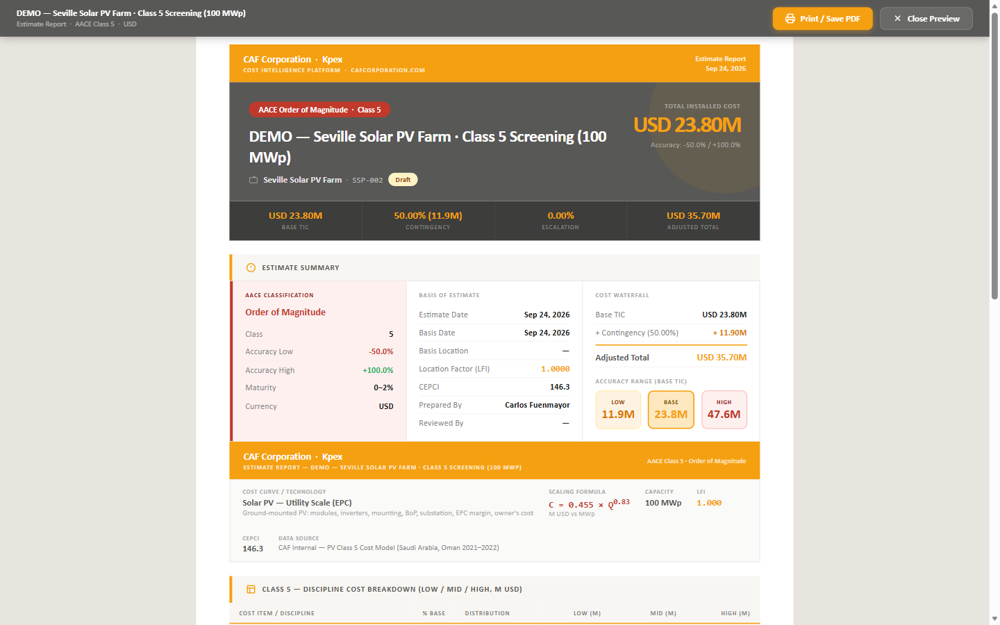

## In this lesson

- How to read your estimate in your own currency and unit system.
- What the PDRI assessment (Z.6.3) is and why it goes with the report.
- What the PDF report contains and how to export it.

## Your currency

You can read the **whole** estimate in your own currency: totals, breakdown, line items, printed report and Excel. Conversion uses the **European Central Bank daily reference rate**.

You choose the currency in the wizard, on the **Estimate Identity** card (**Estimate Currency** field). Two rules matter:

- The **base** is always kept in **US dollars**, so benchmarking stays consistent.
- The rate is **frozen on the estimate**: the form shows, for example, "1 USD = X EUR (frozen on this estimate)".

## Your unit system

In the **cost-curve catalogue** (Module B) and on the **facility pages** you can switch between **metric and imperial** with a single toggle. It is **read-only** (it shows the equivalents): neither the underlying model nor the prices change.

## The PDRI assessment (Z.6.3)

The **Project Definition Rating Index (PDRI)** gives an objective score of how well defined your project is. You can run it **at any stage**, from **Support Tools (Z) → Z.6 Assessment Tools**.

| Aspect | Detail |
|---|---|
| **Variants** | 7: Industrial, Small Industrial, Infrastructure, Small Infrastructure, Buildings, Small Buildings, Oil & Gas EPC |
| **Score** | 0 to 1000; **lower is better** defined |
| **Output** | Score + gap analysis, as a PDF with the full scoring matrix and recommendations |

Why does it matter? Because the AACE class you declare should match the project's real definition level. The PDRI is a **standalone** tool, inside Module **Z.6**: its score and PDF give you **methodology evidence** that your Class 3 really is a Class 3. For now you run it **separately** (it is not automatically attached to the estimate report): you complete it in Z.6 and keep its report as backup.

## The PDF report

From the workspace, click **Preview / Print PDF**. Kpex opens a print-ready version in a new tab, where you can print it or save it as PDF. The branded report includes:

- Project header.
- AACE class declaration.
- Accuracy range statement.
- Cost breakdown by discipline.
- LFI and Cost Index factors applied.
- PDRI score.
- Estimator signature block.

Next to the PDF sits **Export Excel**, which downloads the estimate as a workbook (**Summary · Detail · Basis** sheets). For Class 4 estimates, the workspace itself points you to the BOE report buttons (summary or full) instead. Class 5 estimates also get **Print Basis of Estimate**, which prints the cost-curve basis.

<!-- kpex-videos:start -->
## Watch it in Kpex

Short tours of the real platform, recorded in Kpex itself. English voice — press CC in the player for English or Spanish subtitles.

<figure class="kpex-vid"><video controls preload="none" playsinline crossorigin="anonymous" controlslist="nodownload" oncontextmenu="return false" poster="https://caf-corporation.com/media/kpex-videos/Kpex_Reports.jpg"><source src="https://caf-corporation.com/media/kpex-videos/Kpex_Reports.mp4" type="video/mp4"><track kind="subtitles" srclang="en" label="English" src="https://caf-corporation.com/media/kpex-videos/Kpex_Reports_EN.vtt" default><track kind="subtitles" srclang="es" label="Español" src="https://caf-corporation.com/media/kpex-videos/Kpex_Reports_ES.vtt"></video><figcaption><strong>Kpex · One report format: your brand, your client</strong> · 1:55</figcaption></figure>

<!-- kpex-videos:end -->

## Key idea

> A good report does not just say **how much**: it says **how accurate**, **where**, **when** and **at what level of definition**. Currency, units, PDRI and the PDF are what make it defensible in front of a client.

## Try it in Kpex (5 minutes)

1. On your estimate from lesson 4.2, click **Edit** and check the estimate currency.
2. Click **Preview / Print PDF** and find the AACE class, accuracy range and LFI in the report.
3. Download **Export Excel** and look through its three sheets.
4. Open **Z.6 Assessment Tools** and find the PDRI variant that fits your type of project.
