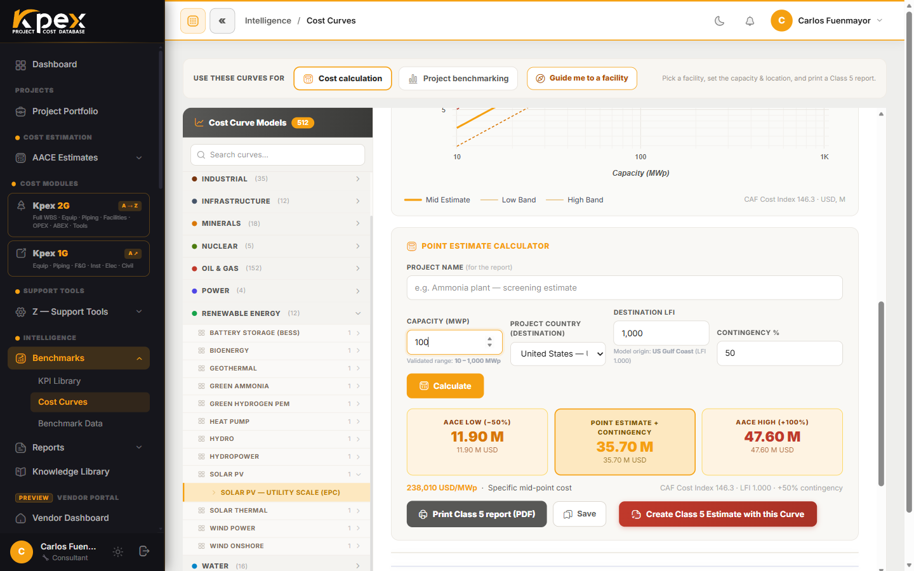

## In this lesson

- You will produce a complete **Class 5** estimate by following the Kpex recipe.
- You will read the result with its accuracy band, print it and cross-check it against P10/P50/P90 ranges.
- You will finish with a small deliverables package, just as you would for a real client.

## The case

An energy company wants an **order-of-magnitude** figure for a **100 MWp utility-scale solar PV plant in Chile**. There is no engineering yet: just a technology, a capacity and a country. That is the textbook Class 5 situation (0–2% definition, −50% to +100% accuracy).

> **Important:** we are not giving you the numbers. Kpex data is escalated every month and calibrated by country, so your result will be the right one **for today**. Record whatever Kpex returns.

## Step by step

### Step 1 · Open the cost curves
In the sidebar, open **Intelligence → Benchmarks → Cost Curves**.

### Step 2 · Pick the facility
Use the **Find your facility** guided picker and go **sector → family → facility** to the utility-scale solar PV curve (**Solar PV — Utility Scale (EPC)**; its driver is capacity in **MWp**, valid from 10 to 1000 MWp).

Before going on, read two things off the panel: the capacity unit and the **Validated range**. Your capacity must sit inside that range.

### Step 3 · Enter the inputs
- **Project name (for the report)**: e.g. "PV plant 100 MWp — screening".
- **Capacity**: `100`.
- **Project country (destination)**: **Chile**. Kpex fills in the **Destination LFI** and shows the model's **Model origin**.
- **Contingency %**: keep the suggested Class 5 value.

### Step 4 · Calculate
Click **Calculate**. Kpex returns the total installed cost with its band and plots your point on the curve with a fixed value label. You will see three cards: **AACE Low (−50%)**, **Point Estimate + Contingency** and **AACE High (+100%)**. Escalation to the current month (Z.5) is already included.

### Step 5 · Print the report
Click **Print Class 5 report (PDF)** and save the one-page report. To keep the calculation, click **Save**.

### Step 6 · Cross-check against P10/P50/P90
Open **Intelligence → Benchmarks → KPI Library** and find the **"Solar PV TIC per MWp"** KPI (total installed cost per MWp) for the solar PV family. Divide your point estimate by 100 MWp and see where it lands against P10, P50 and P90.

### Step 7 (optional) · Turn it into an estimate
Go back to the curve and click **Create Class 5 Estimate with this Curve**. The wizard from lesson 4.1 opens with the curve already selected. Complete the cards, create the estimate and generate its **Preview / Print PDF**.

## Your results table

Copy this table and fill it in with what Kpex returned:

| Item | Your result |
|---|---|
| Curve used | |
| Curve valid range | |
| Model origin country and its LFI | |
| Destination LFI (Chile) | |
| Contingency applied (%) | |
| AACE Low (−50%) | |
| Point Estimate + Contingency | |
| AACE High (+100%) | |
| Unit cost (point ÷ 100 MWp) | |
| P10 / P50 / P90 of the comparable KPI | |
| Does your unit cost fall between P10 and P90? | |

## Deliverables checklist

- [ ] Completed results table.
- [ ] **Print Class 5 report (PDF)** saved.
- [ ] One sentence on where your unit cost sits against P10/P50/P90, and why.
- [ ] One sentence listing the main assumptions (technology, capacity, country, month of calculation).
- [ ] (Optional) Class 5 estimate created under **AACE Estimates**, with its PDF.

<!-- kpex-videos:start -->
## Watch it in Kpex

Short tours of the real platform, recorded in Kpex itself. English voice — press CC in the player for English or Spanish subtitles.

<figure class="kpex-vid">
<iframe src="https://player.vimeo.com/video/1234328822?h=b2dc007046&title=0&byline=0&portrait=0&dnt=1&texttrack=en" title="Class 5 estimate from a capacity curve" loading="lazy" allow="fullscreen; picture-in-picture" allowfullscreen></iframe>
<figcaption><strong>Chapter 1 · Class 5 estimate from a capacity curve</strong> · 2:01</figcaption></figure>

<!-- kpex-videos:end -->

## Key idea

> A proper Class 5 is not "a number": it is **a number with its band**, **calibrated to a country and a month**, **checked against history** and **documented in a report**.

## Try it in Kpex (10 more minutes)

Repeat the exercise changing **one variable at a time**: first the capacity (say 300 MWp), then the country. Note how the **unit cost** moves with size and how the total moves with the LFI. Does the cost per MWp fall as the plant gets bigger?
