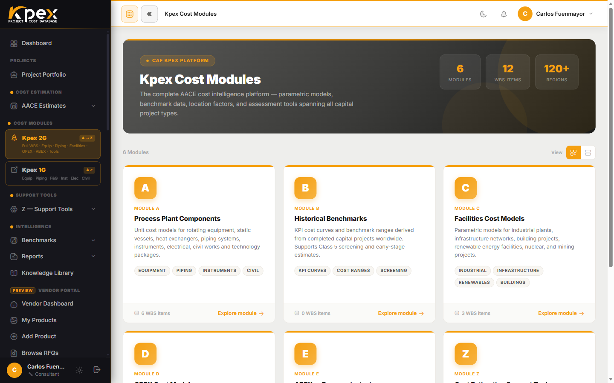

## In this lesson

- What Module A is and what kind of cost it returns.
- Module A's six sub-modules, from A.1 to A.6 (plus A.7, assemblies).
- Why every price comes with a basis, a material and a confidence band.

## What Module A is

**Module A · Process Plant Components** is Kpex's finest-grained layer: the cost of **individual equipment items** in a process plant. It holds **700+ parametric component models**: pumps, compressors, vessels, heat exchangers, conveyors and much more.

Every model works the same way:

1. You enter the item's **sizing parameters** (capacity, size or power), in **metric or imperial**.
2. Kpex returns a **cost range** with **statistical confidence bounds**, not a single number.

## The sub-categories

Module A is organised into **six cost sub-modules, A.1 to A.6**, plus **A.7** for assemblies. Each sub-module has its own component models. The most detailed is A.1, with its six process-equipment families:

| Sub-module | What it contains |
|---|---|
| **A.1 Process Equipment** | The module's finest-grained layer: **A.1.1 Rotating** (compressors, pumps, turbines, fans, blowers), **A.1.2 Static** (pressure vessels, columns, tanks, reactors), **A.1.3 Heat Transfer** (heat exchangers, fired heaters, coolers), **A.1.4 Material Handling** (conveyors, lifts, separation), **A.1.5 Miscellaneous** (agitators, filtration, drying) and **A.1.6 Technologic Packages** (process packages) |
| **A.2 Piping** | Piping and its accessories: **A.2.1** process, services and steam, **A.2.2** non-ferrous and non-metallic, **A.2.3** valves and **A.2.4** piping specialties |
| **A.3 Fire & Gas** | Fire and gas detection and protection systems |
| **A.4 Instruments** | Field instrumentation and control systems |
| **A.5 Electrical** | Electrical equipment and power distribution |
| **A.6 Civil Works** | Civil works: **A.6.1** site development, **A.6.2** buildings, **A.6.3** concrete, **A.6.4** masonry and **A.6.5** structural steel |

> **A.7 Process Equipment Assemblies** completes the module with the **erection** cost of each equipment family (A.7.1–A.7.6).

A practical note: in **early classes** the bulks (piping, instrumentation, electrical and civil works) are not always priced piece by piece. You can also estimate them as **allowances** — a proportion of the major equipment — using the **KPEX-HF** factors from Module B, which you will meet in the next lesson.

## Three properties of every price

### 1. A known basis
All Module A models are expressed on a **US Gulf Coast** basis (LFI = 1.0) and **in the current month**. The price is escalated automatically on the **CAF Cost Index**, so you never work from a stale figure.

### 2. Material-of-construction aware
The same item does not cost the same in carbon steel, stainless steel or a special alloy. Module A models account for the **material of construction**, so choosing it correctly changes the result.

### 3. A range, not a point
Every result carries **statistical confidence bounds**. In an early estimate that is exactly what you need: not just how much, but how uncertain.

## Where to find it

In the sidebar, under **Cost Modules**, the **Kpex 2G** entry (A → Z) opens the full module tree, including Module A. The **Kpex 1G** entry opens the component catalogue (equipment, piping, F&G, instruments, electrical, civil). You can also add Module A components from an estimate's workspace, with quantity and sizing parameters; the cost arrives with location and escalation adjustments already applied.

<!-- kpex-videos:start -->
## Watch it in Kpex

Short tours of the real platform, recorded in Kpex itself. English voice — press CC in the player for English or Spanish subtitles.

<figure class="kpex-vid"><video controls preload="none" playsinline controlslist="nodownload" oncontextmenu="return false" poster="/wp-content/uploads/kpex-videos/Kpex2G_Module_A.jpg"><source src="/wp-content/uploads/kpex-videos/Kpex2G_Module_A.mp4" type="video/mp4"><track kind="subtitles" srclang="en" label="English" src="/wp-content/uploads/kpex-videos/Kpex2G_Module_A_EN.vtt" default><track kind="subtitles" srclang="es" label="Español" src="/wp-content/uploads/kpex-videos/Kpex2G_Module_A_ES.vtt"></video><figcaption><strong>Module A · Process Plant Components</strong> · 2:26</figcaption></figure>
<figure class="kpex-vid"><video controls preload="none" playsinline controlslist="nodownload" oncontextmenu="return false" poster="/wp-content/uploads/kpex-videos/Kpex2G_A1_Process_Equipment.jpg"><source src="/wp-content/uploads/kpex-videos/Kpex2G_A1_Process_Equipment.mp4" type="video/mp4"><track kind="subtitles" srclang="en" label="English" src="/wp-content/uploads/kpex-videos/Kpex2G_A1_Process_Equipment_EN.vtt" default><track kind="subtitles" srclang="es" label="Español" src="/wp-content/uploads/kpex-videos/Kpex2G_A1_Process_Equipment_ES.vtt"></video><figcaption><strong>A.1 · Process Equipment &amp; ISBL</strong> · 1:58</figcaption></figure>
<figure class="kpex-vid"><video controls preload="none" playsinline controlslist="nodownload" oncontextmenu="return false" poster="/wp-content/uploads/kpex-videos/Kpex2G_A2_Piping.jpg"><source src="/wp-content/uploads/kpex-videos/Kpex2G_A2_Piping.mp4" type="video/mp4"><track kind="subtitles" srclang="en" label="English" src="/wp-content/uploads/kpex-videos/Kpex2G_A2_Piping_EN.vtt" default><track kind="subtitles" srclang="es" label="Español" src="/wp-content/uploads/kpex-videos/Kpex2G_A2_Piping_ES.vtt"></video><figcaption><strong>A.2 · Piping</strong> · 1:47</figcaption></figure>
<figure class="kpex-vid"><video controls preload="none" playsinline controlslist="nodownload" oncontextmenu="return false" poster="/wp-content/uploads/kpex-videos/Kpex2G_A3_Fire_Gas.jpg"><source src="/wp-content/uploads/kpex-videos/Kpex2G_A3_Fire_Gas.mp4" type="video/mp4"><track kind="subtitles" srclang="en" label="English" src="/wp-content/uploads/kpex-videos/Kpex2G_A3_Fire_Gas_EN.vtt" default><track kind="subtitles" srclang="es" label="Español" src="/wp-content/uploads/kpex-videos/Kpex2G_A3_Fire_Gas_ES.vtt"></video><figcaption><strong>A.3 · Fire &amp; Gas</strong> · 1:47</figcaption></figure>
<figure class="kpex-vid"><video controls preload="none" playsinline controlslist="nodownload" oncontextmenu="return false" poster="/wp-content/uploads/kpex-videos/Kpex2G_A4_Instruments.jpg"><source src="/wp-content/uploads/kpex-videos/Kpex2G_A4_Instruments.mp4" type="video/mp4"><track kind="subtitles" srclang="en" label="English" src="/wp-content/uploads/kpex-videos/Kpex2G_A4_Instruments_EN.vtt" default><track kind="subtitles" srclang="es" label="Español" src="/wp-content/uploads/kpex-videos/Kpex2G_A4_Instruments_ES.vtt"></video><figcaption><strong>A.4 · Instruments</strong> · 1:20</figcaption></figure>
<figure class="kpex-vid"><video controls preload="none" playsinline controlslist="nodownload" oncontextmenu="return false" poster="/wp-content/uploads/kpex-videos/Kpex2G_A5_Electrical.jpg"><source src="/wp-content/uploads/kpex-videos/Kpex2G_A5_Electrical.mp4" type="video/mp4"><track kind="subtitles" srclang="en" label="English" src="/wp-content/uploads/kpex-videos/Kpex2G_A5_Electrical_EN.vtt" default><track kind="subtitles" srclang="es" label="Español" src="/wp-content/uploads/kpex-videos/Kpex2G_A5_Electrical_ES.vtt"></video><figcaption><strong>A.5 · Electrical</strong> · 1:31</figcaption></figure>
<figure class="kpex-vid"><video controls preload="none" playsinline controlslist="nodownload" oncontextmenu="return false" poster="/wp-content/uploads/kpex-videos/Kpex2G_A6_Civil_Works.jpg"><source src="/wp-content/uploads/kpex-videos/Kpex2G_A6_Civil_Works.mp4" type="video/mp4"><track kind="subtitles" srclang="en" label="English" src="/wp-content/uploads/kpex-videos/Kpex2G_A6_Civil_Works_EN.vtt" default><track kind="subtitles" srclang="es" label="Español" src="/wp-content/uploads/kpex-videos/Kpex2G_A6_Civil_Works_ES.vtt"></video><figcaption><strong>A.6 · Civil Works</strong> · 1:27</figcaption></figure>

<!-- kpex-videos:end -->

## Key idea

> Module A gives you the cost of **each piece of equipment**, sized by you, with its **material**, an **up-to-date basis** and a **confidence band**. It is the building block of the more detailed estimates.

## Try it in Kpex (5 minutes)

1. Open **Cost Modules → Kpex 2G** and go into Module A.
2. Pick a centrifugal pump under **A.1.1 Rotating Equipment** and enter a capacity.
3. Note the cost range it returns.
4. Change the material of construction (if the model allows it) and compare: how far does the range move?
5. Switch the unit toggle to imperial and check that the cost stays the same; only the way the inputs are expressed changes.
