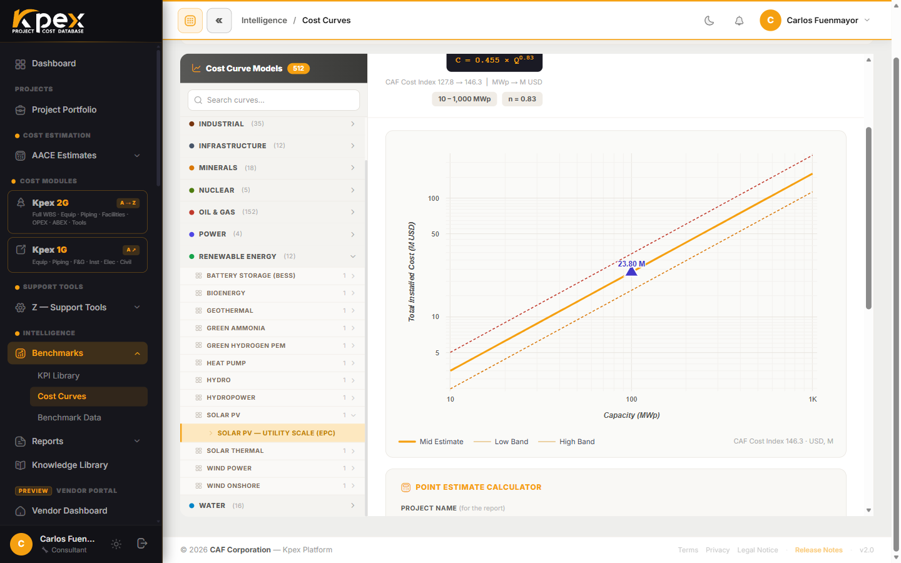

## In this lesson

- What a power-law cost curve is: C = a·Q^n.
- Why Kpex curves are *magnitude-aware*: unit cost falls with size.
- The difference between the **Facility** and **Functional Unit** levels.
- P10/P50/P90 ranges (B.2) and the **KPEX-HF Allowances**.

## The Class 5–4 screening engine

**Module B · Historical Benchmarks & Cost Curves** holds **430+ cost curves across 10 sectors**, validated against past projects. Coverage spans process plants, infrastructure, offshore oil & gas broken down by component, and railway lines. It is the natural tool when you do not yet have an equipment list: all you need is the **capacity**.

## The shape of the curve: C = a·Q^n

Every curve follows a **power law**:

- **C** is the total installed cost.
- **Q** is the capacity (barrels per day, MW, tonnes per year…).
- **a** is a scale coefficient and **n** is the exponent.

When **n is below 1**, total cost grows **more slowly** than capacity. The direct consequence: **cost per unit of capacity falls** as the plant gets bigger. That is the economy of scale a flat rate ("so many dollars per MW at any size") misses.

### An intuitive example (illustrative)

> The numbers in this example are **illustrative**; they are not values from any Kpex curve.

Take a curve with n = 0.6. Double the capacity and total cost is multiplied by 2^0.6 ≈ 1.52, not by 2. You get twice the plant for 52% more money, so the **unit cost** drops by roughly 24% (1.52 ÷ 2 ≈ 0.76). That is why the curves are called **magnitude-aware**: size matters, and no cost-per-unit ratio is constant.

## Two curve levels

| Level | What it represents | Link to other modules |
|---|---|---|
| **Facility** | A whole plant | One-to-one with a Module C model |
| **Functional Unit** | A process unit | Assembles with others into a facility |

Each curve also states its **origin country** (so the Location Factor points the right way) and carries **live escalation** to the current month.

## How to use it

In the sidebar, open **Intelligence → Benchmarks → Cost Curves**:

1. Use the **Find your facility** picker: sector → family → facility.
2. Enter the capacity and press **Calculate**.
3. Kpex plots **your point on the curve** with its ± band and produces a **benchmarking report** you can attach to a Class 5 estimate.

## B.2: P10/P50/P90 ranges

**B.2 · Historical Project Cost Benchmark Ranges** gathers **cost KPIs** (cost per tonne of capacity, per MW, per m²…) with their statistical **P10/P50/P90** range, by project type, region and decade. Use it as a **reality check** before detailed estimating starts: if your number falls well outside the range, something deserves a second look.

<!-- VERIFY: confirm whether B.2 is reached via Intelligence → Benchmarks → KPI Library or Benchmark Data -->

## KPEX-HF Allowances

Module B also contains the **KPEX-HF bulk allowances**: the factors Module A uses to estimate piping, instrumentation, electrical and civil as a proportion of major equipment. It is a good example of how the modules feed each other.

## Key idea

> A curve C = a·Q^n with n < 1 says something a flat rate hides: **the bigger the project, the lower the cost per unit**. In Kpex, every KPI should be read together with the project's magnitude.

## Try it in Kpex (5 minutes)

1. Open **Intelligence → Benchmarks → Cost Curves**.
2. Use **Find your facility** to choose any facility.
3. Calculate the cost for a capacity Q and note the result.
4. Repeat with 2Q. Divide each cost by its capacity: does the unit cost fall?
5. Check whether the curve is a **Facility** or **Functional Unit** curve, and what its origin country is.
