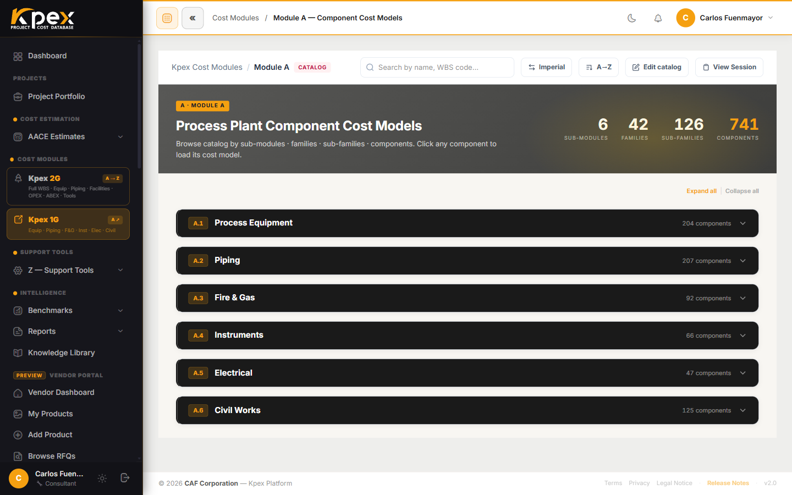

## In this lesson

- What a facility model is and how it differs from a component.
- The seven Module C groups, C.1 to C.7.
- How a facility opens element by element, and why its Class 5 curve is the sum of its components.

## From one item to a whole plant

If Module A gives you the cost of **one piece of equipment**, **Module C · Facilities Cost Models** gives you the cost of **an entire facility**: from a solar PV plant to an offshore FPSO topside.

- **Inputs:** facility parameters (capacity, area, configuration).
- **Outputs:** **total installed cost ranges**.

Kpex holds **150 facility models across 7 groups** (real Kpex header: *150 facilities · 7 WBS groups*), aligned with the Module B benchmark curves.

## The seven groups

| Sector | Sub-groups |
|---|---|
| **C.1 Industrial Process Plants** | Oil & gas production, refineries, chemical and pharmaceutical plants, power plants, food processing, steel mills, wastewater treatment |
| **C.2 Infrastructure** | Highways, tunnels, airport runways, substations, HV transmission, pipelines, aqueducts, dams |
| **C.3 Buildings** | Offices, hospitals, schools, hotels, warehouses, airports, industrial control buildings |
| **C.4 Renewable Energy** | Solar PV, Wind, Battery, CSP, Green H₂, Hydro, Geothermal, Bioenergy, Power-to-X, Heat Pumps |
| **C.5 Nuclear** | Nuclear power plant facilities (IAEA methodology) |
| **C.6 Mining** | Surface and underground mining, mineral processing plants |
| **C.7 New Technologies** | Battery gigafactories, data centers / AI, leading-edge semiconductor fabs (all LIVE) |

## Element by element

A facility model is not a black box. Every facility **opens element by element**, from the **CBS account** (Cost Breakdown Structure) down to the **leaf**, the smallest element in the breakdown. You can see where each part of the total comes from and discuss it with your team or your client.

On top of that, each facility brings a **P10/P50/P90 accuracy band per account**, a **Location Factor + Kpex Cost Index** to localise and escalate the cost, and a **Report** button that generates the (Class 5–3) report.

## Class 5 curve = the sum of its components

This is the idea that ties Kpex together: a facility's **Class 5 cost curve equals the sum of its validated components**. That is why the facilities with a **Facility**-level curve in Module B (126 of 150) map one-to-one to Module C models; the rest do not have a curve yet.

The practical payoff: when your project matures and you move from a capacity-based estimate (Class 5) to one with more definition, you do not switch "worlds". You keep working on the same structure, just in more detail.

| If you have… | Use… |
|---|---|
| Only the plant capacity | The **Facility**-level curve (Module B) |
| The facility parameters and want the breakdown | The facility model (Module C) |
| The equipment list | The components (Module A) |

## Where to find it

- In the sidebar, **Cost Modules → Kpex 2G** opens the module tree, where Module C lives; from there you reach the facility estimators (for example, *Onshore Oil & Gas*).
- Each estimator is a step-by-step wizard: you complete the **Cost Drivers** step (capacity and configuration) and Kpex **generates automatically** the breakdown in the **CBS — Cost Breakdown** step, in the **Cost Breakdown Structure (CBS) — AACE 18R-97** table. There is no separate button: the CBS appears once the drivers are complete.

<!-- kpex-videos:start -->
## Watch it in Kpex

Short tours of the real platform, recorded in Kpex itself. English voice — press CC in the player for English or Spanish subtitles.

<figure class="kpex-vid"><video controls preload="none" playsinline controlslist="nodownload" oncontextmenu="return false" poster="/wp-content/uploads/kpex-videos/Kpex2G_Module_C.jpg"><source src="/wp-content/uploads/kpex-videos/Kpex2G_Module_C.mp4" type="video/mp4"><track kind="subtitles" srclang="en" label="English" src="/wp-content/uploads/kpex-videos/Kpex2G_Module_C_EN.vtt" default><track kind="subtitles" srclang="es" label="Español" src="/wp-content/uploads/kpex-videos/Kpex2G_Module_C_ES.vtt"></video><figcaption><strong>Module C · Facilities Cost Models</strong> · 1:43</figcaption></figure>
<figure class="kpex-vid"><video controls preload="none" playsinline controlslist="nodownload" oncontextmenu="return false" poster="/wp-content/uploads/kpex-videos/Kpex2G_C1_Industrial_Plants.jpg"><source src="/wp-content/uploads/kpex-videos/Kpex2G_C1_Industrial_Plants.mp4" type="video/mp4"><track kind="subtitles" srclang="en" label="English" src="/wp-content/uploads/kpex-videos/Kpex2G_C1_Industrial_Plants_EN.vtt" default><track kind="subtitles" srclang="es" label="Español" src="/wp-content/uploads/kpex-videos/Kpex2G_C1_Industrial_Plants_ES.vtt"></video><figcaption><strong>C.1 · Industrial Process Plants</strong> · 1:39</figcaption></figure>
<figure class="kpex-vid"><video controls preload="none" playsinline controlslist="nodownload" oncontextmenu="return false" poster="/wp-content/uploads/kpex-videos/Kpex2G_C2_Infrastructure_Projects.jpg"><source src="/wp-content/uploads/kpex-videos/Kpex2G_C2_Infrastructure_Projects.mp4" type="video/mp4"><track kind="subtitles" srclang="en" label="English" src="/wp-content/uploads/kpex-videos/Kpex2G_C2_Infrastructure_Projects_EN.vtt" default><track kind="subtitles" srclang="es" label="Español" src="/wp-content/uploads/kpex-videos/Kpex2G_C2_Infrastructure_Projects_ES.vtt"></video><figcaption><strong>C.2 · Infrastructure Projects</strong> · 1:35</figcaption></figure>
<figure class="kpex-vid"><video controls preload="none" playsinline controlslist="nodownload" oncontextmenu="return false" poster="/wp-content/uploads/kpex-videos/Kpex2G_C3_Building_Projects.jpg"><source src="/wp-content/uploads/kpex-videos/Kpex2G_C3_Building_Projects.mp4" type="video/mp4"><track kind="subtitles" srclang="en" label="English" src="/wp-content/uploads/kpex-videos/Kpex2G_C3_Building_Projects_EN.vtt" default><track kind="subtitles" srclang="es" label="Español" src="/wp-content/uploads/kpex-videos/Kpex2G_C3_Building_Projects_ES.vtt"></video><figcaption><strong>C.3 · Building Projects</strong> · 1:41</figcaption></figure>
<figure class="kpex-vid"><video controls preload="none" playsinline controlslist="nodownload" oncontextmenu="return false" poster="/wp-content/uploads/kpex-videos/Kpex2G_C4_Renewable_Energy.jpg"><source src="/wp-content/uploads/kpex-videos/Kpex2G_C4_Renewable_Energy.mp4" type="video/mp4"><track kind="subtitles" srclang="en" label="English" src="/wp-content/uploads/kpex-videos/Kpex2G_C4_Renewable_Energy_EN.vtt" default><track kind="subtitles" srclang="es" label="Español" src="/wp-content/uploads/kpex-videos/Kpex2G_C4_Renewable_Energy_ES.vtt"></video><figcaption><strong>C.4 · Renewable Energy Facilities</strong> · 1:52</figcaption></figure>
<figure class="kpex-vid"><video controls preload="none" playsinline controlslist="nodownload" oncontextmenu="return false" poster="/wp-content/uploads/kpex-videos/Kpex2G_C5_Nuclear_Projects.jpg"><source src="/wp-content/uploads/kpex-videos/Kpex2G_C5_Nuclear_Projects.mp4" type="video/mp4"><track kind="subtitles" srclang="en" label="English" src="/wp-content/uploads/kpex-videos/Kpex2G_C5_Nuclear_Projects_EN.vtt" default><track kind="subtitles" srclang="es" label="Español" src="/wp-content/uploads/kpex-videos/Kpex2G_C5_Nuclear_Projects_ES.vtt"></video><figcaption><strong>C.5 · Nuclear Projects</strong> · 1:57</figcaption></figure>
<figure class="kpex-vid"><video controls preload="none" playsinline controlslist="nodownload" oncontextmenu="return false" poster="/wp-content/uploads/kpex-videos/Kpex2G_C6_Mining_Projects.jpg"><source src="/wp-content/uploads/kpex-videos/Kpex2G_C6_Mining_Projects.mp4" type="video/mp4"><track kind="subtitles" srclang="en" label="English" src="/wp-content/uploads/kpex-videos/Kpex2G_C6_Mining_Projects_EN.vtt" default><track kind="subtitles" srclang="es" label="Español" src="/wp-content/uploads/kpex-videos/Kpex2G_C6_Mining_Projects_ES.vtt"></video><figcaption><strong>C.6 · Mining Projects</strong> · 1:45</figcaption></figure>

<!-- kpex-videos:end -->

## Key idea

> Module C is the bridge between the **curve** (Class 5) and the **detail**: a complete facility, opened account by account, whose curve is the sum of validated components.

## Try it in Kpex (5 minutes)

1. Open **Cost Modules → Kpex 2G** and go into Module C.
2. Pick a sector from the table (for example **C.4 Renewable Energy**) and open a facility.
3. Complete the **Cost Drivers** step (capacity and configuration) and note the total installed cost range.
4. Review the **CBS — Cost Breakdown** that is generated and identify the three accounts that weigh most in the total.
5. Find the same facility under **Intelligence → Benchmarks → Cost Curves** and compare the order of magnitude.
