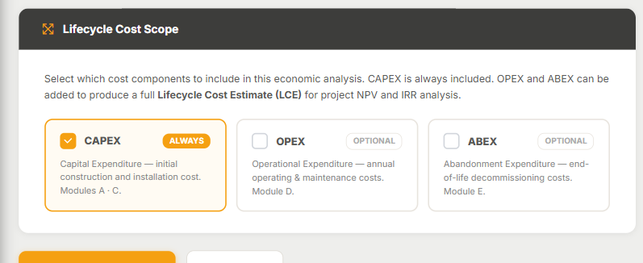

## In this lesson

- Why a CAPEX estimate does not tell the asset's whole story.
- What Module D (OPEX) and Module E (ABEX) cover.
- How to switch on OPEX and ABEX in an estimate through the wizard's **Lifecycle Cost Scope** step.

## Beyond CAPEX

Building a plant is only the start. It then has to be **operated** for decades and, at the end of its life, **decommissioned**. Modules A, B and C cover the initial investment; Modules D and E complete the lifecycle:

| Asset stage | Cost type | Module |
|---|---|---|
| Construction and installation | **CAPEX** (Capital Expenditure) | A · B · C |
| Operation and maintenance | **OPEX** (Operational Expenditure) | **D** |
| Abandonment and decommissioning | **ABEX** (Abandonment Expenditure) | **E** |

## Module D: OPEX

**Module D · OPEX Models** holds operating cost models for **oil and gas facilities** (**D.1 Oil & Gas OPEX**). It covers:

- **Fixed** and **variable** OPEX.
- **Maintenance**.
- **Staffing** benchmarks for producing assets.

## Module E: ABEX

**Module E · Abandonment & Decommissioning Cost Models** covers the full decommissioning lifecycle. It is a capability that is rare in the market, and it spans conventional energy as well as renewables and new technologies, including hydrogen.

| Group | Scope |
|---|---|
| **E.1** | Oil & gas (onshore and offshore) |
| **E.2** | Process plants |
| **E.3** | Renewable energy: wind, solar PV, green H₂, blue H₂, hybrid and Power-to-X |
| **E.4** | Mining |
| **E.5** | Nuclear |

Both modules sit in the sidebar under **Cost Modules → Kpex 2G**, alongside Modules A, B and C.

<!-- VERIFY: exact click path from Kpex 2G to the D.1 estimator and the E.1–E.5 catalogues -->

## Switching on OPEX and ABEX in an estimate

In the **Estimate Wizard**, the fifth step is **Lifecycle Cost Scope**. This is where you decide which cost components the analysis includes:

- **CAPEX** is marked **ALWAYS**: it is always included.
- **OPEX** is **OPTIONAL**: switching it on brings in Module D.
- **ABEX** is **OPTIONAL**: switching it on brings in Module E.

When OPEX or ABEX is on, the **Plant / Facility Lifetime** field appears: the plant's life in years, which Kpex uses for NPV and for discounting ABEX. The wizard itself shows typical ranges by asset type as guidance.

CAPEX + OPEX + ABEX gives you a **Lifecycle Cost Estimate (LCE)**, the basis for project NPV and IRR analysis. Later on, the **Project Portfolio Report** shows which flags (CAPEX/OPEX/ABEX) each estimate carries.

## Who is this for?

- **Owners, operators and national oil companies**, who need the asset's total cost, not just the cost of building it.
- **Feasibility teams** comparing options with similar upfront investment but very different operating or decommissioning profiles.
- **Offshore, mining or nuclear** projects, where ABEX can be a very material number.

## Key idea

> A project does not end when it is built. With **Module D (OPEX)** and **Module E (ABEX)** you carry the same rigour from the first CAPEX estimate through to **final decommissioning**.

## Try it in Kpex (4 minutes)

1. Open **Cost Estimation → AACE Estimates → New Estimate** and move on to the **Lifecycle Cost Scope** step.
2. Switch on **OPEX** and **ABEX** and watch the **Plant / Facility Lifetime** field appear.
3. Read the typical lifetime ranges the wizard suggests and pick one that fits your facility type.
4. Switch both off and check that **CAPEX** stays ticked: it cannot be removed.
