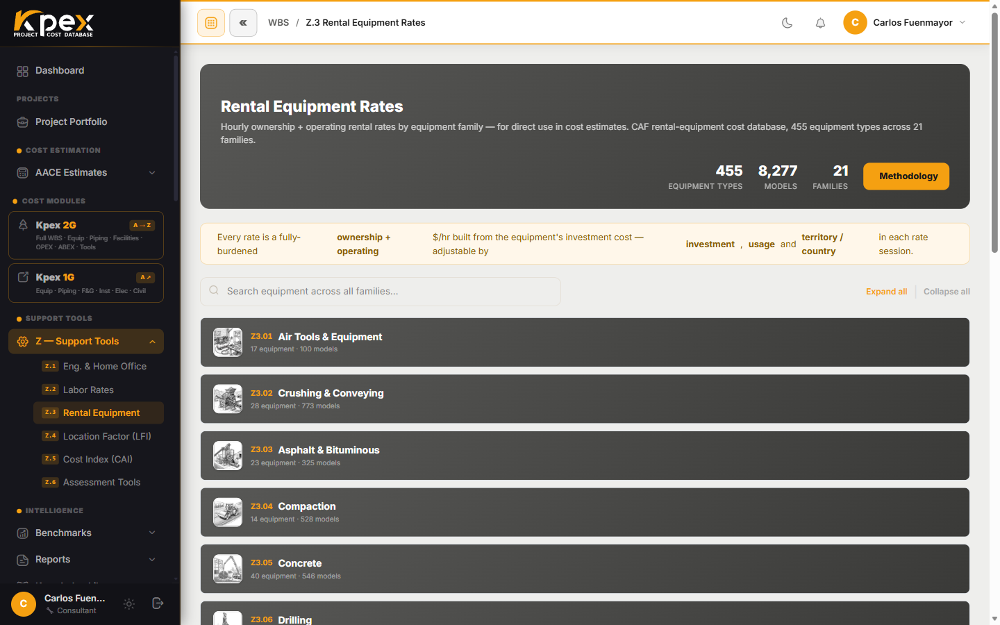

## In this lesson

- What Module Z is and why it is called the "calibration layer".
- **Z.1**: engineering and home-office rates.
- **Z.2**: construction labour rates.
- **Z.3**: construction-equipment rental rates.

## Module Z: the calibration layer

Modules A to E supply the **cost data**. **Module Z** holds the analytical tools that make that data valid for **any geography and any point in time**. They are not optional add-ons: they underpin every Kpex estimate.

They all live in the sidebar under **Support Tools → Z — Support Tools**:

| Menu entry | Tool |
|---|---|
| **Z.1 Eng. & Home Office** | Engineering and home office |
| **Z.2 Labor Rates** | Construction labour |
| **Z.3 Rental Equipment** | Rental equipment |
| **Z.4 Location Factor (LFI)** | Location factor (lesson 6.2) |
| **Z.5 Cost Index (CAI)** | Cost index (lesson 6.3) |
| **Z.6 Assessment Tools** | Assessments (lesson 6.4) |

This lesson covers the first three: the ones that turn **hours and machines into money**.

## Z.1 — Engineering and home office

Every project needs engineering, procurement and construction management: the **EPCM** component. **Z.1** provides **reference rates** for each engineering discipline (process, mechanical, civil, electrical, instruments, project management) plus **home-office overheads**.

What is it for? Building the EPCM line of an estimate **without detailed man-hour counting**, which is very handy at the early classes.

## Z.2 — Construction labour rates

**Z.2** is a database of **crew composition** and **labour rates** by discipline and by country or region.

| Inputs | Output |
|---|---|
| Trade, jurisdiction, shift, overtime | **Fully-loaded crew rate** per man-hour or per crew-day |

"Fully loaded" means **direct wages + social charges + site accommodation + supervision**. It is essential for **Class 3 and more detailed** estimates, where labour stops being a percentage and starts being calculated.

## Z.3 — Rental equipment rates

**Z.3** is a browsable catalogue of **construction-equipment** rental rates, organised by **equipment family** (excavation, lifting, compaction, pumping, air tools and more).

Here is how it works:

1. **Expand a family** to see its equipment cards.
2. **Open one**: this starts a rate session.
3. Kpex builds the **hourly, daily, weekly and monthly** rate from the machine's **investment cost** (**ownership + operating**).
4. Adjust the **capacity and spec options**: they move the price.

Rates are **escalated to the current period** on the CAF Cost Index **by equipment family** and can be adjusted by **territory or country**. Z.3 also integrates with Z.2 to build **daily construction cost rates** (machine + crew).

## How the three fit together

| The estimator asks… | Tool |
|---|---|
| What do engineering and management cost? | **Z.1** |
| What does a crew-hour cost in this country? | **Z.2** |
| What does it cost to keep this crane for a month? | **Z.3** |

## Key idea

> Z.1, Z.2 and Z.3 turn **disciplines, crews and machines** into rates escalated to today and adjusted to your location. They are the foundation of indirect and construction costs once an estimate gains definition.

## Try it in Kpex (5 minutes)

1. Open **Support Tools → Z — Support Tools → Z.3 Rental Equipment**.
2. Expand a family (lifting, for example) and open one item.
3. Note its daily and monthly rate.
4. Change a capacity or spec option: how far does the rate move?
5. Change the territory or country and watch the effect.
6. Finally, open **Z.2 Labor Rates** and find the rate for one trade in your country.

<!-- VERIFY: exact names of the territory/country controls in Z.3 and of the input fields in Z.1 and Z.2 -->
