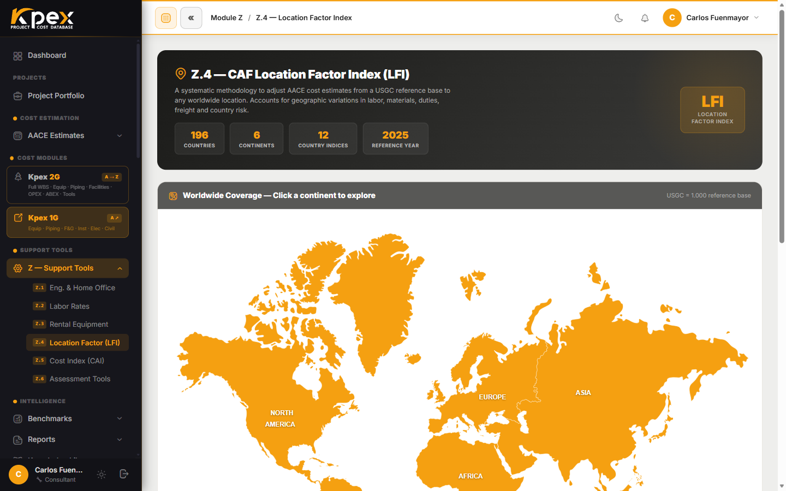

## In this lesson

- What the **CAF LFI** is and why the US Gulf Coast equals 1.000.
- The formula E = A × (B + C + D) / 3 and what each factor means.
- How Kpex applies the factor from **origin to destination**.
- The country manual, and applying the LFI to the whole estimate or per line.

## What the LFI is

The **CAF LFI (Location Factor Index)** adjusts any base cost to any location on earth. It is one of the two engines that keep the whole Kpex database current: this one handles **geography** (the other, the Cost Index, handles time).

| Feature | Detail |
|---|---|
| **Coverage** | **196 countries** across 6 continents (Z.4.1–Z.4.6) |
| **Basis** | US Gulf Coast = **LFI 1.000** (the AACE standard reference point) |
| **Reading it** | Above 1.0 → costlier than the Gulf Coast; below 1.0 → cheaper |

## The formula: E = A × (B + C + D) / 3

Each country's final factor (**E**) combines four factors:

| Factor | What it measures |
|---|---|
| **A** | Country drivers |
| **B** | Procurement, duty and freight |
| **C** | Labour |
| **D** | Engineering |

In words: procurement, labour and engineering are **averaged**, and the result is **multiplied** by the country's own drivers.

## Origin to destination

Not every cost model is calibrated on the US Gulf Coast. Some were built from another country's data. So Kpex records each model's **country of origin** and applies:

**Applied factor = LFI(destination) ÷ LFI(origin)**

When you pick your **project country**, Kpex moves the cost from the model's true origin to your location, applying the inverse where the origin is not the Gulf Coast.

### An illustrative calculation

> **Note:** every number in this example is **made up and rounded**, purely to show the mechanics. **They are not real Kpex factors.**

**Step 1 — the LFI of a fictional country, "Destinia":**
A = 1.10 · B = 1.20 · C = 0.90 · D = 1.20

E = 1.10 × (1.20 + 0.90 + 1.20) / 3 = 1.10 × 1.10 = **1.21**

**Step 2 — a model calibrated in "Originia"**, whose LFI is 1.10, with a base cost of USD 10 million.

Applied factor = 1.21 ÷ 1.10 = **1.10**

Cost in Destinia = 10 × 1.10 = **USD 11 million**

Had the same model been calibrated on the Gulf Coast (LFI 1.000), the factor would be 1.21 and the cost USD 12.1 million. Origin matters.

## The country manual

For every country, Kpex offers a **full dossier**: the factors, the procurement, labour and engineering inputs, a country profile with flag and a map of its principal cities, and **major recent projects with their published CAPEX**.

## Applying it in an estimate

- **Globally**: the location you set in the Estimate Wizard's **Project Identification** step drives the default LFI for the whole estimate.
- **Per line**: for projects spanning several locations, you can apply the LFI to each cost element separately.

Your country or region has no standard factor? The **Z.6.1 LFI Assessment** tool builds a custom LFI (lesson 6.4).

## Key idea

> The LFI is not just "how much dearer it is here": it is an **origin-to-destination** factor, **LFI(destination) ÷ LFI(origin)**, built from country, procurement, labour and engineering.

## Try it in Kpex (5 minutes)

1. Open **Support Tools → Z — Support Tools → Z.4 Location Factor (LFI)**.
2. Navigate the map to your country and open its page.
3. Note its LFI and identify factors A, B, C and D.
4. Repeat with a second country and work out by hand the factor to move a cost from the first to the second (destination ÷ origin).
5. Open the country manual and find the major recent projects section.

<!-- VERIFY: exact label of the button that opens the country manual/report in Z.4 -->
