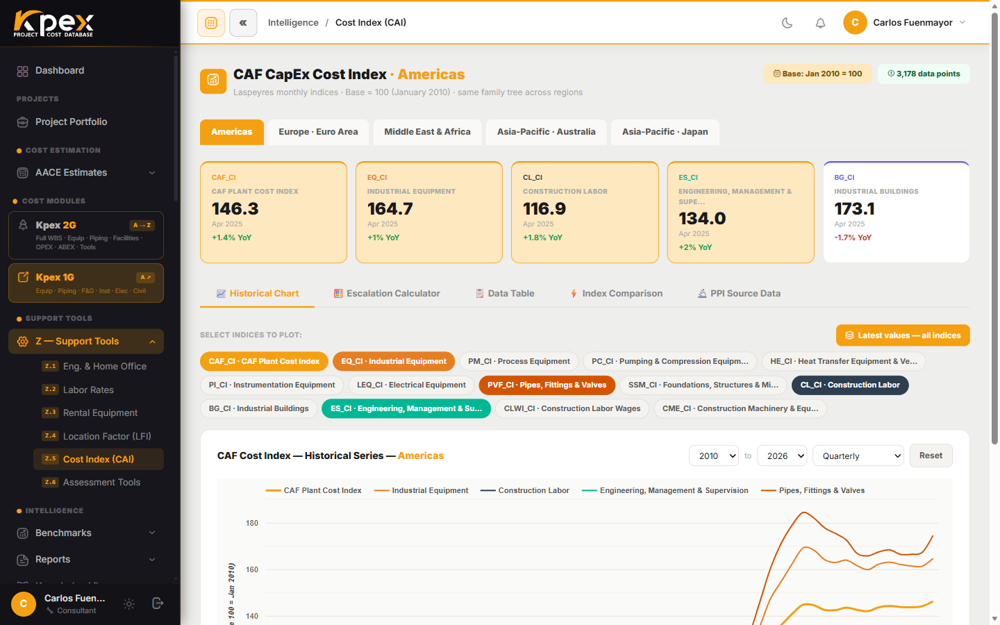

## In this lesson

- What the **CAF Cost Index** is and how it differs from annual indices.
- The per-family sub-indices and why they matter.
- How escalation is applied **automatically, on read**.
- The available regions and the compare-two-periods mode.

## The second engine: time

The **CAF Cost Index** is Kpex's own **cost-escalation** database. If the LFI keeps costs current by **geography**, the Cost Index does it by **time**.

Compared with annual indices such as CEPCI or ENR, it has two advantages:

1. It is updated **every month**.
2. It is broken down into **per-family sub-indices**, so each cost component escalates on the index that actually drives it.

## Applied automatically, on read

This is the key point: **there is no button to press**. The catalogue shows prices **"current to"** this month and re-prices itself whenever the index refreshes. What you see is always in today's money.

## The sub-indices

| Sub-index | Covers |
|---|---|
| **CME-CI (Composite)** | Overall composite index; used as the single factor when no breakdown is needed |
| **EQ (Equipment)** | Process equipment manufacturing and procurement |
| **ST (Structural Steel)** | Structural steel fabrication and erection |
| **PI (Piping)** | Piping materials and installation |
| **EL (Electrical)** | Electrical equipment and cabling |
| **IN (Instrumentation)** | Control systems, instruments, analysers |
| **CV (Civil)** | Concrete, civil works and earthworks |
| **LB (Labor)** | Construction labour rates (US Gulf Coast basis) |
| *+6 additional sub-indices* | Insulation, painting, mechanical, engineering, project management and indirect costs |

This list is illustrative: the live set is shown in the tool itself.

## Multi-region

Alongside the original **Americas** index there are regional indices for **Europe (Euro Area)**, **Asia-Pacific**, **Japan** and **Middle East & Africa**. Each is built from its region's own official statistics, on the same method and family tree, so escalation reflects **where the project's equipment actually comes from**.

| Region | Main source |
|---|---|
| Americas | US Bureau of Labor Statistics (PPI) |
| Europe / Euro Area | Eurostat |
| Asia-Pacific | ABS (Australia) |
| Japan | e-Stat |
| Middle East & Africa | Regional statistics |

All are combined on CAF's proprietary composite methodology. **Base period: 2010 = 100**, with monthly data from 2010 to the present. If a region is not live yet, its page says it is *on the roadmap*.

## What you can do in the tool

Find it under **Support Tools → Z — Support Tools → Z.5 Cost Index (CAI)**. It is organised in tabs:

- **Historical Chart**: the historical series; you pick the sub-indices to plot (*Select Indices to Plot* chips), the year range (**From / To**) and the granularity (annual, quarterly or monthly).
- **Escalation Calculator**: computes the **escalation factor between two periods** for an amount.
- **Data Table**: the monthly index values.
- **Index Comparison**: compares **every sub-index side by side** (a table of annual averages and cumulative growth 2010 → today).
- **PPI Source Data**: the official series behind the sub-indices.

You can also produce a **printable snapshot** of the latest values.

<!-- kpex-videos:start -->
## Watch it in Kpex

Short tours of the real platform, recorded in Kpex itself. English voice — press CC in the player for English or Spanish subtitles.

<figure class="kpex-vid"><video controls preload="none" playsinline crossorigin="anonymous" controlslist="nodownload" oncontextmenu="return false" poster="https://caf-corporation.com/media/kpex-videos/Kpex2G_Z5_Kpex_Cost_Index.jpg"><source src="https://caf-corporation.com/media/kpex-videos/Kpex2G_Z5_Kpex_Cost_Index.mp4" type="video/mp4"><track kind="subtitles" srclang="en" label="English" src="https://caf-corporation.com/media/kpex-videos/Kpex2G_Z5_Kpex_Cost_Index_EN.vtt" default><track kind="subtitles" srclang="es" label="Español" src="https://caf-corporation.com/media/kpex-videos/Kpex2G_Z5_Kpex_Cost_Index_ES.vtt"></video><figcaption><strong>Z.5 · Kpex Cost Index</strong> · 1:34</figcaption></figure>

<!-- kpex-videos:end -->

## Key idea

> The CAF Cost Index is **monthly**, **per family** and **multi-region**, and it applies **itself, on read**. That is why in Kpex you never work from a stale figure.

## Try it in Kpex (5 minutes)

1. Open **Support Tools → Z — Support Tools → Z.5 Cost Index (CAI)**.
2. In **Historical Chart**, compare how **EQ** and **LB** have moved: which has risen more since 2010?
3. Go to **Escalation Calculator**, pick two periods five years apart and note the escalation factor.
4. Switch region (to **Europe (Euro Area)**, for example) and repeat. Do you get the same factor?
