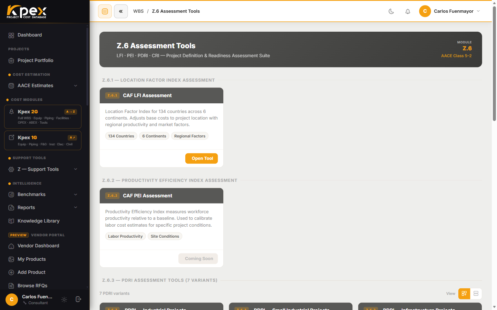

## In this lesson

- The four Z.6 assessments: **LFI Assessment**, **PEI**, **PDRI** and **CRI**.
- The question each one answers and what it delivers.
- The 7 PDRI variants and how to read the score.

## Measuring what is not cost

The cost modules tell you **how much**. The **Z.6** assessments tell you **how confident** you can be: how well defined the project is, how productive the labour will be, how ready it is to build, or which location factor to use where no standard one exists. They are the methodology evidence behind an estimate.

You will find them under **Support Tools → Z — Support Tools → Z.6 Assessment Tools**.

## The four tools

| Tool | Purpose | Output |
|---|---|---|
| **Z.6.1 · LFI Assessment** | Build a custom location factor for countries or regions not in the standard Z.4 database | Custom LFI + PDF assessment report |
| **Z.6.2 · PEI Assessment** | Productivity Efficiency Index: quantifies construction-labour productivity differentials against the US Gulf Coast | PEI factor (0.5–2.5 typical range) |
| **Z.6.3 · PDRI Assessment** | Project Definition Rating Index, per AACE practice: measures how well defined the project is | PDRI score (0–1000, **lower is better**) + gap analysis |
| **Z.6.4 · CRI Assessment** | Construction Readiness Index: checks whether the construction package is complete enough to mobilise at the target accuracy | CRI score + readiness gap report |

## The PDRI in detail

The PDRI is the assessment you will use most, because it links straight to your estimate's **AACE class**: the better defined the project, the narrower the accuracy range you can declare.

### Seven variants

Z.6.3 includes **7 independent variants**, each using its applicable AACE questionnaire:

| Industrial | Infrastructure | Buildings | Oil & gas |
|---|---|---|---|
| **Industrial** | **Infrastructure** | **Buildings** | **Oil & Gas EPC** |
| **Small Industrial** | **Small Infrastructure** | **Small Buildings** | |

Kpex **scores and weights** the answers automatically. The output PDF includes the **full scoring matrix** and a **recommendations** section.

### Reading the score

The scale runs from **0 to 1000** and **lower is better**: a low score means few open questions remain. It is not an exam you pass with a high mark; it is a map of what still needs defining.

### How you run it

Each variant opens with the **Start** button. As you answer the questionnaire, the **Live PDRI Score** panel updates the score **live**; on save, Kpex recomputes and stores the total. The PDRI is a **standalone** tool (Z.6.3): its PDF gives you **methodology evidence** for the AACE class you declare, and you keep it **alongside** your estimate. For now it runs separately (it is not automatically attached to the estimate report).

## When to use each one

| Situation | Tool |
|---|---|
| You are about to declare an estimate's class and want to justify it | **PDRI** |
| You are building in a country whose productivity differs sharply from the reference | **PEI** |
| The project is about to mobilise to site | **CRI** |
| Your location has no standard LFI | **LFI Assessment** |

On the same Z.6 page you will also find the **CAF Accuracy Calculator**, which rounds out the assessment suite.

<!-- kpex-videos:start -->
## Watch it in Kpex

Short tours of the real platform, recorded in Kpex itself. English voice — press CC in the player for English or Spanish subtitles.

<figure class="kpex-vid"><video controls preload="none" playsinline crossorigin="anonymous" controlslist="nodownload" oncontextmenu="return false" poster="https://caf-corporation.com/media/kpex-videos/Kpex2G_Z6_Assessment_Tools.jpg"><source src="https://caf-corporation.com/media/kpex-videos/Kpex2G_Z6_Assessment_Tools.mp4" type="video/mp4"><track kind="subtitles" srclang="en" label="English" src="https://caf-corporation.com/media/kpex-videos/Kpex2G_Z6_Assessment_Tools_EN.vtt" default><track kind="subtitles" srclang="es" label="Español" src="https://caf-corporation.com/media/kpex-videos/Kpex2G_Z6_Assessment_Tools_ES.vtt"></video><figcaption><strong>Z.6 · Assessment Tools</strong> · 1:33</figcaption></figure>

<!-- kpex-videos:end -->

## Key idea

> Z.6 turns the estimator's judgement into **measurable evidence**. A low PDRI score (lower is better) backs up the AACE class you declare in your estimate.

## Try it in Kpex (6 minutes)

1. Open **Support Tools → Z — Support Tools → Z.6 Assessment Tools**.
2. Pick the PDRI variant that best fits a project you know (for example **Small Industrial**).
3. Answer the first sections of the questionnaire and watch how the score changes.
4. In the gap analysis, identify the two items that penalise your score most.
5. Review this lesson's table and decide which other assessment that project would need.
