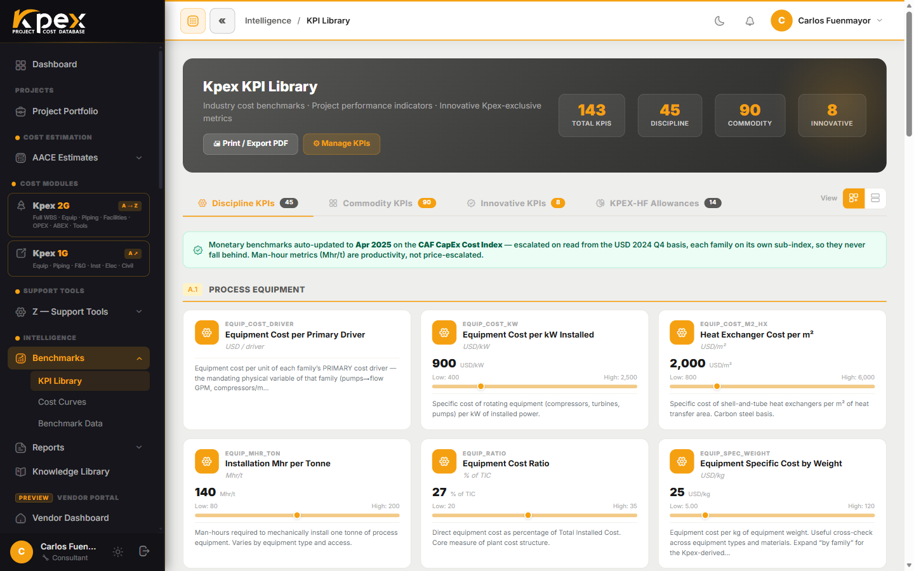

## In this lesson

- What lives under **Intelligence → Benchmarks** and what each tool is for.
- How to calculate a cost from a curve (B.1) and check it against P10/P50/P90 ranges (B.2).
- What the **Global CAPEX Monitor** is and how to use it as a project radar.

## Benchmarks: history as your reference

In the sidebar's **Intelligence** group, the **Benchmarks** menu brings together two kinds of historical cost reference. Together they are the Class 5 and Class 4 screening engine: they tell you what something *should* cost before a design exists.

| Tool | What it gives you | Question it answers |
|---|---|---|
| **B.1 · Cost Curves** | Total installed cost vs. capacity curves (`cost = a · capacity^n`) | "What does a plant of this size cost?" |
| **B.2 · KPI ranges** | Statistical **P10/P50/P90** ranges for cost KPIs (per tonne, per MW, per m²…) | "Is my number reasonable compared with real projects?" |

In the **Benchmarks** menu you will see **KPI Library**, **Cost Curves**, **Construction Costs** and **Benchmark Data**. B.2 (the KPI ranges) lives in **KPI Library**; **Benchmark Data** is the list of historical reference projects.

## B.1 · Cost Curves: calculate and benchmark

Each curve shows how total installed cost scales with capacity: $/bbl/day for a refinery, $/kW for a power plant, and so on. The workflow is simple:

1. Open **Intelligence → Benchmarks → Cost Curves**.
2. Use the **Find your facility** guided picker: it walks you **sector → family → facility**.
3. Enter the **capacity** and press **Calculate**.
4. Kpex plots **your point on the curve**, with a fixed value label and the **± band** around it.
5. Print the one-page **benchmarking report** and attach it to your Class 5 estimate.

Three things worth knowing:

- **The curves are magnitude-aware.** Because the exponent *n* is below 1, the cost **per unit** falls as the project grows. A flat rate (fixed $/unit) misses that behaviour.
- **Every curve has a level**: **Facility** (a whole plant, one-to-one with a Module C model) or **Functional Unit** (a process unit that assembles into a facility).
- **Every curve carries its country of origin**, so the Location Factor (Z.4) points the right way, plus live escalation on the Cost Index (Z.5).

## B.2 · P10/P50/P90 ranges

KPI ranges give you a **reality check** before detailed estimating starts. They are presented by project type, region and decade:

- **P10**: the low end; only 10% of projects cost less.
- **P50**: the median, the "typical" value.
- **P90**: the high end; only 10% of projects cost more.

If your estimate lands outside the P10–P90 band, it isn't necessarily wrong, but you should be able to explain why.

## Global CAPEX Monitor: the project radar

The **Global CAPEX Monitor** is a **public register** of large industrial, energy and infrastructure projects worldwide. It is organised **by country**, and each project shows its **announced CAPEX** and capacity. Open a project to see its **area-by-area breakdown**.

It does two jobs: it shows **where capital is being committed**, and it is the reference set behind the benchmark curves. You'll find it on the public website under **Insights → Global CAPEX Monitor**. Without an active membership you see a preview of the **first five countries**; an **active membership (from the Practitioner tier)** opens the full register.

## Key idea

> First **calculate** with the curve (B.1), then **check** against the P10/P50/P90 ranges (B.2), and use the **Global CAPEX Monitor** to see what is actually being built around the world.

## Try it in Kpex (5 minutes)

1. Open **Intelligence → Benchmarks → Cost Curves** and use **Find your facility** to pick a facility from your sector.
2. Enter a capacity, press **Calculate** and note the cost and the ± band.
3. Double the capacity and calculate again. Did the total cost double? What happened to the cost per unit?
4. Open the **Global CAPEX Monitor**, pick a country and open a project to see its area breakdown.
