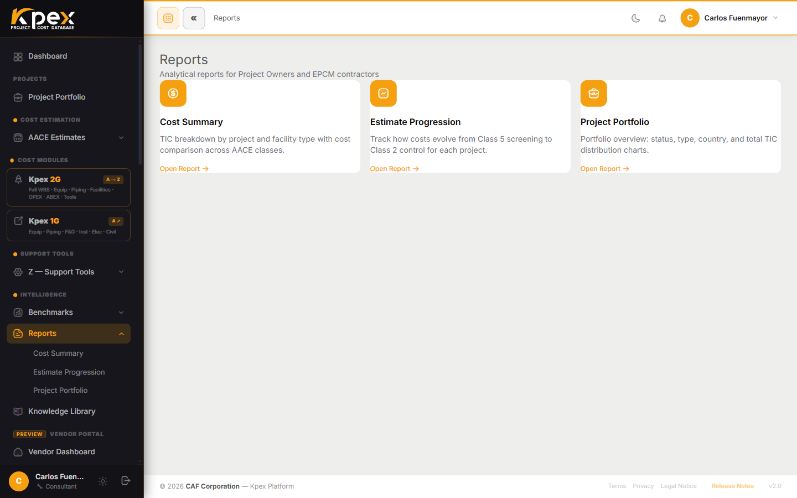

## In this lesson

- Where the portfolio reports live and what each one contains.
- Which report to pick for the question you're being asked.
- Why the reports count **estimates**, not projects.

## From a single estimate to the portfolio view

So far you have worked one estimate at a time. But a cost manager or project director rarely asks about a single number: they want to know **what it all adds up to**, **how it has moved** and **where each project stands**. That is what the reports are for.

Go to **Intelligence → Reports** in the sidebar. You'll find three pre-built reports that read directly from your estimates:

| Report | What it contains | Best used for |
|---|---|---|
| **Cost Summary** | Consolidated cost breakdown across all your estimates: by project, class, discipline and cost element. Pivot-table style view | Portfolio cost reporting to management; client cost summaries |
| **Estimate Progression** | How **a single estimate** has evolved over time as it moves from Class 5 to Class 2. Shows cost movements by update date | Documenting estimate history for audit and change management |
| **Project Portfolio** | Summary of all active and archived projects: status, AACE class, lifecycle scope flags (CAPEX/OPEX/ABEX) and estimate accuracy ranges | Project management overview; programme-level cost status |

## Which report should I use?

A practical way to choose is to start from the question:

- **"What does everything in our pipeline add up to, by discipline?"** → **Cost Summary**.
- **"Why has the number gone up since the last review?"** → **Estimate Progression**.
- **"Where does each project in the programme stand?"** → **Project Portfolio**.

### Cost Summary: the consolidated snapshot

It works like a pivot table: the same set of estimates can be grouped by project, class, discipline or cost element. This is the report you take into a management meeting.

### Estimate Progression: the story of one estimate

Estimates mature: they start as a Class 5 screening and, as definition grows, become Class 3 and then Class 2. This report records every cost movement with its date. It is your evidence when an auditor or client asks **what changed, and when**. In the Class 2 workflow it is the tool for managing change against the control baseline.

### Project Portfolio: the programme dashboard

It lists every project, active and archived, with its status, its AACE class, the CAPEX/OPEX/ABEX flags you set in the wizard, and the accuracy range of each estimate.

## Estimates, not projects

Remember from Module 4: the AACE class belongs to the **estimate**, not the project. One project can carry a Class 5 today and a Class 3 later on. That's why reports and portfolio charts **group and count estimates by class** instead of stamping the project with a single class. You get a truer picture of where the work actually stands.

## Key idea

> **Cost Summary** tells you *how much*, **Estimate Progression** tells you *how it changed*, and **Project Portfolio** tells you *where we are*. All three are fed by your estimates, so good reporting starts with well-classified estimates.

## Try it in Kpex (4 minutes)

1. Open **Intelligence → Reports → Cost Summary** and find the Class 5 estimate you built in Module 4.
2. Go back to that estimate, change a quantity or an item of equipment, and save.
3. Open **Estimate Progression** and check whether the cost movement appears with its date. <!-- VERIFY: confirm a saved edit creates a new point in Estimate Progression (or whether a new revision is required) -->
4. Open **Project Portfolio** and review your project's class, lifecycle scope and accuracy range.
