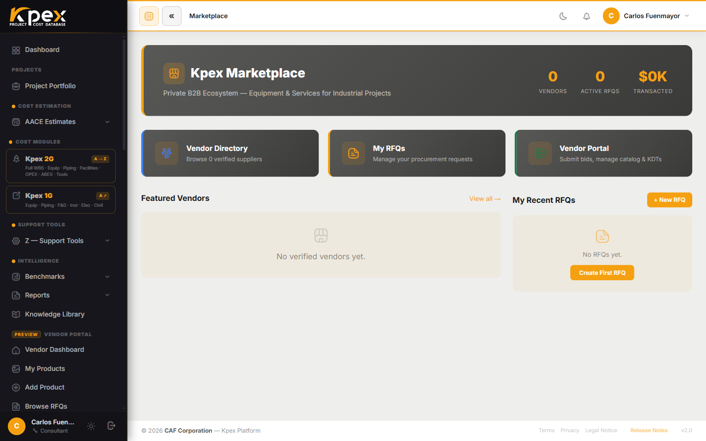

## In this lesson

- What **Kpex Exchange** is and why it is a multi-sided marketplace.
- The five participants and what each one gains.
- How an **RFQ** (request for quotation) works and where it fits in your estimate.

## From parametric price to real price

In the earlier modules you worked with **cost data**: curves, models and components calibrated for location and time. They are exactly right for Classes 5 to 3. But as the project matures towards Class 2 and Class 1, the estimate needs something more: **real vendor prices**.

**Kpex Exchange** is the last link in the chain you saw in lesson 1.2: the place where parametric data is **replaced by real prices**. It is a **multi-sided** procurement and data marketplace that connects the platform's participants, so each one contributes something and gets something back.

## The five participants

| Participant | What they do on the Exchange | What they gain |
|---|---|---|
| **Owner / Operator** | Issues **RFQs** (requests for quotation) for equipment packages and receives vendor quotes through the platform | Competitive equipment pricing, faster procurement and an audit trail |
| **EPC Contractor** | Browses vendor pricing to inform estimate line items. Takes part in owner RFQs where authorised | Market-validated pricing; live component cost checks |
| **Equipment Vendor** | Lists equipment families with indicative pricing and responds to RFQs | Direct access to qualified buyers with active CAPEX projects |
| **Data Partner** | Contributes historical project cost datasets | Recognition as a benchmark contributor |
| **Estimator** | Accesses live vendor pricing while building the estimate, and uses data-partner benchmarks for Class 5–4 validation | Real-world pricing inputs and less uncertainty in early estimates |

The loop closes on its own: owners ask for prices, vendors answer, data partners enrich the history, and estimators and EPCs use all of it to produce more reliable numbers.

## How an RFQ works

An **RFQ** (*Request for Quotation*) is a formal request for a price on an equipment package:

1. The owner/operator creates the RFQ describing the package.
2. Vendors see it in their portal and submit a quote.
3. The owner receives the quotes inside Kpex, compares them and keeps the history.

In the Class 2 workflow you saw in Module 3, this is the step where you **replace parametric costs with real quotes**, reconcile the bids and freeze the control baseline.

## Where to find it in Kpex

What you see in the sidebar depends on your profile type:

- **All profiles**: the **Kpex Exchange** group, with **Exchange Home**, **Product Catalog** and **Vendors**.
- **Owner / Operator**: a **Procurement** section with **My RFQs** and **New RFQ**.
- **Vendor**: the **Vendor Portal**, with **My Products**, **Add Product** and **Browse RFQs**.
- **Data Partner**: its own portal, with **My Datasets** and **Submit Dataset**.

## Key idea

> Kpex Exchange turns the platform into an **ecosystem**: the place where you estimate is the same place where you **request, receive and compare real prices**, and where the cost history grows with every participant.

## Try it in Kpex (4 minutes)

1. Open **Kpex Exchange → Exchange Home** and browse the **Product Catalog**.
2. Go to **Vendors** and open a vendor's page. Note which equipment families it offers.
3. Think about the estimate you built in Module 4: which major item of equipment would you take to an RFQ first once the project reaches Class 2?
