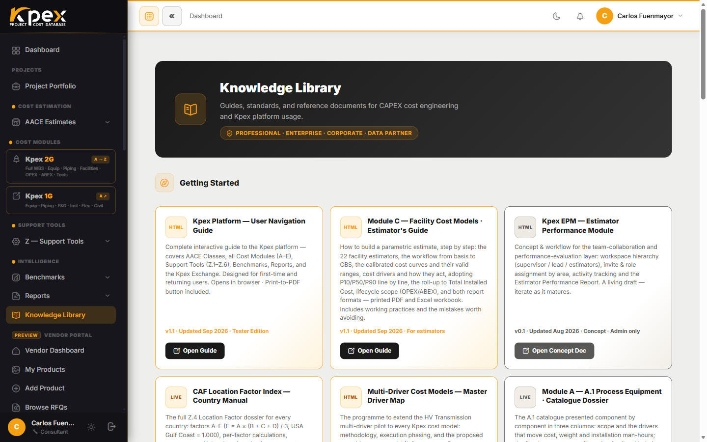

## In this lesson

- Who to contact for each kind of question.
- Where to find guides and reference documents inside Kpex.
- Where the platform is heading.

## You've toured the whole platform

By now you know all five layers of Kpex: you can create an estimate with its AACE class, feed it from cost modules A–E, calibrate it with the Z tools, benchmark it, report on it and take it to the Exchange when you need real prices. What's left is knowing **where to get help** when you need it.

## Support channels

| Channel | Contact | Best for |
|---|---|---|
| **General support** | support@caf-corporation.com | Account access, feature questions, billing |
| **Methodology questions** | methodology@caf-corporation.com | AACE/PMI alignment, LFI and Cost Index technical queries |
| **Platform website** | caf-corporation.com/kpex | Product information, pricing, blog |
| **Knowledge Library** | caf-corporation.com/knowledge | In-platform guides, AACE reference documents, templates |
| **Strategic partnerships** | partnerships@caf-corporation.com | Enterprise/Corporate accounts, Data Partner agreements, alliance discussions |

A practical tip: when you write to **methodology@**, include the AACE class, the project country and the estimate's base month. That's what the technical team needs to reproduce your number.

## The Knowledge Library

The **Knowledge Library** sits in the Kpex sidebar. It brings together user guides, AACE reference documents and templates, and it's the first place to look before contacting support. Depending on your membership it may show a lock: click it to see which plan unlocks it.

## What's coming

Kpex keeps growing. The main line of development is **AI estimators**: conversational assistants that take a description of your facility, or questions asked in project-management language, and prepare an order-of-magnitude or feasibility estimate using the same modules you already know (C, A and B), with the Location Factor and Cost Index applied automatically. Everything you've learned in this course is the foundation they run on: understanding what the AI does is what lets you review and defend its result.

## Key idea

> There's a channel for every kind of question: **support@** for your account and features, **methodology@** for the technical side, and the **Knowledge Library** as your first stop.

## Your next steps

1. Save **support@** and **methodology@** to your contacts.
2. Open the **Knowledge Library** and bookmark a guide that will help on your next project.
3. Take this course's **final exam**: it unlocks your certificate and your student benefit, covered in the next lesson.
