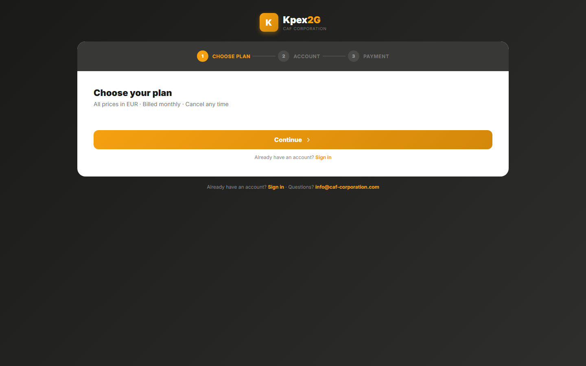

## En esta lección

- Por qué necesitas una cuenta de Kpex para seguir el curso.
- Cómo activar tu cuenta de prueba, paso a paso.
- Qué hacer si algo no funciona.

## Por qué necesitas una cuenta

Casi todas las lecciones terminan con un **"Pruébalo en Kpex"**: una tarea corta dentro de la plataforma. Para hacerlas necesitas acceso a Kpex. Como alumno del curso tienes una **cuenta de prueba** con una duración de **15 días desde tu compra**, pensada para que completes todos los ejercicios. Al cumplirse, el acceso a Kpex vence, aunque no hayas terminado el curso.

<!-- DECISION PENDING: trial tier (length decided: 15 days) -->

Kpex funciona **completamente en el navegador**: no hay nada que instalar. Sirve cualquier navegador moderno: **Chrome, Edge, Firefox o Safari**.

## Activa tu cuenta paso a paso

La interfaz de Kpex está **solo en inglés**. En este curso verás los nombres de botones y campos en inglés, en **negrita**, con su explicación en español.

<!-- VERIFY: mecanismo exacto de activación de la prueba para alumnos (enlace especial, código o registro normal con plan de prueba). Los pasos 1–4 describen el formulario de registro actual en /register; el paso de plan y de pago puede no aplicar a la prueba. -->

1. **Entra a kpex.caf-corporation.com** desde tu navegador. <!-- VERIFY: enlace de activación que recibirá el alumno desde Akdemy -->
2. **Crea tu cuenta** (**Create your account**). Completa los campos:

   | Campo en Kpex | Qué escribir |
   |---|---|
   | **Full Name** | Tu nombre completo |
   | **Corporate Email** | Tu correo profesional |
   | **Password** | Una contraseña de al menos 8 caracteres, con una mayúscula y un número |
   | **Confirm Password** | La misma contraseña otra vez |

3. **Acepta los términos.** Marca la casilla que confirma que leíste y aceptas los **Terms of Service** y la **Privacy Policy** de Kpex. La casilla no viene marcada: tienes que marcarla tú.
4. **Verifica tu correo** (**Verify your email**). Kpex te envía un **código de 6 dígitos** al correo que indicaste. Escríbelo y pulsa **Verify & Continue**.
5. **Inicia sesión.** En la pantalla de acceso escribe tu **Email Address** y tu **Password** y pulsa **Sign In**. Si usas tu propio equipo, puedes marcar **Keep me signed in**.

## Qué incluye tu prueba

Tu cuenta de prueba te da acceso a las partes de Kpex que usa este curso. Si en la barra lateral ves un elemento con un **candado**, significa que esa función pertenece a otro nivel de membresía; lo verás con más detalle en la lección 2.2.

<!-- DECISION PENDING: qué nivel de membresía (tier) tiene la cuenta de prueba y si todos los ejercicios del curso quedan cubiertos -->

## Si algo no funciona

| Problema | Qué hacer |
|---|---|
| No llega el código de verificación | Revisa la carpeta de spam y confirma que escribiste bien el correo |
| Olvidaste la contraseña | En la pantalla de acceso, pulsa **Forgot password?** |
| Cualquier otro problema de acceso | Escribe a **support@caf-corporation.com** |

## Idea clave

> Tu cuenta de prueba es tu **laboratorio** durante el curso. Actívala ahora, antes de seguir: los ejercicios empiezan en el Módulo 1 y los 15 días ya están corriendo desde tu compra.

## Pruébalo en Kpex (5 minutos)

1. Activa tu cuenta siguiendo los pasos de esta lección.
2. Inicia sesión y comprueba que llegas al **Dashboard**.
3. Cierra sesión desde el menú de tu nombre, arriba a la derecha (**Sign Out**), y vuelve a entrar. Así confirmas que tu contraseña funciona antes de empezar el Módulo 1.
