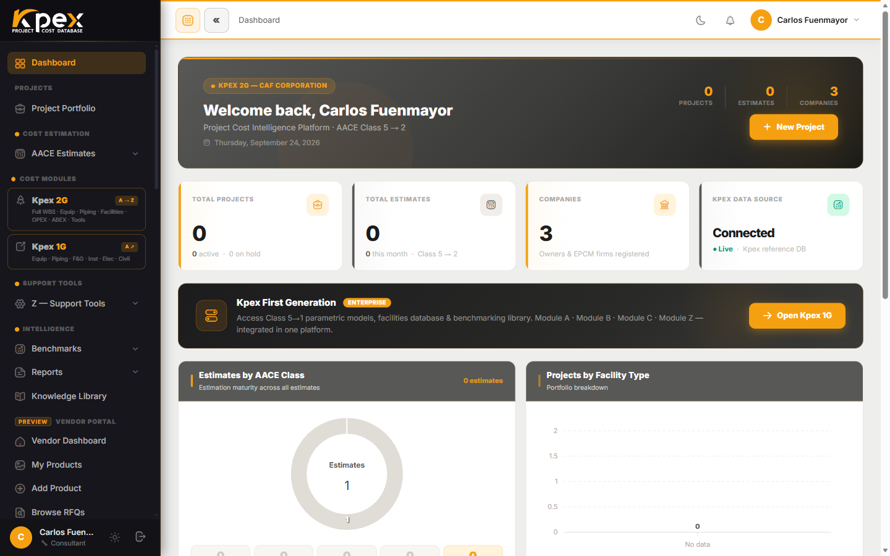

## En esta lección

- Qué es Kpex y qué problema resuelve.
- Las cinco ideas que distinguen a Kpex de un libro de costos tradicional.

## ¿Qué es Kpex?

**Kpex** es una plataforma en la nube de **inteligencia de costos CAPEX**, desarrollada por CAF Corporation Ingeniería de Costes SL. Sirve para preparar, validar y comparar estimados de inversión de capital siguiendo los estándares de la industria. Funciona completamente desde el navegador: no hay nada que instalar.

La mayoría de las plataformas del mercado siguen **una sola** escuela. Kpex armoniza las dos grandes referencias de la profesión:

- **AACE International**: clasificación de estimados Clase 5 a Clase 1 (RP 18R-97) y el marco TCM.
- **PMI**: el capítulo de costos del PMBOK y el estándar de WBS.

En la práctica, el ingeniero de costos y el gerente de proyecto trabajan en la misma herramienta y hablan el mismo idioma.

## Las cinco ideas que hacen distinta a Kpex

### 1. Una base de datos que se mantiene al día sola: geografía × tiempo

Un libro de costos envejece desde el día en que se imprime. En Kpex, cada costo está anclado a una referencia, la **Costa del Golfo de EE. UU.** en un **mes base**, y dos motores lo ajustan **automáticamente cada vez que lo consultas**:

| Motor | Qué ajusta | Cómo |
|---|---|---|
| **Z.4 · CAF Location Factor Index (LFI)** | La **geografía** | Lleva el costo a cualquiera de **197 países**, desde el país de origen del modelo hasta el país de tu proyecto |
| **Z.5 · Kpex Cost Index** | El **tiempo** | Lo escala al **mes actual** con índices mensuales |

Resultado: tu estimado siempre está **en dinero de hoy y en tu ubicación**.

### 2. Profundidad: el catálogo CAPEX estructurado más grande de su tipo

- **700+ modelos paramétricos de equipos** (Módulo A).
- **150 modelos completos de facilities** (Módulo C).
- **653 curvas de costo históricas** (Módulo B).

Cada modelo indica su driver de capacidad, su rango válido, su base de costo y su procedencia.

### 3. El ciclo de vida completo: CAPEX, OPEX y ABEX

Los módulos **A, B y C** forman el núcleo de estimación de CAPEX. El **Módulo D** añade los costos de operación (**OPEX**) y el **Módulo E** los de abandono y desmantelamiento (**ABEX**), algo poco común en el mercado. Así cubres el activo desde el primer estimado hasta su desmantelamiento.

### 4. Sistema métrico ⇄ imperial, en todas partes

Cualquier dato de entrada, rango o resultado se puede ver en **sistema métrico o imperial** con un solo interruptor, sin alterar el modelo. También puedes leer el estimado **en tu propia moneda**, convertida al tipo de cambio del día del Banco Central Europeo. La base siempre se guarda en dólares para que las comparaciones sean coherentes.

### 5. Módulo Z: una caja de herramientas que ningún otro estimador trae

Herramientas que normalmente viven en hojas de cálculo sueltas o en consultoras especializadas: factor de ubicación, índice de costos mensual, tarifas de mano de obra y de equipos de alquiler, tarifas de ingeniería y la batería de evaluaciones (PDRI, PEI, CRI y Accuracy Rating).

## Idea clave

> Kpex no es un libro de costos: es una **base de datos viva** que se recalibra sola por **ubicación** y por **tiempo**, dentro de un entorno de estimación que cubre **todo el ciclo de vida** del activo.

## Pruébalo en Kpex (2 minutos)

1. Entra a tu cuenta de prueba de Kpex.
2. Recorre la barra lateral e identifica los cinco grupos: *Cost Estimation*, *Cost Modules*, *Support Tools (Z)*, *Intelligence* y *Kpex Exchange*.
3. Busca en el catálogo un precio que diga **"current to"** seguido del mes actual: es el Cost Index trabajando.
