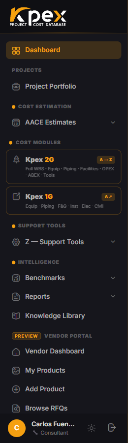

## En esta lección

- Las cinco capas de Kpex y qué hay en cada una.
- Quién trabaja principalmente en cada capa.

## Las cinco capas

Kpex se organiza en cinco capas. Cada una corresponde a un grupo de la barra lateral, así que aprenderlas es aprender a moverte por la plataforma.

| Capa | Qué contiene | Usuarios principales |
|---|---|---|
| **Cost Estimation** | Asistente de estimados AACE Clase 5–2, constructor de WBS, reportes PDF con trazabilidad completa de la metodología | Ingenieros de costos, gerentes de proyecto, consultores |
| **Cost Modules A–E** | 700+ modelos de componentes (A), benchmarks históricos (B), 150 modelos de facilities (C), OPEX (D), ABEX y desmantelamiento (E), todos escalados al día y en métrico/imperial | Estimadores, equipos de factibilidad |
| **Support Tools Z** | CAF LFI (196 países), CAF Cost Index (mensual, multirregión), tarifas de ingeniería, mano de obra y alquiler, evaluaciones PDRI/PEI/CRI | Estimadores senior, control de proyectos |
| **Intelligence** | 430+ curvas de benchmark, rangos P10/P50/P90, reportes de portafolio y de progresión | Directores de proyecto, gerentes de costos |
| **Kpex Exchange** | Marketplace: solicitudes de cotización (RFQ), precios de proveedores, aportes de socios de datos | Compras, proveedores, socios de datos |

## Cómo se conectan las capas

Piensa en Kpex como una cadena:

1. **Cost Modules** aportan el **dato de costo**: un equipo, una facility, una curva.
2. **Support Tools Z** lo **calibran**: a tu país (LFI), a hoy (Cost Index) y a tu nivel de definición (PDRI).
3. **Cost Estimation** lo **organiza** en un estimado con su clase AACE y su WBS.
4. **Intelligence** lo **compara** contra la historia y lo **reporta**.
5. **Kpex Exchange** lo **reemplaza** por precios reales de proveedores cuando el proyecto madura.

## Idea clave

> **Dato → calibración → estimado → comparación → precio real.** Cada capa de Kpex es un eslabón de esa cadena.

## Pruébalo en Kpex (3 minutos)

Abre un elemento de cada grupo de la barra lateral y anota en una línea qué ves. Al final del curso vuelve a esta lista: te sorprenderá cuánto más entiendes.
