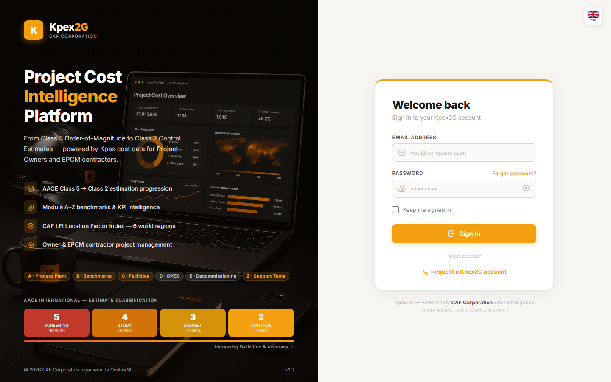

## En esta lección

- Dónde y cómo se accede a Kpex.
- Las etapas del registro de una cuenta nueva.
- Cómo iniciar sesión, recuperar tu contraseña y cerrar sesión.
- En qué idioma está la plataforma.

## Dónde está Kpex

Kpex es una plataforma en la nube. Se accede en **kpex.caf-corporation.com** desde cualquier navegador moderno:

| Requisito | Detalle |
|---|---|
| Navegador | Chrome, Edge, Firefox o Safari |
| Instalación | Ninguna: todo funciona en el navegador |
| Primer acceso | Te lleva a la página de registro para crear tu cuenta y elegir un plan de membresía |

Como todo vive en el navegador, puedes trabajar desde cualquier equipo: tus estimados están en tu cuenta, no en un archivo local.

## El idioma de la plataforma

La **interfaz de la aplicación Kpex está, por ahora, solo en inglés**. El selector de idioma existe en el sitio web público y en la página de inicio de sesión, pero dentro de la aplicación todo aparece en inglés.

Por eso, en este curso los nombres de pantallas, botones y menús aparecen **en inglés y en negrita**, tal como los verás en Kpex, con su explicación en español.

## Registro de una cuenta nueva

El registro tiene tres etapas, que se muestran arriba del formulario:

| Etapa en Kpex | Qué haces |
|---|---|
| **Choose Plan** | Eliges tu plan de membresía |
| **Account** | Creas tu cuenta: **Full Name**, **Corporate Email**, **Password** y **Confirm Password**, y aceptas los **Terms of Service** y la **Privacy Policy** |
| **Payment** | Revisas el resumen del pedido y pasas al pago seguro |

Entre la etapa **Account** y el pago, Kpex te pide **verificar tu correo** (**Verify your email**) con un **código de 6 dígitos** que te llega por email.

La contraseña debe tener **al menos 8 caracteres, con una mayúscula y un número**. La casilla de aceptación de términos no viene marcada: debes marcarla de forma explícita.

> Si estás siguiendo este curso, ya activaste tu cuenta de prueba en la lección 0.2. Esta sección te sirve para entender el registro completo, por ejemplo si más adelante das de alta a un colega.

<!-- VERIFY: si la cuenta de prueba del alumno pasa por las etapas Choose Plan y Payment o las omite -->

## Iniciar sesión

En la pantalla de acceso:

1. Escribe tu **Email Address** y tu **Password**.
2. Si estás en tu propio equipo, marca **Keep me signed in** para no tener que entrar cada vez.
3. Pulsa **Sign In**. Llegas al **Dashboard**, que verás en la próxima lección.

## Recuperar la contraseña

Si la olvidaste, pulsa **Forgot password?** junto al campo de contraseña. Kpex te enviará un enlace a tu correo para crear una nueva.

## Tu cuenta y el cierre de sesión

Arriba a la derecha verás tu nombre. Al hacer clic se abre un menú con:

- **My Account**: tus datos de perfil.
- **Sign Out**: cierra la sesión. Úsalo siempre en equipos compartidos.

## Si necesitas ayuda

Para problemas de acceso, preguntas sobre funciones o facturación, el canal es **support@caf-corporation.com**.

## Idea clave

> Kpex no se instala: **se abre**. Con un navegador y tu cuenta tienes toda la plataforma disponible desde cualquier equipo. La interfaz está en inglés, así que familiarízate con los nombres de los menús tal como aparecen en pantalla.

## Pruébalo en Kpex (3 minutos)

1. Cierra sesión con **Sign Out** desde el menú de tu nombre.
2. Vuelve a entrar desde **kpex.caf-corporation.com**, esta vez marcando **Keep me signed in**.
3. Abre **My Account** y revisa que tu nombre y tu correo sean correctos.
