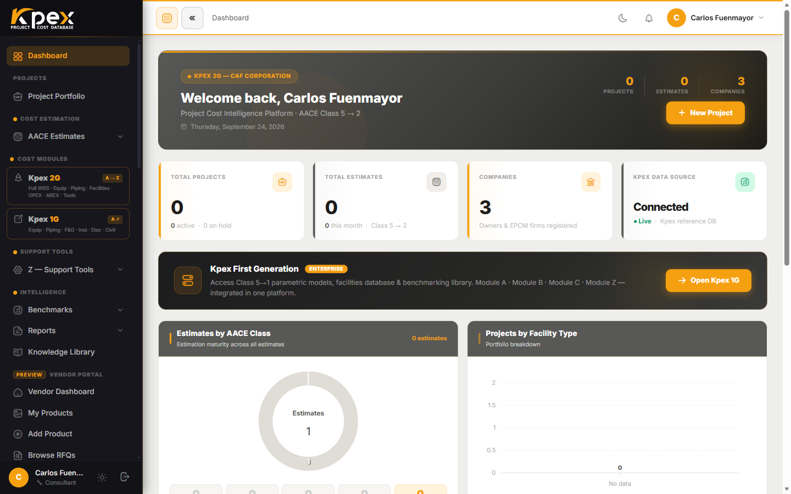

## En esta lección

- Las tres zonas del **Dashboard** de Kpex.
- Cómo está organizada la barra lateral y qué significa el candado.
- Qué información te muestra el área central y qué hay en la barra superior.

## Tu punto de partida

Cada vez que inicias sesión llegas al **Dashboard**, tu centro de mando personal. Desde aquí ves el estado de tu trabajo y llegas a cualquier parte de la plataforma. La pantalla tiene **tres zonas**:

| Zona | Dónde está | Para qué sirve |
|---|---|---|
| **1. Barra lateral** | Izquierda | Navegar por todas las secciones de Kpex |
| **2. Área central** | Centro | Ver el resumen de tus proyectos y estimados |
| **3. Barra superior** | Arriba a la derecha | Notificaciones, modo claro u oscuro y tu cuenta |

## Zona 1: la barra lateral

Todas las secciones de la plataforma están aquí, agrupadas por función. Son las mismas capas que viste en la lección 1.2:

| Grupo en la barra lateral | Qué encuentras |
|---|---|
| **Cost Estimation** | Los estimados AACE (**AACE Estimates**) y el Estimate Wizard |
| **Cost Modules** | Los módulos de costo A a E |
| **Support Tools** | Las herramientas del Módulo Z (**Z — Support Tools**) |
| **Intelligence** | **Benchmarks** y **Reports** |
| **Kpex Exchange** | El marketplace |

Arriba de estos grupos están el acceso al propio **Dashboard** y a tu **Project Portfolio** (portafolio de proyectos). Según tu nivel de membresía también verás la **Knowledge Library**, la biblioteca de guías y documentos de referencia.

### El candado 🔒

Algunos elementos aparecen **atenuados y con un candado**. Significa que esa función requiere un **nivel de membresía superior** al tuyo. Si pasas el cursor por encima verás el aviso **Upgrade to unlock**. El elemento sigue visible a propósito: así sabes que la función existe aunque todavía no la tengas.

## Zona 2: el área central

El área central resume tu actividad con tarjetas y gráficos, entre ellos:

- **Total Projects** y **Total Estimates**: cuántos proyectos y estimados tienes.
- **Estimates by AACE Class**: tus estimados agrupados por clase AACE.
- **Projects by Facility Type**: tu portafolio por tipo de facility.
- **Recent Projects** y **Recent Estimates**: lo último en lo que trabajaste, lo más reciente primero.

Si tu cuenta es nueva, verás mensajes como **No projects yet** o **No estimates yet**. Es normal: se llenarán cuando crees tu primer estimado en el Módulo 4.

El contenido del área central **se adapta a tu nivel de membresía y a tu tipo de perfil**, así que dos usuarios pueden ver dashboards distintos.

<!-- VERIFY: la guía menciona una tarjeta de resumen del Cost Index (CAI) y accesos rápidos a las herramientas más usadas; no se encontraron en dashboard/index.blade.php -->

## Zona 3: la barra superior

En la esquina superior derecha tienes:

| Elemento | Qué hace |
|---|---|
| **Luna / sol** | Cambia entre modo claro y modo oscuro (**Toggle dark / light mode**) |
| **Campana** | Abre tus **Notifications** (muestra las 20 más recientes) |
| **Tu nombre** | Abre el menú con **My Account** y **Sign Out** |

<!-- VERIFY: la guía menciona un enlace de ayuda rápida y la insignia del nivel de membresía junto al nombre; no se encontraron en la barra superior de layouts/app.blade.php -->

Recuerda que la interfaz de la aplicación está **solo en inglés**: el selector de idioma solo existe en el sitio web público y en la página de inicio de sesión.

## Idea clave

> El Dashboard tiene tres zonas: **navegas** con la barra lateral, **ves tu estado** en el área central y **gestionas tu sesión** en la barra superior. Un candado no es un error: indica una función de otro nivel de membresía.

## Pruébalo en Kpex (4 minutos)

1. En el Dashboard, identifica las tres zonas.
2. Recorre la barra lateral y anota qué elementos tienen candado en tu cuenta.
3. Cambia a modo oscuro con el botón de la barra superior y vuelve al modo claro.
4. Abre la campana de notificaciones y revisa si tienes alguna.
