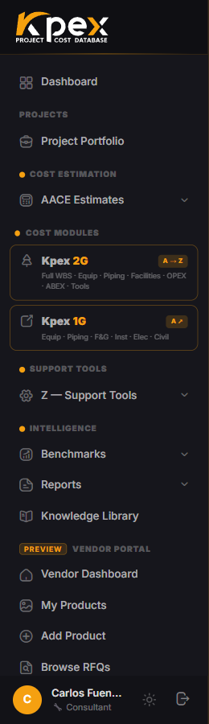

## En esta lección

- Los cuatro tipos de perfil de Kpex.
- Cómo cambia la barra lateral según tu perfil.
- Qué perfil tienes tú y por qué importa para este curso.

## Un perfil, una interfaz

Kpex adapta su interfaz a tu **tipo de perfil**. No todos los usuarios hacen lo mismo: un estimador necesita toda la caja de herramientas, mientras que un proveedor solo necesita publicar sus productos y responder solicitudes de cotización. Por eso la barra lateral muestra a cada perfil las secciones que le sirven.

## Los cuatro perfiles

| Perfil en Kpex | Flujo de trabajo principal | Qué ves en la barra lateral |
|---|---|---|
| **Consultant / Estimator** | El flujo completo de estimación de costos: clases AACE, módulos de costo y herramientas | La barra lateral completa, con todas las secciones |
| **Owner / Operator** | Revisar los estimados de los contratistas EPC y emitir solicitudes de cotización (RFQ) por Kpex Exchange | Estimados y compras |
| **Vendor** | Publicar equipos y servicios y responder a las RFQ | Solo el **Vendor Portal** |
| **Data Partner** | Aportar datos históricos de costos | El portal de **Data Partner** |

## Qué ve cada perfil

### Consultant / Estimator
Ve todos los grupos que conociste en la lección 2.2: **Cost Estimation**, **Cost Modules**, **Support Tools**, **Intelligence** y **Kpex Exchange**, además de su **Project Portfolio**. Es el perfil de quien prepara estimados.

### Owner / Operator
Su barra lateral se centra en dos bloques: **EPC Cost Estimates** (con **All Estimates** y **Project Portfolio**) y **Procurement** (con **My RFQs** y **New RFQ**). Es el perfil de quien recibe y evalúa estimados y pide precios al mercado.

### Vendor
Trabaja en el **Vendor Portal**: gestiona sus productos (**My Products**, **Add Product**) y consulta las solicitudes abiertas (**Browse RFQs**).

### Data Partner
Trabaja en su propio portal, desde donde aporta conjuntos de datos históricos (**My Datasets**) a la base de Kpex.

Todos los perfiles tienen acceso al **Dashboard** y al grupo **Kpex Exchange**, el marketplace que conecta a compradores y proveedores. Lo verás en la lección 7.3.

## ¿Qué perfil tienes tú?

El registro por cuenta propia **no te pregunta el perfil**: todas las cuentas nuevas se crean como **Consultant / Estimator**, el perfil que ve la plataforma completa. El tipo de perfil se define en el **onboarding**, no es autoservicio: **Consultant / Estimator** es el perfil por defecto, **Owner / Operator** y **Vendor** se habilitan en el alta, y el de **Data Partner** se asigna por invitación de CAF Corporation. En **My Account → Profile** gestionas tus datos (nombre, cargo, teléfono, biografía y avatar), pero no el tipo de perfil.

Tu cuenta de prueba del curso es un perfil **Consultant / Estimator**, porque es el que ve la plataforma completa y el que necesitas para los ejercicios de estimación.

## Perfil y membresía no son lo mismo

No confundas dos ideas distintas:

| Concepto | Qué define |
|---|---|
| **Tipo de perfil** | **Qué tipo de trabajo** haces en Kpex, y por lo tanto qué secciones ves |
| **Nivel de membresía** | **Cuánto** de cada sección tienes desbloqueado (los elementos con candado de la lección 2.2) |

Dos estimadores con el mismo perfil pueden ver candados distintos si tienen membresías distintas.

## Idea clave

> El **perfil** decide **qué secciones** ves; la **membresía** decide **cuáles están desbloqueadas**. Kpex muestra a cada usuario solo lo que su trabajo necesita.

## Pruébalo en Kpex (3 minutos)

1. Compara tu barra lateral con la tabla de esta lección: ¿qué perfil tienes?
2. Abre el grupo **Kpex Exchange** y anota qué opciones contiene.
3. Piensa en tu organización: ¿qué perfil tendría cada uno de tus colegas, clientes y proveedores?
