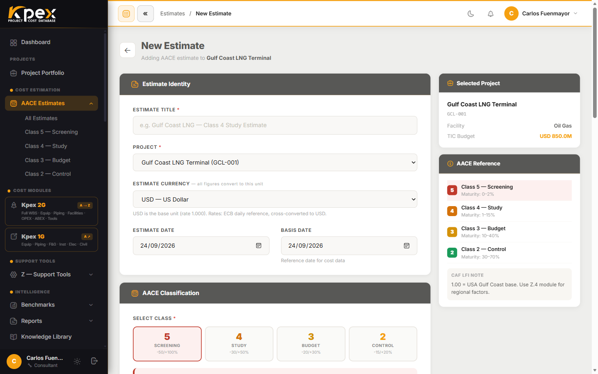

## En esta lección

- Las cinco clases de estimado de AACE 18R-97 y qué significa cada una.
- Cómo se corresponde cada clase con las técnicas de estimación del PMI.
- Por qué la clase pertenece a un **estimado** y no a un **proyecto**.

## Una norma, cinco niveles de madurez

Kpex está construida alrededor de la **Práctica Recomendada 18R-97 de AACE International**, el estándar mundial para clasificar estimados de costo. Cada estimado que creas en Kpex lleva asignada una **clase AACE**, y esa clase define dos cosas: el **rango de precisión** que puedes esperar y el **nivel de definición del proyecto** que necesitas para producirlo.

La regla es sencilla: cuanto más definido está el proyecto, más estrecho es el rango de precisión. Se cuenta de la Clase 5 (la menos definida) a la Clase 1 (la más definida).

| Clase AACE | Nombre común | Rango de precisión | Definición del proyecto | Uso típico |
|---|---|---|---|---|
| **Clase 5** | Screening / Orden de magnitud | −50% a +100% | 0–2% completa | Screening de conceptos y de portafolio, prefactibilidad |
| **Clase 4** | Estudio / Factibilidad | −30% a +50% | 1–15% completa | Estudio de factibilidad, selección de concepto, business case |
| **Clase 3** | Presupuesto / Autorización | −20% a +30% | 10–40% completa | Autorización, FID (decisión final de inversión), aprobación de presupuesto |
| **Clase 2** | Estimado de control | −15% a +20% | 30–75% completa | Evaluación de órdenes de cambio, línea base de control del proyecto |
| **Clase 1** | Definitivo / Verificación | −10% a +15% | 65–100% completa | Licitación, presupuesto final, gestión de cambios contractuales |

Fíjate en dos detalles:

- Los rangos son **asimétricos**: el riesgo de quedarse corto es mayor que el de pasarse, sobre todo al principio. Un Clase 5 puede terminar costando el doble.
- Los porcentajes de definición **se solapan** entre clases. La clase no es un número exacto, sino una zona de madurez.
- **Kpex trabaja de la Clase 5 a la Clase 2.** La Clase 1 (definitivo) se prepara con la ingeniería completa y ofertas firmes de contratistas, fuera del alcance de la plataforma.

## La equivalencia con el PMI

El gerente de proyecto certificado PMI no suele hablar de "Clase 4", sino de **estimación paramétrica**. Kpex conecta ambos mundos: mapea las clases AACE con los conceptos de gestión de costos del **capítulo 7 del PMBOK**.

| Clase AACE | Técnica de estimación PMI (PMBOK cap. 7) |
|---|---|
| **Clase 5** | Estimación **análoga** (*Analogous Estimating*) |
| **Clase 4** | Estimación **paramétrica** (*Parametric Estimating*) |
| **Clase 3** | Inicio de la estimación **ascendente** (*Bottom-up Estimating*) |
| **Clases 2–1** | Estimación **ascendente** con **MTO detallado** (cómputo de materiales) |

Gracias a esta doble alineación, el estimador formado en AACE y el PM certificado PMI pueden trabajar cada uno desde su propio marco, sobre el mismo estimado.

## La clase es del estimado, no del proyecto

Es un error frecuente decir "este es un proyecto Clase 3". En Kpex, **la clase AACE pertenece a un estimado**. Un mismo proyecto puede tener **varios estimados de distintas clases** a medida que madura su definición: un screening Clase 5 hoy y un Clase 3 más adelante.

Por eso las páginas de proyecto y los gráficos de portafolio de Kpex **agrupan y cuentan los estimados por clase**, en lugar de sellar el proyecto con una sola. Así ves con más realismo en qué punto está el trabajo.

## Idea clave

> La clase AACE te dice **cuánto puedes confiar en un número** según **cuánto sabes del proyecto**. Y como el proyecto madura, un mismo proyecto acumula estimados de clases distintas.

## Pruébalo en Kpex (3 minutos)

1. En la barra lateral abre **Cost Estimation → AACE Estimates**.
2. Observa que los estimados se pueden consultar **por clase** (una entrada por cada clase, además de **All Estimates**).
3. Inicia un estimado nuevo con **New Estimate** y haz clic en cada tarjeta de clase del bloque **AACE Classification**: comprueba cómo cambian el rango de precisión (**Accuracy Range**) y la madurez (**Definition Maturity**). Cancela sin guardar.
