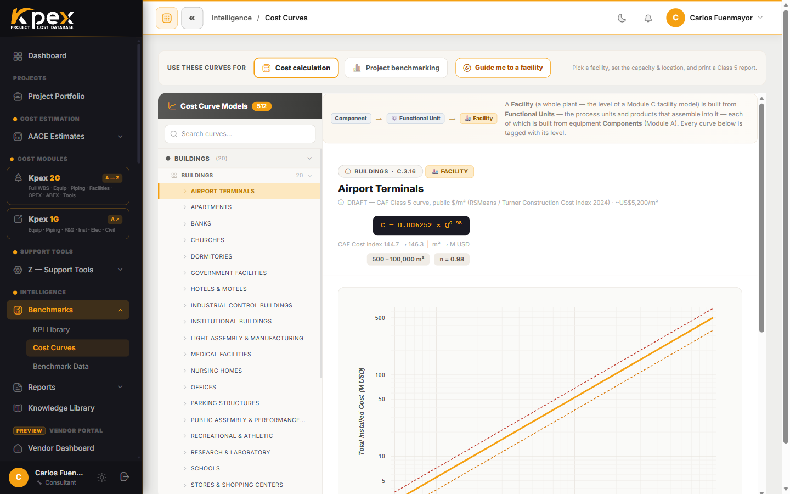

## En esta lección

- Qué hace Kpex cuando eliges la clase de un estimado.
- La "receta" práctica: qué parte de Kpex abrir para construir cada clase.
- La capa de calibración que trabaja igual en todas las clases.

## Lo que pasa cuando eliges la clase

Al crear un estimado nuevo, Kpex te pide seleccionar la **clase AACE objetivo**. A partir de esa decisión, la plataforma:

1. **Activa el conjunto de módulos adecuado.** Por ejemplo, la Clase 5 usa las curvas de costo y los modelos de facilities del Módulo C; la Clase 3 usa los datos a nivel de componente del Módulo A.
2. **Aplica la lista de verificación PDRI** (vía **Z.6.3**) para comprobar que el nivel de definición del proyecto corresponde a la clase elegida.
3. **Etiqueta el reporte** con el rango de precisión y la justificación de la clase, listo para entregar al cliente.

## La receta: una herramienta principal por clase

Cada clase se construye con una herramienta principal distinta. Esta tabla es la receta práctica: qué abrir en Kpex, y en qué orden, según el nivel de definición que tengas.

| Clase | Herramienta principal | Cómo se construye |
|---|---|---|
| **Clase 5** · Orden de magnitud | **Cost Curves** (Módulo B) + modelo de facility del Módulo C | Abre **Intelligence → Benchmarks → Cost Curves**, elige la facility (o usa el selector guiado **Guide me to a facility**), introduce la **capacidad** que la determina y pulsa **Calculate**. Kpex devuelve el costo total instalado con su banda ± y marca tu punto en la curva. Define el país del proyecto (Z.4) y el costo ya viene escalado (Z.5). Imprime el reporte de benchmarking de una página y contrasta con los rangos P10/P50/P90 (B.2). |
| **Clase 4** · Factibilidad | **Equipment List Builder** (Módulo A, ISBL) + bulk por disciplina (Módulo B) | Construye la **lista de equipos**: añade los equipos mayores desde la **librería ISBL del Módulo A** (punto de operación, tamaño y cantidad) y Kpex completa el **bulk ISBL por disciplina** (Módulo B) —cimentación, tubería e instrumentos salen de su cómputo; estructura, eléctrico, telecoms, aislamiento y pintura con la asignación estadística P50 de su subfamilia—. Lee el costo total instalado desglosado por disciplina. Marca OPEX (Módulo D) y ABEX (Módulo E) si quieres el ciclo de vida completo. LFI y Cost Index se aplican solos; ejecuta el PDRI. |
| **Clase 3** · Presupuesto / FID | Componentes del Módulo A + MTO, de abajo hacia arriba sobre la WBS | Crea el estimado y construye la **WBS**. Añade los equipos mayores del Módulo A con su dimensionamiento real; agrega el cómputo de materiales a granel (tubería, E&I, civil) con las asignaciones **KPEX-HF**; valora la mano de obra con **Z.2**, los equipos de alquiler con **Z.3** y la ingeniería/EPCM con **Z.1**. Aquí el número deja de ser paramétrico y pasa a ser construido. Y es aquí, no en la Clase 2, donde arranca **Procurement Contracts**: importas ofertas de contratistas, marcas el *first-runner* y lo aplicas a la WBS para empezar a sustituir los costos paramétricos por ofertas reales. |
| **Clase 2** · Control | MTO detallado + ofertas reales consolidadas | Refina el cómputo hasta un MTO detallado y consolida las **ofertas reales** que ya cargaste en **Procurement Contracts** desde la Clase 3 como línea base de control. Concilia ofertas, congela la línea base y usa el reporte **Estimate Progression** para gestionar los cambios. Nota: el **Kpex Exchange (RFQ)** es un **marketplace aparte** para solicitar ofertas a proveedores; es distinto del Procurement Contracts que vive dentro del estimado. |

Observa la progresión: de **una curva y un número de capacidad** (Clase 5) pasas a una **lista de equipos con su bulk estadístico** (Clase 4), luego al **cómputo detallado sobre la WBS** (Clase 3, donde ya entran las primeras **ofertas reales** vía Procurement Contracts) y por último a los **precios reales consolidados** (Clase 2). Es la misma evolución *análoga → paramétrica → ascendente* que viste en la lección anterior.

## La misma capa de calibración en todas las clases

Trabajes en la clase que trabajes, los dos motores que mantienen el número al día están **siempre activos**:

- El **CAF Location Factor (Z.4)** lleva el costo a tu país.
- El **Kpex Cost Index (Z.5)** lo escala a hoy.

Además, puedes leer e imprimir todo el estimado **en tu moneda y en tu sistema de unidades**, y adjuntar al reporte la **puntuación PDRI** y la declaración de referencia y precisión.

## Idea clave

> Elegir la clase es elegir la **herramienta**: curvas para la Clase 5, facilities para la 4, componentes y WBS para la 3, cotizaciones reales para la 2. La **calibración** (ubicación y tiempo) es la misma en todas.

## Pruébalo en Kpex (4 minutos)

1. Abre **Intelligence → Benchmarks → Cost Curves** y localiza el selector **Guide me to a facility**. Recorre sector → familia → facility sin calcular nada.
2. Vuelve a la barra lateral y localiza, en los módulos de costo, un modelo de facility del **Módulo C** y un equipo del **Módulo A**.
3. Anota qué herramienta usarías para un estimado de **Clase 5**, uno de **Clase 4** y uno de **Clase 3** de tu propia industria.
