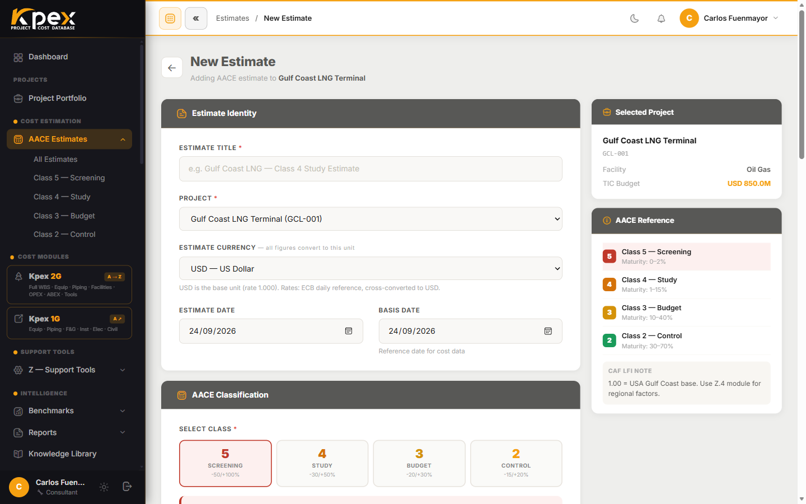

## En esta lección

- Cómo abrir el asistente de estimados (**Estimate Wizard**).
- Qué se decide en cada una de sus cinco tarjetas.
- El bloque extra que aparece solo en la Clase 5.

## Dónde está el asistente

En la barra lateral, abre **Cost Estimation → AACE Estimates** y pulsa **New Estimate**. Se abre un formulario con **cinco tarjetas** a la izquierda y un panel de referencia fijo a la derecha. Si entras desde un proyecto, el estimado queda ya vinculado a ese proyecto.

<!-- VERIFY: la guía de navegación v1.2 nombra las tarjetas "Project Identification / Estimate Classification / Facility Definition / Cost Index Reference / Lifecycle Cost Scope"; esta lección usa los nombres reales de estimates/create.blade.php. Confirmar cuál debe prevalecer. -->

## Las cinco tarjetas

| # | Tarjeta (UI) | Qué decides |
|---|---|---|
| 1 | **Estimate Identity** | Título del estimado, proyecto al que pertenece, moneda del estimado (**Estimate Currency**), fecha del estimado (**Estimate Date**) y fecha base de los datos (**Basis Date**) |
| 2 | **AACE Classification** | La clase AACE objetivo. Al hacer clic en una tarjeta de clase, un banner muestra su rango de precisión y su madurez de definición |
| 3 | **Cost Data** | El costo total instalado base (**TIC Total**, antes de contingencia), el porcentaje de contingencia y el de escalación |
| 4 | **Basis of Estimate** | El país del proyecto (**Project Country**), que rellena automáticamente el factor de ubicación **CAF LFI (Z.4)**; la escalación con el **Cost Adjustment Index (CAI — Z.5)**; y tus notas de supuestos y exclusiones |
| 5 | **Lifecycle Cost Scope** | Si el estimado incluye solo CAPEX o añade OPEX y/o ABEX, y la vida útil de la planta |

### 1 · Estimate Identity
Aquí eliges también la **moneda**. Las tasas vienen de la referencia diaria del Banco Central Europeo; el estimado se guarda siempre en dólares y se muestra convertido a la tasa que queda **congelada** en el estimado.

### 2 · AACE Classification
El selector muestra tarjetas para las Clases **5, 4, 3 y 2**, cada una con su rango (por ejemplo, Clase 5: −50/+100%). No hay tarjeta de Clase 1: Kpex cubre de la Clase 5 a la Clase 2.

### Solo en Clase 5 · Class 5 — Cost Curve Basis
Si eliges la Clase 5, aparece un bloque adicional: seleccionas una curva de costo (**Cost Curve Model**), introduces la capacidad de la planta (**Plant Capacity**) y el factor de ubicación, y pulsas **Calculate from Curve**. Kpex muestra el rango bajo (−50%), el punto medio con contingencia y el alto (+100%), y **rellena automáticamente el TIC** de la tarjeta 3.

### 3 · Cost Data
Si no vienes de una curva, escribes aquí el **TIC Total**. La contingencia y la escalación se suman encima en el resumen del estimado.

### 4 · Basis of Estimate
Al elegir el país, el **Location Factor** se rellena solo (con etiqueta **AUTO**), aunque puedes sobrescribirlo. Para la escalación, elige el año base, el año de ejecución y el índice, y pulsa **Fetch CAI**: Kpex calcula el porcentaje de escalación.

### 5 · Lifecycle Cost Scope
**CAPEX** está siempre incluido. Activa **OPEX** para sumar el Módulo D y **ABEX** para sumar el Módulo E; al hacerlo aparece la vida útil de la planta (**Plant / Facility Lifetime**), que se usa para el VPN y el descuento del ABEX.

Termina con **Create Estimate**.

## Idea clave

> El asistente fija **qué** estimas (identidad y clase), **cuánto** cuesta de partida (Cost Data), **dónde y cuándo** (Basis of Estimate) y **qué parte del ciclo de vida** cubres (Lifecycle Cost Scope).

## Pruébalo en Kpex (5 minutos)

1. Abre **New Estimate** y elige un proyecto de prueba.
2. Selecciona la **Clase 4** y luego la **Clase 5**: comprueba que el bloque **Class 5 — Cost Curve Basis** solo aparece con la Clase 5.
3. En **Basis of Estimate**, elige un país y observa cómo cambia el **Location Factor**.
4. Activa **OPEX** y **ABEX** y mira qué campo nuevo aparece. Puedes cancelar o crear el estimado: lo usarás en la lección 4.2.
