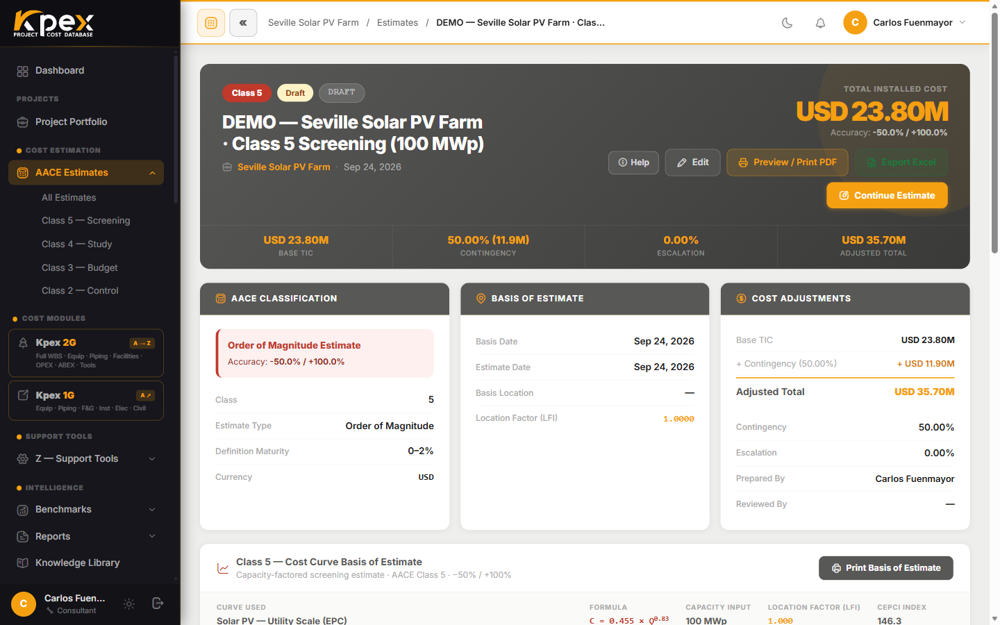

## En esta lección

- Qué ves al abrir un estimado recién creado.
- Cómo añadir equipos del Módulo A con el **Equipment List Builder**.
- Cómo organizar las partidas en la **WBS** y cómo se aplican ubicación y escalación.

## El espacio de trabajo del estimado

Al crear un estimado, Kpex lo abre en su propio espacio de trabajo. En la parte superior tienes los botones de acción y, debajo, los bloques de resumen:

| Bloque (UI) | Qué muestra |
|---|---|
| **AACE Classification** | Clase, rango de precisión y moneda del estimado |
| **Basis of Estimate** | Fechas, ubicación y notas que definiste en el asistente |
| **Cost Adjustments** | La "cascada" del costo: **Base TIC** + contingencia + escalación = **Adjusted Total** |
| **WBS Cost Breakdown** | El desglose del costo según la estructura de desglose del trabajo |

Los botones principales son:

- **Continue Estimate**: sigue construyendo el estimado **actual**; te lleva a la herramienta adecuada para su clase. En Clase 5 abre el formulario de curva y capacidad; en las demás clases abre el **Equipment List Builder** (Módulo A). No cambia de clase.
- **Mature to Class N**: este es el botón para **avanzar de clase**. Crea la clase siguiente (más detallada) en el mismo proyecto y arrastra la base —país, factor, moneda y total anterior—. No lo confundas con *Continue Estimate*: uno sigue el estimado actual, el otro genera la siguiente clase.
- **WBS Builder**: el constructor de la estructura de partidas.
- **Edit**: cambia título, fechas, contingencia, escalación, base del estimado y ubicación. No modifica las partidas de costo.
- **Procurement**: aparece en los estimados de Clase 2 y 3, para gestionar paquetes y ofertas.

## Añadir equipos del Módulo A

El **Equipment List Builder** trabaja en tres pasos:

1. **WBS Build**: defines las áreas de la planta.
2. **Equipment List**: añades equipos a cada área.
3. **DC Method**: eliges cómo pasar del equipo al costo directo, con las asignaciones **KPEX-HF** o el **Lang Factor**.

Los equipos vienen del catálogo del Módulo A (rotativos, estáticos, transferencia de calor, civil, eléctrico, instrumentos). Añades cada uno con su **cantidad** y sus **parámetros de dimensionamiento**, y el costo aparece al instante con los ajustes de ubicación y escalación ya aplicados. A partir de ahí el sistema calcula los costos directos (DC), los indirectos (IC) y el costo total instalado (TIC).

## La WBS: dónde viven las partidas

Tu estimado se organiza en una **estructura de desglose del trabajo (WBS)** alineada con el marco TCM de AACE y con el estándar de WBS del PMI. En el **WBS Builder** construyes la jerarquía **Facility → Area → Unit → Cost Item** y, en ella, introduces las partidas de costo con cantidades, precios unitarios y totales. La WBS alimenta el resumen del estimado y los reportes.

Las partidas se pueden agrupar, reordenar y etiquetar por disciplina o por sistema de la facility.

## Ubicación y escalación: automáticas

No tienes que calcular nada a mano:

- **Z.4 · CAF LFI (geografía)**: eliges el país del proyecto y Kpex lleva cada costo desde el país de origen del modelo a tu ubicación (**LFI destino ÷ LFI origen**).
- **Z.5 · Kpex Cost Index (tiempo)**: la escalación al mes actual ya viene incorporada.

El LFI se aplica **de forma global** a todo el estimado y, además, puede ajustarse **por partida en el WBS Builder** (dentro del cuadro de estimación paramétrica de cada nodo del WBS, campo **Location Factor (CAF LFI)**), útil en proyectos con varias ubicaciones.

<!-- kpex-videos:start -->
## Míralo en Kpex

Recorridos breves de la plataforma real, grabados en el propio Kpex. Voz en inglés — pulsa CC en el reproductor para subtítulos en español o inglés.

<figure class="kpex-vid">
<iframe src="https://player.vimeo.com/video/1234348981?h=0dc9bea106&title=0&byline=0&portrait=0&dnt=1&texttrack=es" title="Clase 4: equipos, bulk ISBL y cuadrillas" loading="lazy" allow="fullscreen; picture-in-picture" allowfullscreen></iframe>
<figcaption><strong>Chapter 2 · Clase 4: equipos, bulk ISBL y cuadrillas</strong> · 2:24</figcaption></figure>

<!-- kpex-videos:end -->

## Idea clave

> El asistente crea el estimado; el **espacio de trabajo** lo llena. Equipos del Módulo A, partidas en la WBS y, por debajo, ubicación y tiempo calibrados automáticamente.

## Pruébalo en Kpex (6 minutos)

1. Abre el estimado de la lección 4.1 (o crea uno de **Clase 3**).
2. Pulsa **Continue Estimate** y, en el **Equipment List Builder**, define un área y añade un equipo del Módulo A (por ejemplo, una bomba centrífuga) con su cantidad.
3. Abre el **WBS Builder** y localiza los niveles **Facility → Area → Unit → Cost Item**.
4. Vuelve al estimado y revisa cómo cambió el bloque **Cost Adjustments**.
