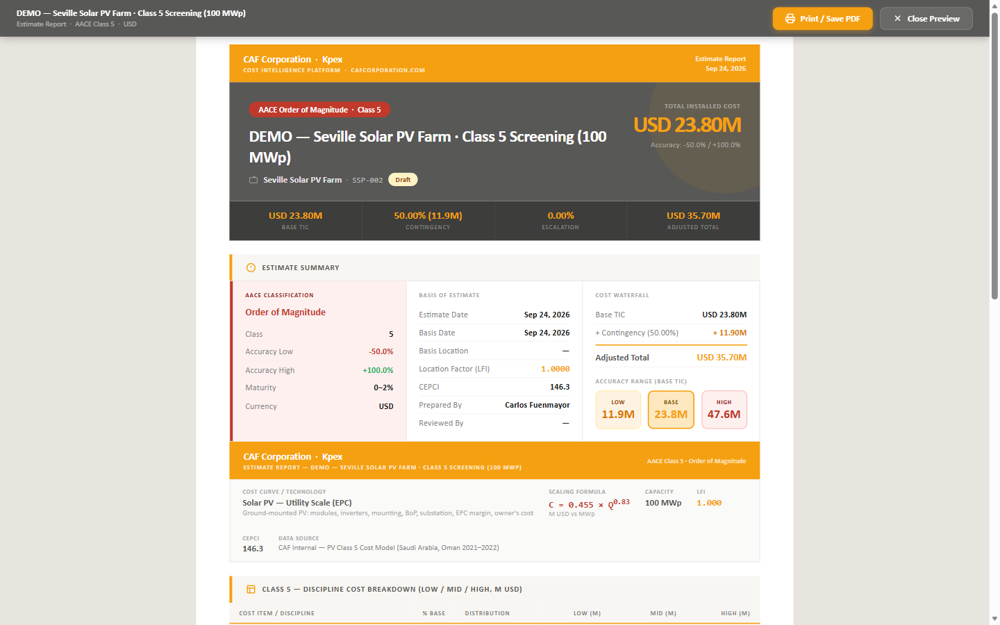

## En esta lección

- Cómo leer tu estimado en tu moneda y en tu sistema de unidades.
- Qué es la evaluación PDRI (Z.6.3) y por qué acompaña al reporte.
- Qué contiene el reporte (un libro de Excel con tu marca) y cómo exportarlo.

## Tu moneda

Puedes leer **todo** el estimado en tu propia moneda: totales, desglose, partidas, reporte impreso y Excel. La conversión usa la **tasa de referencia diaria del Banco Central Europeo**.

La moneda se elige en el asistente, en la tarjeta **Estimate Identity** (campo **Estimate Currency**). Dos reglas importantes:

- La **base** se guarda siempre en **dólares estadounidenses**, para que las comparaciones con benchmarks sean coherentes.
- La tasa queda **congelada en el estimado**: el formulario te muestra, por ejemplo, "1 USD = X EUR (frozen on this estimate)".

## Tu sistema de unidades

En los **catálogos de curvas de costo** (Módulo B) y en las **páginas de facilities** puedes cambiar entre **sistema métrico e imperial** con un solo interruptor. El cambio es **solo de lectura** (muestra las equivalencias): ni el modelo subyacente ni los precios se alteran.

## La evaluación PDRI (Z.6.3)

El **Project Definition Rating Index (PDRI)** puntúa de forma objetiva qué tan definido está tu proyecto. Puedes ejecutarlo **en cualquier etapa**, desde **Support Tools (Z) → Z.6 Assessment Tools**.

| Aspecto | Detalle |
|---|---|
| **Variantes** | 7: Industrial, Small Industrial, Infrastructure, Small Infrastructure, Buildings, Small Buildings, Oil & Gas EPC |
| **Puntuación** | De 0 a 1000; **cuanto más baja, mejor** definido está el proyecto |
| **Resultado** | Puntuación + análisis de brechas, en un PDF con la matriz completa y recomendaciones |

¿Por qué importa? Porque la clase AACE que declaras debe corresponder al nivel real de definición. El PDRI es una herramienta **independiente**, dentro del Módulo **Z.6**: su puntuación y su PDF te sirven como **evidencia metodológica** de que tu Clase 3 es, de verdad, una Clase 3. Por ahora se ejecuta **por separado** (no se adjunta automáticamente al reporte del estimado): lo corres en Z.6 y conservas su reporte como respaldo.

## El reporte

En Kpex, cada reporte viene en **un solo formato: un libro de Excel con tu marca**, listo para imprimir o enviar. No es "un PDF por un lado y un Export Excel aparte": es el mismo libro, que previsualizas en el navegador y descargas en Excel para imprimirlo o guardarlo como PDF. Hay dos reportes:

- **Kpex 1G — el reporte de la sesión:** la salida de la sesión en curso (los componentes que has valorado, con su costo, sus horas-hombre de instalación y su peso).
- **Kpex 2G — el reporte por estimado:** cada estimado tiene su reporte, y el reporte crece con el estimado (Clase 5 → Clase 2).

Desde el espacio de trabajo, pulsa **Preview / Print PDF** (o **Report** en una sesión). Kpex abre la previsualización en una pestaña nueva, con todas las hojas del libro; eliges el cliente en **Prepared for** y pulsas **Download Excel** para imprimirlo o guardarlo como PDF.

El libro de marca abre con su **portada**: tu **logo** a la izquierda y el **logo del cliente** a la derecha, bajo *Prepared for* (ambos se configuran en tu perfil, en *Report logo* y *Report clients*). Kpex solo firma como la herramienta que lo generó. Desde el plan **Professional** puedes además elegir el **color** de tus reportes de Excel.

Las hojas reales del libro son:

- **Cover** — portada con tu logo, el del cliente y la declaración de clase AACE y rango de precisión.
- **Basis of estimate** — la base del estimado, con los factores de **LFI (Z.4)** y **Cost Index (Z.5)** aplicados.
- **Summary** — el resumen del costo por disciplina.
- **Components** — los componentes valorados, con costo, horas-hombre y peso.
- **Sources & data quality** — las fuentes y la calidad del dato.

El PDRI **no** va en este reporte: se corre por separado en **Z.6** y conservas su PDF aparte (lo viste arriba).

<!-- kpex-videos:start -->
## Míralo en Kpex

Recorridos breves de la plataforma real, grabados en el propio Kpex. Voz en inglés — pulsa CC en el reproductor para subtítulos en español o inglés.

<figure class="kpex-vid"><video controls preload="none" playsinline controlslist="nodownload" oncontextmenu="return false" poster="/wp-content/uploads/kpex-videos/Kpex_Reports.jpg"><source src="/wp-content/uploads/kpex-videos/Kpex_Reports.mp4" type="video/mp4"><track kind="subtitles" srclang="en" label="English" src="/wp-content/uploads/kpex-videos/Kpex_Reports_EN.vtt"><track kind="subtitles" srclang="es" label="Español" src="/wp-content/uploads/kpex-videos/Kpex_Reports_ES.vtt" default></video><figcaption><strong>Kpex · One report format: your brand, your client</strong> · 1:55</figcaption></figure>

<!-- kpex-videos:end -->

## Idea clave

> Un buen reporte no solo dice **cuánto**: dice **con qué precisión**, **dónde**, **cuándo** y **con qué nivel de definición**. Moneda, unidades, PDRI y PDF son las piezas que lo hacen defendible ante el cliente.

## Pruébalo en Kpex (5 minutos)

1. En el estimado de la lección 4.2, pulsa **Edit** y comprueba la moneda del estimado.
2. Pulsa **Preview / Print PDF** e identifica en el reporte la clase AACE, el rango de precisión y el LFI.
3. Pulsa **Download Excel** y recorre las hojas del libro: cover, basis of estimate, summary, components y sources & data quality.
4. Abre **Z.6 Assessment Tools** y localiza la variante PDRI que corresponde a tu tipo de proyecto.
