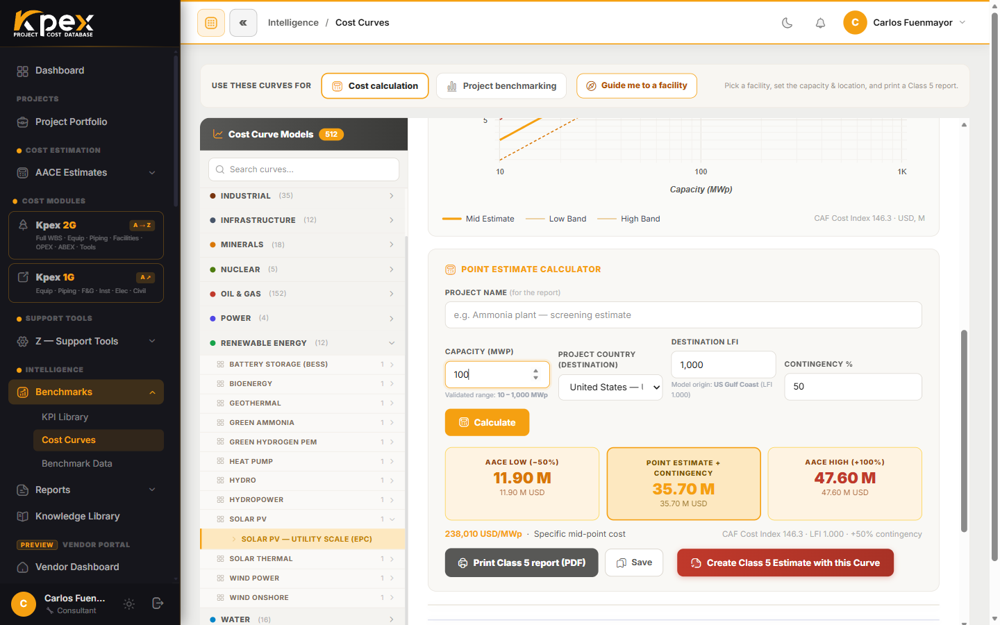

## En esta lección

- Vas a producir un estimado **Clase 5** completo siguiendo la receta de Kpex.
- Leerás el resultado con su banda de precisión, lo imprimirás y lo contrastarás con los rangos P10/P50/P90.
- Terminarás con un pequeño paquete de entregables, como harías con un cliente real.

## El caso

Una empresa de energía quiere saber, **en orden de magnitud**, cuánto costaría una **planta solar fotovoltaica a escala de servicio público de 100 MWp en Chile**. No hay ingeniería todavía: solo una tecnología, una capacidad y un país. Es exactamente el escenario de una Clase 5 (definición del 0–2%, precisión de −50% a +100%).

> **Importante:** no te damos las cifras. Los datos de Kpex se escalan cada mes y se calibran por país, así que tu resultado será el correcto **para hoy**. Anota lo que Kpex te devuelva.

## Paso a paso

### Paso 1 · Abre las curvas de costo
En la barra lateral, abre **Intelligence → Benchmarks → Cost Curves**.

### Paso 2 · Elige la facility
Usa el selector guiado **Guide me to a facility** y recorre **sector → familia → facility** hasta la curva de solar FV a escala de servicio público (**Solar PV — Utility Scale (EPC)**; su driver es la capacidad en **MWp**, con rango válido de 10 a 1000 MWp).

Antes de seguir, lee dos datos del panel: la unidad de capacidad y el **Validated range**. Tu capacidad debe estar dentro de ese rango.

### Paso 3 · Introduce los datos
- **Project name (for the report)**: por ejemplo, "Planta FV 100 MWp — screening".
- **Capacity**: `100`.
- **Project country (destination)**: **Chile**. Kpex rellena el **Destination LFI** y te muestra el **Model origin** del modelo.
- **Contingency %**: deja el valor propuesto para Clase 5.

### Paso 4 · Calcula
Pulsa **Calculate**. Kpex devuelve el costo total instalado con su banda y marca tu punto sobre la curva con una etiqueta de valor fija. Verás tres tarjetas: **AACE Low (−50%)**, **Point Estimate + Contingency** y **AACE High (+100%)**. La escalación al mes actual (Z.5) ya está incluida.

### Paso 5 · Imprime el reporte
Pulsa el botón **Class 5 report** (con icono de impresora) y guarda el reporte de una página. Si quieres conservar el cálculo, pulsa **Save**.

### Paso 6 · Contrasta con los rangos P10/P50/P90
Abre **Intelligence → Benchmarks → KPI Library** y busca el KPI **"Solar PV TIC per MWp"** (costo total instalado por MWp) de la familia solar FV. Divide tu punto estimado entre 100 MWp y comprueba dónde cae respecto de P10, P50 y P90.

### Paso 7 (opcional) · Conviértelo en un estimado
Vuelve a la curva y pulsa **Create Class 5 Estimate with this Curve**. Se abre el asistente de la lección 4.1 con la curva ya elegida. Completa las tarjetas, crea el estimado y genera su **Preview / Print PDF**.

## Tu tabla de resultados

Copia esta tabla y rellénala con lo que te devolvió Kpex:

| Dato | Tu resultado |
|---|---|
| Curva utilizada | |
| Rango válido de la curva | |
| País de origen del modelo y su LFI | |
| LFI de destino (Chile) | |
| Contingencia aplicada (%) | |
| AACE Low (−50%) | |
| Point Estimate + Contingency | |
| AACE High (+100%) | |
| Costo unitario (punto ÷ 100 MWp) | |
| P10 / P50 / P90 del KPI comparable | |
| ¿Tu costo unitario cae entre P10 y P90? | |

## Checklist de entregables

- [ ] Tabla de resultados completa.
- [ ] Reporte **Class 5 report** guardado.
- [ ] Una frase que explique dónde cae tu costo unitario frente a P10/P50/P90 y por qué.
- [ ] Una frase con los supuestos principales (tecnología, capacidad, país, mes del cálculo).
- [ ] (Opcional) Estimado Clase 5 creado en **AACE Estimates** con su PDF.

<!-- kpex-videos:start -->
## Míralo en Kpex

Recorridos breves de la plataforma real, grabados en el propio Kpex. Voz en inglés — pulsa CC en el reproductor para subtítulos en español o inglés.

<figure class="kpex-vid">
<iframe src="https://player.vimeo.com/video/1234328822?h=b2dc007046&title=0&byline=0&portrait=0&dnt=1&texttrack=es" title="Estimado Clase 5 por curva de capacidad" loading="lazy" allow="fullscreen; picture-in-picture" allowfullscreen></iframe>
<figcaption><strong>Chapter 1 · Estimado Clase 5 por curva de capacidad</strong> · 2:01</figcaption></figure>

<!-- kpex-videos:end -->

## Idea clave

> Una Clase 5 bien hecha no es "un número": es **un número con su banda**, **calibrado a un país y a un mes**, **contrastado con la historia** y **documentado en un reporte**.

## Pruébalo en Kpex (10 minutos más)

Repite el ejercicio cambiando **una sola variable**: primero la capacidad (por ejemplo, 300 MWp) y después el país. Anota cómo cambia el **costo unitario** con el tamaño y cómo cambia el total con el LFI. ¿Baja el costo por MWp al crecer la planta?
