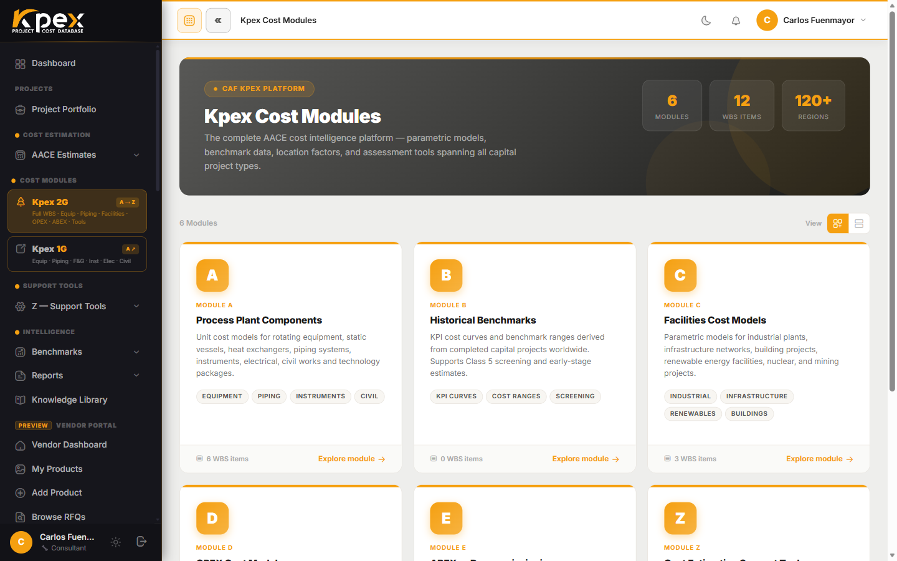

## En esta lección

- Qué es el Módulo A y qué tipo de costo devuelve.
- Los seis submódulos del Módulo A, de A.1 a A.6 (el montaje de los equipos está incluido en A.1).
- Por qué cada precio viene con base, material y banda de confianza.

## Qué es el Módulo A

El **Módulo A · Process Plant Components** es la capa más fina de Kpex: el costo de **equipos individuales** de una planta de proceso. Contiene **más de 700 modelos paramétricos de componentes**: bombas, compresores, recipientes, intercambiadores, transportadores y mucho más.

Cada modelo funciona igual:

1. Introduces los **parámetros de dimensionamiento** del equipo (su capacidad, tamaño o potencia), en sistema **métrico o imperial**.
2. Kpex devuelve un **rango de costo** con **límites de confianza estadísticos**, no un número único.

## Las subcategorías

El Módulo A se organiza en **seis submódulos de costo, de A.1 a A.6**. Cada submódulo tiene sus propios modelos de componente. El más detallado es A.1, con sus seis familias de equipos de proceso:

| Submódulo | Qué contiene |
|---|---|
| **A.1 Process Equipment** | La capa más fina del módulo: **A.1.1 Rotating** (compresores, bombas, turbinas, ventiladores, sopladores), **A.1.2 Static** (recipientes a presión, columnas, tanques, reactores), **A.1.3 Heat Transfer** (intercambiadores, hornos de fuego directo, enfriadores), **A.1.4 Material Handling** (transportadores, elevadores, separación), **A.1.5 Miscellaneous** (agitadores, filtración, secado) y **A.1.6 Technologic Packages** (paquetes de proceso) |
| **A.2 Piping** | Tubería y sus **siete familias** (~207 componentes): **A.2.1 Pipes** (tubos), **A.2.2 Valves** (válvulas), **A.2.3 Fittings** (accesorios), **A.2.4 Strainers** (filtros), **A.2.5 Hangers & Supports** (soportes), **A.2.6 Steam Specialties** (especialidades de vapor) y **A.2.7 Fabrication & Assembly** (fabricación y montaje, incl. *hot taps*) |
| **A.3 Fire & Gas** | Sistemas de detección y protección contra incendio y gas |
| **A.4 Instruments** | Instrumentación de campo y sistemas de control |
| **A.5 Electrical** | Equipos eléctricos y distribución de energía |
| **A.6 Civil Works** | Obra civil: **A.6.1** desarrollo del sitio, **A.6.2** edificaciones, **A.6.3** concreto, **A.6.4** mampostería y **A.6.5** acero estructural |

> **El montaje de los equipos está incluido en A.1.** Cada equipo de proceso viene con su **ISBL** instalado: el equipo más su montaje y los materiales a granel (bulks) que lo rodean. Por eso el elemento A.7 *Process Equipment Assemblies* del WBS no tiene submódulo propio en Kpex. Cuando el montaje ya está contratado, el de los equipos que se compran solo como suministro sale del ISBL y pasa al paquete del **subcontrato de montaje mecánico (instalación de equipos)**, valorado con la cotización del contratista. Es lo típico de un estimado **Clase 2**, pero también ocurre en una **Clase 3** cuando las negociaciones con el contratista EPC están adelantadas, y en las muchas variantes entre ambas. Lo que decide es el avance de la contratación, no la etiqueta de la clase: en Kpex se fija equipo por equipo con el **modo de suministro** de cada uno (solo suministro, suministro e instalación, o MOE).

Una nota práctica: en las **clases tempranas** no siempre se cotizan los *bulks* (tubería, instrumentación, electricidad y obra civil) pieza por pieza. También puedes estimarlos como **allowances** —una proporción del equipo mayor— con los factores **KPEX-HF** del Módulo B, que verás en la próxima lección.

## Tres propiedades de cada precio

### 1. Una base conocida
Todos los modelos del Módulo A se expresan con base **Costa del Golfo de EE. UU.** (LFI = 1,0) y **al mes actual**. El precio se escala automáticamente con el **CAF Cost Index**, así que no trabajas con una cifra vieja.

### 2. Sensible al material de construcción
El mismo equipo no cuesta lo mismo en acero al carbono que en acero inoxidable o en una aleación especial. Los modelos del Módulo A tienen en cuenta el **material de construcción**, por lo que elegirlo bien cambia el resultado.

### 3. Un rango, no un punto
Cada resultado incluye **límites de confianza estadísticos**. En un estimado temprano eso es exactamente lo que necesitas: saber no solo cuánto, sino con qué incertidumbre.

## Dónde lo encuentras

En la barra lateral, dentro de **Cost Modules**, el acceso **Kpex 2G** (A → Z) abre el árbol completo de módulos, incluido el Módulo A. El acceso **Kpex 1G** abre el catálogo de componentes (equipos, tuberías, F&G, instrumentación, electricidad, civil). Además, desde el espacio de trabajo de un estimado puedes añadir componentes del Módulo A con su cantidad y sus parámetros de tamaño; el costo llega con el ajuste de ubicación y de escalación ya aplicado.

## Idea clave

> El Módulo A te da el costo de **cada equipo**, dimensionado por ti, con **material**, **base al día** y **banda de confianza**. Es el ladrillo con el que se construyen los estimados más detallados.

## Pruébalo en Kpex (5 minutos)

1. Abre **Cost Modules → Kpex 2G** y entra en el Módulo A.
2. Elige una bomba centrífuga de **A.1.1 Rotating Equipment** e introduce una capacidad.
3. Anota el rango de costo que devuelve.
4. Cambia el material de construcción (si el modelo lo permite) y compara: ¿cuánto se mueve el rango?
5. Cambia el interruptor de unidades a imperial y comprueba que el costo no cambia, solo la forma de expresar los datos.
