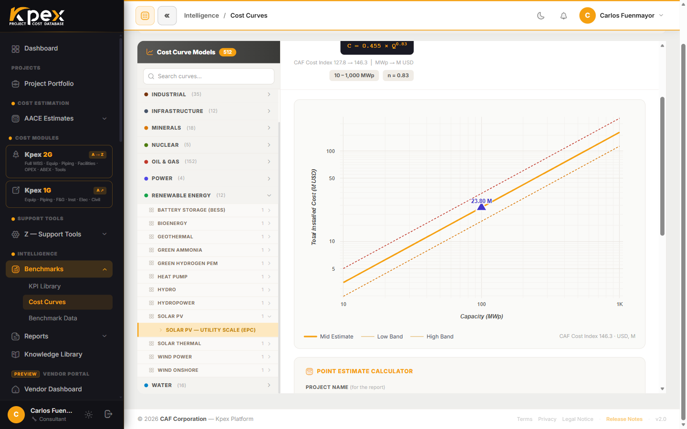

## En esta lección

- Qué es una curva de costo de ley de potencia, C = a·Q^n.
- Por qué las curvas de Kpex son *magnitude-aware*: el costo unitario baja con el tamaño.
- Los tres niveles de curva: **Component → Functional Unit → Facility**.
- La **KPI Library** (rangos bajo/medio/alto) y su pestaña **KPEX-HF** con matriz P10/P50/P90.

## El motor de screening Clase 5–4

El **Módulo B · Historical Benchmarks & Cost Curves** contiene **653 curvas de costo en 10 sectores (60 familias)**, validadas contra proyectos reales. Cubre plantas de proceso, infraestructura, offshore de petróleo y gas desglosado por componente, y líneas ferroviarias. Es la herramienta natural cuando todavía no tienes una lista de equipos: basta con la **capacidad**. Junto a las **Cost Curves**, el Módulo B reúne la **KPI Library**, **Construction Costs** y **Benchmark Data**, además de herramientas propias de **Offshore O&G** y **Railway**.

## La forma de la curva: C = a·Q^n

Cada curva sigue una **ley de potencia**:

- **C** es el costo total instalado.
- **Q** es la capacidad (barriles por día, MW, toneladas por año…).
- **a** es un coeficiente de escala y **n** el exponente.

Cuando **n es menor que 1**, el costo total crece **más despacio** que la capacidad. Consecuencia directa: el **costo por unidad de capacidad baja** a medida que la planta crece. Es la economía de escala que una tarifa plana (por ejemplo, "tantos dólares por MW para cualquier tamaño") no captura.

### Un ejemplo intuitivo (ilustrativo)

> Los números de este ejemplo son **ilustrativos**; no son valores de ninguna curva de Kpex.

Supón una curva con n = 0,6. Si duplicas la capacidad, el costo total se multiplica por 2^0,6 ≈ 1,52, no por 2. Tienes el doble de planta por un 52 % más de dinero, así que el **costo unitario** cae aproximadamente un 24 % (1,52 ÷ 2 ≈ 0,76). Por eso decimos que las curvas son **magnitude-aware**: el tamaño importa, y ningún ratio de costo por unidad es constante.

## Tres niveles de curva

| Nivel | Qué representa | Relación con otros módulos |
|---|---|---|
| **Component** | Una pieza o elemento constructivo | El nivel más bajo de la cadena; se agrupa en unidades funcionales |
| **Functional Unit** | Una unidad de proceso | Se ensambla con otras para formar una facility |
| **Facility** | Una planta completa | Corresponde uno a uno con un modelo del Módulo C |

Cada curva indica además su **país de origen** (para que el Location Factor se aplique en la dirección correcta) y lleva **escalación automática** al mes actual mediante el **Kpex Cost Index**.

## Cómo se usa

En la barra lateral, abre **Intelligence → Benchmarks → Cost Curves**:

1. Usa el selector **Guide me to a facility**: sector → familia → facility.
2. Introduce la capacidad y pulsa **Calculate**.
3. Kpex dibuja **tu punto sobre la curva** con su banda ±, y genera un **reporte de benchmarking** que puedes adjuntar a un estimado Clase 5.

## B.2: la KPI Library

La **KPI Library** reúne **KPIs de costo** (costo por tonelada de capacidad, por MW, por m²…) con su rango estadístico **bajo/medio/alto**, por tipo de proyecto, región y década. Se consulta en **Intelligence → Benchmarks → KPI Library**. Sirve como **prueba de realidad** antes de empezar a estimar en detalle: si tu número cae muy fuera del rango, algo merece revisión.

## KPEX-HF Allowances

Los **KPEX-HF bulk allowances** son la **4.ª pestaña de la KPI Library** (con su propia matriz **P10/P50/P90**): los factores que el Módulo A usa para estimar tubería, instrumentación, electricidad y civil como proporción del equipo mayor. Es un buen ejemplo de cómo los módulos se alimentan entre sí.

<!-- kpex-videos:start -->
## Míralo en Kpex

Recorridos breves de la plataforma real, grabados en el propio Kpex. Voz en inglés — pulsa CC en el reproductor para subtítulos en español o inglés.

<figure class="kpex-vid"><video controls preload="none" playsinline controlslist="nodownload" oncontextmenu="return false" poster="/wp-content/uploads/kpex-videos/Kpex2G_Module_B.jpg"><source src="/wp-content/uploads/kpex-videos/Kpex2G_Module_B.mp4" type="video/mp4"><track kind="subtitles" srclang="en" label="English" src="/wp-content/uploads/kpex-videos/Kpex2G_Module_B_EN.vtt"><track kind="subtitles" srclang="es" label="Español" src="/wp-content/uploads/kpex-videos/Kpex2G_Module_B_ES.vtt" default></video><figcaption><strong>Module B · Historical Project Cost Benchmarks</strong> · 1:52</figcaption></figure>
<figure class="kpex-vid"><video controls preload="none" playsinline controlslist="nodownload" oncontextmenu="return false" poster="/wp-content/uploads/kpex-videos/Kpex2G_B1_Cost_Curves.jpg"><source src="/wp-content/uploads/kpex-videos/Kpex2G_B1_Cost_Curves.mp4" type="video/mp4"><track kind="subtitles" srclang="en" label="English" src="/wp-content/uploads/kpex-videos/Kpex2G_B1_Cost_Curves_EN.vtt"><track kind="subtitles" srclang="es" label="Español" src="/wp-content/uploads/kpex-videos/Kpex2G_B1_Cost_Curves_ES.vtt" default></video><figcaption><strong>B.1 · Benchmark Cost Curves</strong> · 1:23</figcaption></figure>
<figure class="kpex-vid"><video controls preload="none" playsinline controlslist="nodownload" oncontextmenu="return false" poster="/wp-content/uploads/kpex-videos/Kpex2G_B2_KPI_Library.jpg"><source src="/wp-content/uploads/kpex-videos/Kpex2G_B2_KPI_Library.mp4" type="video/mp4"><track kind="subtitles" srclang="en" label="English" src="/wp-content/uploads/kpex-videos/Kpex2G_B2_KPI_Library_EN.vtt"><track kind="subtitles" srclang="es" label="Español" src="/wp-content/uploads/kpex-videos/Kpex2G_B2_KPI_Library_ES.vtt" default></video><figcaption><strong>B.2 · KPI Ranges Library</strong> · 1:42</figcaption></figure>
<figure class="kpex-vid"><video controls preload="none" playsinline controlslist="nodownload" oncontextmenu="return false" poster="/wp-content/uploads/kpex-videos/Kpex2G_B_Offshore_OG.jpg"><source src="/wp-content/uploads/kpex-videos/Kpex2G_B_Offshore_OG.mp4" type="video/mp4"><track kind="subtitles" srclang="en" label="English" src="/wp-content/uploads/kpex-videos/Kpex2G_B_Offshore_OG_EN.vtt"><track kind="subtitles" srclang="es" label="Español" src="/wp-content/uploads/kpex-videos/Kpex2G_B_Offshore_OG_ES.vtt" default></video><figcaption><strong>B.3 · Offshore Oil &amp; Gas Benchmarks</strong> · 1:19</figcaption></figure>
<figure class="kpex-vid"><video controls preload="none" playsinline controlslist="nodownload" oncontextmenu="return false" poster="/wp-content/uploads/kpex-videos/Kpex2G_B4_Railway.jpg"><source src="/wp-content/uploads/kpex-videos/Kpex2G_B4_Railway.mp4" type="video/mp4"><track kind="subtitles" srclang="en" label="English" src="/wp-content/uploads/kpex-videos/Kpex2G_B4_Railway_EN.vtt"><track kind="subtitles" srclang="es" label="Español" src="/wp-content/uploads/kpex-videos/Kpex2G_B4_Railway_ES.vtt" default></video><figcaption><strong>B.4 · Railway Benchmarks</strong> · 1:24</figcaption></figure>

<!-- kpex-videos:end -->

## Idea clave

> Una curva C = a·Q^n con n < 1 dice algo que una tarifa plana calla: **cuanto más grande el proyecto, menor el costo por unidad**. En Kpex, cada KPI debe leerse junto a la magnitud del proyecto.

## Pruébalo en Kpex (5 minutos)

1. Abre **Intelligence → Benchmarks → Cost Curves**.
2. Con **Guide me to a facility**, elige una facility cualquiera.
3. Calcula el costo para una capacidad Q y anota el resultado.
4. Repite con 2Q. Divide cada costo entre su capacidad: ¿baja el costo unitario?
5. Observa el nivel de la curva en la cadena **Component → Functional Unit → Facility** y cuál es su país de origen.
