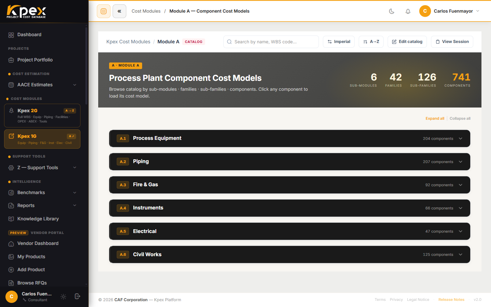

## En esta lección

- Qué es un modelo de facility y en qué se diferencia de un componente.
- Los seis sectores del Módulo C, de C.1 a C.6.
- Cómo se abre una facility elemento por elemento y por qué su curva Clase 5 es la suma de sus componentes.

## De un equipo a una planta completa

Si el Módulo A te da el costo de **un equipo**, el **Módulo C · Facilities Cost Models** te da el costo de **una instalación completa**: desde una planta solar fotovoltaica hasta los *topsides* de una FPSO offshore.

- **Entradas:** parámetros de la facility (capacidad, área, configuración).
- **Salidas:** **rangos de costo total instalado**.

Kpex contiene **150 modelos de facilities en 6 sectores**, alineados con las curvas de benchmark del Módulo B.

## Los seis sectores

| Sector | Subgrupos |
|---|---|
| **C.1 Industrial Process Plants** | Producción de petróleo y gas, refinerías, plantas químicas y farmacéuticas, centrales eléctricas, procesado de alimentos, acerías, tratamiento de aguas residuales |
| **C.2 Infrastructure** | Autopistas, ferrocarriles, túneles, ductos, transmisión eléctrica, subestaciones, acueductos, terminales marítimas |
| **C.3 Buildings** | Oficinas, hospitales, escuelas, hoteles, almacenes, aeropuertos, edificios de control industrial |
| **C.4 Renewable Energy** | Solar FV, eólica terrestre y marina, H₂ verde, H₂ azul, CSP, hidroeléctrica, baterías, geotermia, Power-to-X, sistemas híbridos |
| **C.5 Nuclear** | Instalaciones de centrales nucleares (metodología IAEA) |
| **C.6 Mining** | Minería a cielo abierto y subterránea, plantas de procesamiento de minerales |

## Elemento por elemento

Un modelo de facility no es una caja negra. Cada facility **se abre elemento por elemento**: desde la **cuenta del CBS** (*Cost Breakdown Structure*) hasta la **hoja**, el elemento más pequeño del desglose. Así ves de dónde sale cada parte del total y puedes discutirlo con tu equipo o con tu cliente.

## La curva Clase 5 = la suma de sus componentes

Aquí está la idea que conecta todo Kpex: la **curva de costo Clase 5 de una facility es igual a la suma de sus componentes validados**. Por eso las curvas de nivel **Facility** del Módulo B se corresponden uno a uno con los modelos del Módulo C.

Esto tiene una consecuencia práctica muy útil. Cuando tu proyecto madura y pasas de un estimado por capacidad (Clase 5) a uno con más definición, no cambias de "mundo": sigues trabajando sobre la misma estructura, ahora con más detalle.

| Si tienes… | Usa… |
|---|---|
| Solo la capacidad de la planta | La curva de nivel **Facility** (Módulo B) |
| Los parámetros de la facility y quieres ver el desglose | El modelo de facility (Módulo C) |
| La lista de equipos | Los componentes (Módulo A) |

## Dónde lo encuentras

- En la barra lateral, **Cost Modules → Kpex 2G** abre el árbol de módulos, donde está el Módulo C; desde ahí llegas a los estimadores de facilities (por ejemplo, *Onshore Oil & Gas*).
- Cada estimador es un asistente por pasos: completas el paso **Cost Drivers** (capacidad y configuración) y Kpex **genera automáticamente** el desglose en el paso **CBS — Cost Breakdown**, en la tabla **Cost Breakdown Structure (CBS) — AACE 18R-97**. No hay un botón aparte: el CBS aparece al completar los drivers.

## Idea clave

> El Módulo C es el puente entre la **curva** (Clase 5) y el **detalle**: una facility completa, abierta cuenta por cuenta, cuya curva es la suma de componentes validados.

## Pruébalo en Kpex (5 minutos)

1. Abre **Cost Modules → Kpex 2G** y entra en el Módulo C.
2. Elige un sector de la tabla (por ejemplo, **C.4 Renewable Energy**) y abre una facility.
3. Completa el paso **Cost Drivers** (capacidad y configuración) y anota el rango de costo total instalado.
4. Revisa el **CBS — Cost Breakdown** que se genera e identifica las tres cuentas que más pesan en el total.
5. Busca la misma facility en **Intelligence → Benchmarks → Cost Curves** y compara el orden de magnitud.
