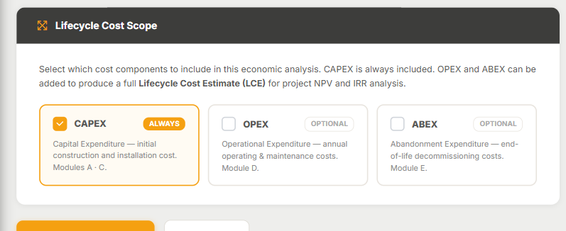

## En esta lección

- Por qué un estimado de CAPEX no cuenta toda la historia del activo.
- Qué cubre el Módulo D (OPEX) y qué cubre el Módulo E (ABEX).
- Cómo activar OPEX y ABEX en un estimado con el paso **Lifecycle Cost Scope** del asistente.

## Más allá del CAPEX

Construir una planta es solo el principio. Después hay que **operarla** durante décadas y, al final de su vida, **desmantelarla**. Los módulos A, B y C cubren la inversión inicial; los módulos D y E completan el ciclo de vida:

| Etapa del activo | Tipo de costo | Módulo |
|---|---|---|
| Construcción e instalación | **CAPEX** (*Capital Expenditure*) | A · B · C |
| Operación y mantenimiento | **OPEX** (*Operational Expenditure*) | **D** |
| Abandono y desmantelamiento | **ABEX** (*Abandonment Expenditure*) | **E** |

## Módulo D: OPEX

El **Módulo D · OPEX Models** contiene modelos de costo de operación para **facilities de petróleo y gas** (**D.1 Oil & Gas OPEX**). Cubre:

- OPEX **fijo** y **variable**.
- **Mantenimiento**.
- Benchmarks de **dotación de personal** para activos en producción.

## Módulo E: ABEX

El **Módulo E · Abandonment & Decommissioning Cost Models** cubre el ciclo completo de desmantelamiento. Es una capacidad poco común en el mercado, y abarca tanto la energía convencional como las tecnologías renovables y nuevas, incluido el hidrógeno.

| Grupo | Alcance |
|---|---|
| **E.1** | Petróleo y gas (onshore y offshore) |
| **E.2** | Plantas de proceso |
| **E.3** | Energías renovables: eólica, solar FV, H₂ verde, H₂ azul, híbridos y Power-to-X |
| **E.4** | Minería |
| **E.5** | Nuclear |

Ambos módulos se abren desde **Cost Modules → Kpex 2G**, junto a los módulos A, B y C: el **estimador D.1 (OPEX)** y los **catálogos E.1–E.5 (ABEX)** —onshore, offshore, proceso, renovables, minería y nuclear—. Requieren nivel **Professional** o superior.

## Activar OPEX y ABEX en un estimado

En el **Estimate Wizard**, el quinto paso se llama **Lifecycle Cost Scope**. Ahí decides qué componentes incluye el análisis:

- **CAPEX** está marcado como **ALWAYS**: siempre se incluye.
- **OPEX** es **OPTIONAL**: al activarlo entra en juego el Módulo D.
- **ABEX** es **OPTIONAL**: al activarlo entra en juego el Módulo E.

Si activas OPEX o ABEX, aparece el campo **Plant / Facility Lifetime**: la vida útil de la planta en años, que Kpex usa para el cálculo del VPN (NPV) y para descontar el ABEX. El propio asistente muestra rangos típicos como orientación según el tipo de activo.

Con CAPEX + OPEX + ABEX obtienes un **Lifecycle Cost Estimate (LCE)**, la base para un análisis de VPN y TIR del proyecto. Más adelante, el **Project Portfolio Report** muestra qué banderas (CAPEX/OPEX/ABEX) tiene cada estimado.

## ¿Para quién es esto?

- **Dueños, operadores y petroleras nacionales**, que necesitan el costo total del activo y no solo el de construirlo.
- **Equipos de factibilidad**, que comparan alternativas cuya inversión inicial es parecida pero cuya operación o desmantelamiento no lo son.
- Proyectos **offshore, mineros o nucleares**, donde el ABEX puede ser una cifra muy relevante.

## Idea clave

> Un proyecto no termina cuando se construye. Con los módulos **D (OPEX)** y **E (ABEX)** llevas el mismo rigor desde el primer estimado de CAPEX hasta el **desmantelamiento final**.

## Pruébalo en Kpex (4 minutos)

1. Abre **Cost Estimation → AACE Estimates → New Estimate** y avanza hasta el paso **Lifecycle Cost Scope**.
2. Activa **OPEX** y **ABEX** y observa cómo aparece el campo **Plant / Facility Lifetime**.
3. Lee los rangos típicos de vida útil que sugiere el asistente y elige uno coherente con tu tipo de facility.
4. Desactiva ambos y comprueba que **CAPEX** sigue marcado: no se puede quitar.
