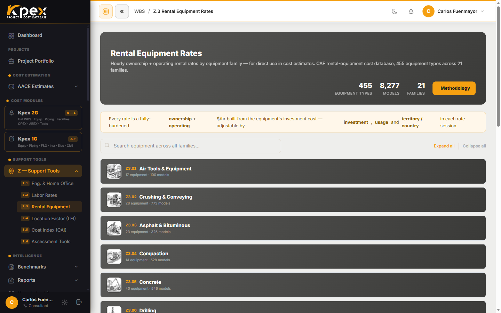

## En esta lección

- Qué es el Módulo Z y por qué se llama "capa de calibración".
- **Z.1**: tarifas de ingeniería y oficina central (home office).
- **Z.2**: tarifas de mano de obra de construcción.
- **Z.3**: tarifas de equipos de construcción en alquiler.

## El Módulo Z: la capa de calibración

Los módulos A a E aportan el **dato de costo**. El **Módulo Z** contiene las herramientas analíticas que hacen que ese dato sirva para **cualquier geografía y cualquier momento**. No son complementos opcionales: sostienen cada estimado de Kpex.

Todas están en la barra lateral, en **Support Tools → Z — Support Tools**:

| Entrada del menú | Herramienta |
|---|---|
| **Z.1 Eng. & Home Office** | Ingeniería y oficina central |
| **Z.2 Labor Rates** | Mano de obra de construcción |
| **Z.3 Rental Equipment** | Equipos de alquiler |
| **Z.4 Location Factor (LFI)** | Factor de ubicación (lección 6.2) |
| **Z.5 Cost Index (CAI)** | Índice de costos (lección 6.3) |
| **Z.6 Assessment Tools** | Evaluaciones (lección 6.4) |

En esta lección vemos las tres primeras: las que convierten **horas y máquinas en dinero**.

## Z.1 — Ingeniería y oficina central

Todo proyecto necesita ingeniería, compras y gestión de la construcción: el componente **EPCM** (*Engineering, Procurement and Construction Management*). **Z.1** ofrece **tarifas de referencia** por disciplina de ingeniería (proceso, mecánica, civil, eléctrica, instrumentación, gestión de proyectos) y los **gastos generales de la oficina central**.

¿Para qué sirve? Para construir la partida de EPCM de un estimado **sin contar horas-hombre en detalle**, algo muy útil en las clases tempranas.

## Z.2 — Tarifas de mano de obra de construcción

**Z.2** es una base de datos de **composición de cuadrillas** y **tarifas de mano de obra** por disciplina y por país o región.

| Entradas | Salida |
|---|---|
| Oficio, jurisdicción, turno, horas extra | **Tarifa de cuadrilla totalmente cargada** por hora-hombre o por día-cuadrilla |

"Totalmente cargada" significa que incluye **salarios directos + cargas sociales + alojamiento en obra + supervisión**. Es imprescindible en estimados de **Clase 3 o más detallados**, donde la mano de obra deja de ser un porcentaje y pasa a calcularse.

## Z.3 — Tarifas de equipos de alquiler

**Z.3** es un catálogo navegable de tarifas de alquiler de **equipos de construcción**, organizado por **familia** (excavación, izaje, compactación, bombeo, herramientas neumáticas y más).

Así se usa:

1. **Expande una familia** para ver sus tarjetas de equipos.
2. **Abre un equipo**: se inicia una sesión de cálculo de tarifa.
3. Kpex construye la tarifa **por hora, día, semana y mes** a partir del **costo de inversión** de la máquina (**propiedad + operación**).
4. Ajusta las opciones de **capacidad y especificación**: cambian el precio.

Las tarifas se **escalan al periodo actual** con el CAF Cost Index **por familia de equipo** y se pueden ajustar por **territorio o país**. Además, Z.3 se integra con Z.2 para construir **tarifas diarias de costo de construcción** (máquina + cuadrilla).

## Cómo encajan las tres

| Pregunta del estimador | Herramienta |
|---|---|
| ¿Cuánto cuesta la ingeniería y la gestión? | **Z.1** |
| ¿Cuánto cuesta una hora de cuadrilla en este país? | **Z.2** |
| ¿Cuánto cuesta tener esta grúa un mes? | **Z.3** |

## Idea clave

> Z.1, Z.2 y Z.3 traducen **disciplinas, cuadrillas y máquinas** a tarifas escaladas al día y ajustadas a tu ubicación. Son la base de los costos indirectos y de construcción cuando el estimado gana definición.

## Pruébalo en Kpex (5 minutos)

1. Abre **Support Tools → Z — Support Tools → Z.3 Rental Equipment**.
2. Expande una familia (por ejemplo, izaje) y abre un equipo.
3. Anota su tarifa diaria y mensual.
4. Cambia una opción de capacidad o especificación: ¿cuánto se mueve la tarifa?
5. Cambia el territorio o país y observa el efecto.
6. Por último, abre **Z.2 Labor Rates** y localiza la tarifa de un oficio en tu país.

<!-- VERIFY: nombres exactos de los controles de territorio/país en Z.3 y de los campos de entrada en Z.1 y Z.2 -->
