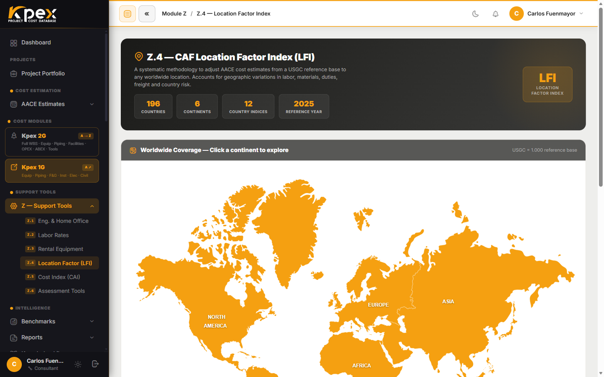

## En esta lección

- Qué es el **CAF LFI** y por qué la Costa del Golfo de EE. UU. vale 1,000.
- La fórmula E = A × (B + C + D) / 3 y qué significa cada factor.
- Cómo Kpex aplica el factor de **origen a destino**.
- El manual de país y cómo aplicar el LFI a todo el estimado o por partida.

## Qué es el LFI

El **CAF LFI (Location Factor Index)** ajusta cualquier costo base a cualquier lugar del mundo. Es uno de los dos motores que mantienen al día toda la base de datos de Kpex: este se ocupa de la **geografía** (el otro, el Cost Index, del tiempo).

| Característica | Detalle |
|---|---|
| **Cobertura** | **197 países** en 6 continentes (Z.4.1–Z.4.6) |
| **Base** | Costa del Golfo de EE. UU. = **LFI 1,000** (el punto de referencia estándar de AACE) |
| **Lectura** | Mayor que 1,0 → más caro que la Costa del Golfo; menor que 1,0 → más barato |

## La fórmula: E = A × (B + C + D) / 3

El factor final de cada país (**E**) combina cuatro factores:

| Factor | Qué mide |
|---|---|
| **A** | Factores del país (*country drivers*) |
| **B** | Compras, aranceles y flete |
| **C** | Mano de obra |
| **D** | Ingeniería |

Es decir: se **promedian** compras, mano de obra e ingeniería, y el resultado se **multiplica** por los factores propios del país.

## De origen a destino

No todos los modelos de costo están calibrados en la Costa del Golfo. Algunos se construyeron con datos de otro país. Por eso Kpex guarda el **país de origen** de cada modelo y aplica:

**Factor aplicado = LFI(destino) ÷ LFI(origen)**

Cuando eliges el **país de tu proyecto**, Kpex mueve el costo desde el origen real del modelo hasta tu ubicación, aplicando el inverso cuando el origen no es la Costa del Golfo.

### Un cálculo ilustrativo

> **Atención:** todos los números de este ejemplo son **inventados y redondos**, solo para entender la mecánica. **No son factores reales de Kpex.**

**Paso 1 — el LFI de un país ficticio "Destinolandia":**
A = 1,10 · B = 1,20 · C = 0,90 · D = 1,20

E = 1,10 × (1,20 + 0,90 + 1,20) / 3 = 1,10 × 1,10 = **1,21**

**Paso 2 — un modelo calibrado en "Origenlandia"**, cuyo LFI es 1,10, con un costo base de 10 millones de USD.

Factor aplicado = 1,21 ÷ 1,10 = **1,10**

Costo en Destinolandia = 10 × 1,10 = **11 millones de USD**

Si el mismo modelo estuviera calibrado en la Costa del Golfo (LFI 1,000), el factor sería 1,21 y el costo, 12,1 millones. El origen importa.

## El manual de país

Para cada país, Kpex ofrece un **dossier completo**: los factores, los datos de compras, mano de obra e ingeniería, un perfil del país con bandera y mapa de sus ciudades principales, y **grandes proyectos recientes con su CAPEX publicado**.

## Cómo se aplica en un estimado

- **Globalmente**: el país que eliges en el paso **Basis of Estimate** del Estimate Wizard define el LFI por defecto de todo el estimado.
- **Por partida**: en proyectos con varias ubicaciones, puedes ajustar el LFI de cada partida por separado en el **WBS Builder**.

¿Tu país o región no tiene factor estándar? La herramienta **Z.6.1 LFI Assessment** construye un LFI a medida (lección 6.4).

<!-- kpex-videos:start -->
## Míralo en Kpex

Recorridos breves de la plataforma real, grabados en el propio Kpex. Voz en inglés — pulsa CC en el reproductor para subtítulos en español o inglés.

<figure class="kpex-vid"><video controls preload="none" playsinline controlslist="nodownload" oncontextmenu="return false" poster="/wp-content/uploads/kpex-videos/Kpex2G_Z4_Location_Factor.jpg"><source src="/wp-content/uploads/kpex-videos/Kpex2G_Z4_Location_Factor.mp4" type="video/mp4"><track kind="subtitles" srclang="en" label="English" src="/wp-content/uploads/kpex-videos/Kpex2G_Z4_Location_Factor_EN.vtt"><track kind="subtitles" srclang="es" label="Español" src="/wp-content/uploads/kpex-videos/Kpex2G_Z4_Location_Factor_ES.vtt" default></video><figcaption><strong>Z.4 · Location Factor</strong> · 1:49</figcaption></figure>

<!-- kpex-videos:end -->

## Idea clave

> El LFI no es solo "cuánto más caro es aquí": es un factor **de origen a destino**, **LFI(destino) ÷ LFI(origen)**, construido con país, compras, mano de obra e ingeniería.

## Pruébalo en Kpex (5 minutos)

1. Abre **Support Tools → Z — Support Tools → Z.4 Location Factor (LFI)**.
2. Navega por el mapa hasta tu país y abre su página.
3. Anota su LFI e identifica los factores A, B, C y D.
4. Repite con otro país y calcula a mano el factor para mover un costo del primero al segundo (destino ÷ origen).
5. En la página del país, pulsa **⬇ PDF Report** para abrir su dossier y localiza la sección de grandes proyectos recientes.
