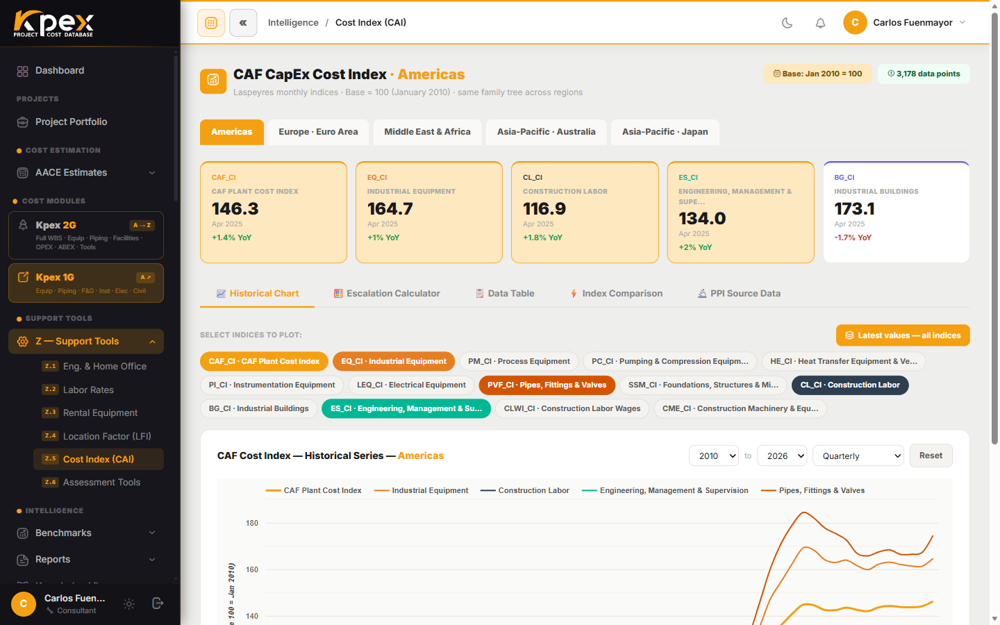

## En esta lección

- Qué es el **Kpex Cost Index** y en qué se diferencia de los índices anuales.
- Los subíndices por familia y por qué importan.
- Cómo se aplica la escalación **automáticamente al leer**.
- Las regiones disponibles y el modo de comparación entre dos periodos.

## El segundo motor: el tiempo

El **Kpex Cost Index** es la base de datos propia de Kpex para la **escalación de costos**. Si el LFI mantiene los costos al día en **geografía**, el Cost Index lo hace en **tiempo**.

Frente a índices anuales como CEPCI o ENR, tiene dos ventajas:

1. Se actualiza **cada mes**.
2. Se desagrega en **subíndices por familia**, así que cada componente de costo escala con el índice que realmente lo mueve.

## Aplicado automáticamente, al leer

Este es el punto más importante: **no hay que pulsar ningún botón**. El catálogo muestra los precios **"current to"** el mes actual y se vuelve a calcular solo cada vez que el índice se actualiza. Lo que ves siempre está en dinero de hoy.

## Los subíndices

| Subíndice | Qué cubre |
|---|---|
| **CAF_CI (Composite)** | Índice compuesto general; se usa como factor único cuando no hace falta el desglose |
| **EQ (Equipment)** | Fabricación y compra de equipos de proceso |
| **ST (Structural Steel)** | Fabricación y montaje de acero estructural |
| **PI (Piping)** | Materiales e instalación de tubería |
| **EL (Electrical)** | Equipos eléctricos y cableado |
| **IN (Instrumentation)** | Sistemas de control, instrumentos, analizadores |
| **CV (Civil)** | Concreto, obra civil y movimiento de tierras |
| **LB (Labor)** | Tarifas de mano de obra de construcción (base Costa del Golfo) |
| *+6 subíndices adicionales* | Aislamiento, pintura, mecánica, ingeniería, gestión de proyectos y costos indirectos |

Esta lista es ilustrativa: el conjunto vigente se muestra en la propia herramienta.

## Multirregión

Además del índice original de **Americas**, hay índices regionales para **Europe (Euro Area)**, **Asia-Pacific**, **Japan** y **Middle East & Africa**. Cada uno se construye con las estadísticas oficiales de su región, con el mismo método y el mismo árbol de familias. Así la escalación refleja **de dónde viene realmente el equipo** del proyecto.

| Región | Fuente principal |
|---|---|
| Americas | US Bureau of Labor Statistics (PPI) |
| Europe / Euro Area | Eurostat |
| Asia-Pacific | ABS (Australia) |
| Japan | e-Stat |
| Middle East & Africa | Estadísticas regionales |

Todas se combinan con la metodología compuesta propia de CAF. **Periodo base: 2010 = 100**, con datos mensuales desde 2010 hasta hoy. Si una región aún no está activa, su página lo indica como *on the roadmap*.

## Qué puedes hacer en la herramienta

La encuentras en **Support Tools → Z — Support Tools → Z.5 Kpex Cost Index**. Está organizada en pestañas:

- **Historical Chart**: la serie histórica; eliges los subíndices a graficar (chips *Select Indices to Plot*), el rango de años (**From / To**) y la granularidad (anual, trimestral o mensual).
- **Escalation Calculator**: calcula el **factor de escalación entre dos periodos** para un importe.
- **Data Table**: los valores mensuales del índice.
- **Index Comparison**: compara **todos los subíndices lado a lado** (tabla de promedios anuales y crecimiento acumulado 2010 → hoy).
- **PPI Source Data**: las series oficiales que componen los subíndices.

También puedes generar un **snapshot imprimible** de los últimos valores.

## Idea clave

> El Kpex Cost Index es **mensual**, **por familia** y **multirregión**, y se aplica **solo, al leer**. Por eso en Kpex nunca trabajas con una cifra vieja.

## Pruébalo en Kpex (5 minutos)

1. Abre **Support Tools → Z — Support Tools → Z.5 Kpex Cost Index**.
2. En **Historical Chart**, compara la evolución de **EQ** y **LB**: ¿cuál ha subido más desde 2010?
3. Ve a **Escalation Calculator**, elige dos periodos separados cinco años y anota el factor de escalación.
4. Cambia de región (por ejemplo, a **Europe (Euro Area)**) y repite. ¿Sale el mismo factor?
