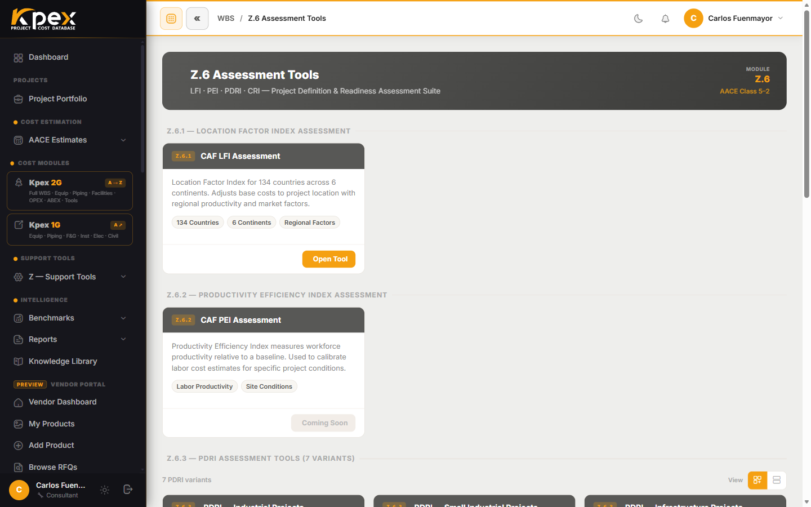

<!-- kpex-intro:start -->
<figure class="kpex-vid kpex-intro"><video controls preload="none" playsinline controlslist="nodownload" oncontextmenu="return false" poster="/wp-content/uploads/kpex-videos/Kpex2G_Z6_Assessment_Tools.jpg"><source src="/wp-content/uploads/kpex-videos/Kpex2G_Z6_Assessment_Tools.mp4" type="video/mp4"><track kind="subtitles" srclang="en" label="English" src="/wp-content/uploads/kpex-videos/Kpex2G_Z6_Assessment_Tools_EN.vtt"><track kind="subtitles" srclang="es" label="Español" src="/wp-content/uploads/kpex-videos/Kpex2G_Z6_Assessment_Tools_ES.vtt" default></video><figcaption><strong>Z.6 · Assessment Tools</strong> · 1:33</figcaption></figure>
<!-- kpex-intro:end -->

## En esta lección

- Las cuatro evaluaciones de Z.6: **LFI Assessment**, **PEI**, **PDRI** y **CRI**.
- Qué pregunta responde cada una y qué entrega.
- Las 7 variantes del PDRI y cómo leer su puntuación.

## Medir lo que no es costo

Los módulos de costo te dicen **cuánto**. Las evaluaciones de **Z.6** te dicen **con qué grado de confianza**: qué tan definido está el proyecto, qué tan productiva será la mano de obra, qué tan listo está para construirse o qué factor de ubicación usar donde no existe uno estándar. Son la evidencia metodológica que respalda un estimado.

Las encuentras en **Support Tools → Z — Support Tools → Z.6 Assessment Tools**.

## Las cuatro herramientas

| Herramienta | Para qué sirve | Qué entrega |
|---|---|---|
| **Z.6.1 · LFI Assessment** | Construir un factor de ubicación a medida para países o regiones que no están en la base estándar de Z.4 | LFI personalizado + reporte PDF |
| **Z.6.2 · PEI Assessment** | *Productivity Efficiency Index*: cuantifica la diferencia de productividad de la mano de obra de construcción frente a la Costa del Golfo de EE. UU. | Factor PEI (rango típico 0,5–2,5) |
| **Z.6.3 · PDRI Assessment** | *Project Definition Rating Index*, según la práctica AACE: mide el nivel de definición del proyecto | Puntuación PDRI (0–1000, **menor es mejor**) + análisis de brechas |
| **Z.6.4 · CRI Assessment** | *Construction Readiness Index*: evalúa si el paquete de construcción está lo bastante completo para movilizar con la precisión objetivo | Puntuación CRI + reporte de brechas de preparación |

## El PDRI en detalle

El PDRI es la evaluación que más usarás, porque conecta directamente con la **clase AACE** de tu estimado: cuanto mejor definido está el proyecto, más estrecho puede ser el rango de precisión que declaras.

### Siete variantes

Z.6.3 incluye **7 variantes independientes**, cada una con el cuestionario AACE que le corresponde:

| Industrial | Infraestructura | Edificios | Petróleo y gas |
|---|---|---|---|
| **Industrial** | **Infrastructure** | **Buildings** | **Oil & Gas EPC** |
| **Small Industrial** | **Small Infrastructure** | **Small Buildings** | |

Kpex **puntúa y pondera** las respuestas automáticamente. El PDF de salida incluye la **matriz de puntuación completa** y una sección de **recomendaciones**. La variante industrial, por ejemplo, consta de **70 elementos** agrupados en **15 categorías** y **3 secciones**.

### Cómo leer la puntuación

La escala va de **0 a 1000** y **menos es mejor**: una puntuación baja significa que quedan pocas indefiniciones. No es un examen que se aprueba con nota alta, sino un mapa de lo que falta por definir.

### Cómo se ejecuta

Cada variante se abre con el botón **Start**. A medida que respondes el cuestionario, el panel **Live PDRI Score** actualiza la puntuación **en vivo** y marca los **umbrales 200 y 600** (por debajo de 200, el proyecto está muy definido); al guardar, Kpex recalcula y conserva el total. El PDRI es una herramienta **independiente** (Z.6.3): su PDF te sirve como **evidencia metodológica** de la clase AACE que declaras, y lo conservas **junto** a tu estimado. Por ahora se ejecuta por separado (no se adjunta automáticamente al reporte del estimado).

## Cuándo usar cada una

| Situación | Herramienta |
|---|---|
| Vas a declarar la clase de un estimado y quieres justificarla | **PDRI** |
| Construyes en un país con productividad muy distinta a la de referencia | **PEI** |
| El proyecto está por movilizar a obra | **CRI** |
| Tu ubicación no tiene LFI estándar | **LFI Assessment** |

En la misma página de Z.6 encontrarás también la **CAF Accuracy Calculator**, que completa la batería de evaluaciones.

## Idea clave

> Z.6 convierte el juicio del estimador en **evidencia medible**. Un PDRI bajo (menor es mejor) respalda la clase AACE que declaras en tu estimado.

## Pruébalo en Kpex (6 minutos)

1. Abre **Support Tools → Z — Support Tools → Z.6 Assessment Tools**.
2. Elige la variante PDRI que mejor encaje con un proyecto que conozcas (por ejemplo, **Small Industrial**).
3. Responde las primeras secciones del cuestionario y observa cómo cambia la puntuación.
4. Identifica en el análisis de brechas los dos elementos que más penalizan tu puntuación.
5. Repasa la tabla de esta lección y decide qué otra evaluación necesitaría ese proyecto.
