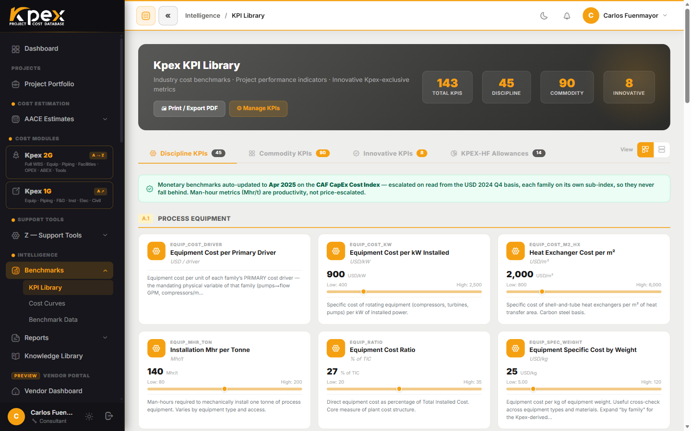

## En esta lección

- Qué encuentras en **Intelligence → Benchmarks** y para qué sirve cada herramienta.
- Cómo calcular un costo con una curva (B.1) y contrastarlo con los rangos P10/P50/P90 (B.2).
- Qué es el **Global CAPEX Monitor** y cómo usarlo como radar de proyectos.

## Benchmarks: la historia como referencia

En el grupo **Intelligence** de la barra lateral, el menú **Benchmarks** reúne dos tipos de referencia histórica de costos. Juntas son el motor de *screening* de las Clases 5 y 4: te dicen cuánto *debería* costar algo antes de que exista un diseño.

| Herramienta | Qué te da | Pregunta que responde |
|---|---|---|
| **B.1 · Cost Curves** | Curvas de costo total instalado vs. capacidad (`costo = a · capacidad^n`) | "¿Cuánto cuesta una planta de este tamaño?" |
| **B.2 · Rangos de KPIs** | Rangos estadísticos **P10/P50/P90** de KPIs de costo (por tonelada, por MW, por m²…) | "¿Mi número es razonable comparado con proyectos reales?" |

En el menú **Benchmarks** verás las entradas **KPI Library**, **Cost Curves**, **Construction Costs** y **Benchmark Data**. B.2 (los rangos de KPIs) vive en **KPI Library**; **Benchmark Data** es el listado de proyectos históricos de referencia.

## B.1 · Cost Curves: calcular y comparar

Cada curva muestra cómo escala el costo total instalado con la capacidad ($/bbl/día en una refinería, $/kW en una central eléctrica):

1. Abre **Intelligence → Benchmarks → Cost Curves**.
2. Usa el selector guiado **Guide me to a facility**: te lleva de **sector → familia → facility**.
3. Introduce la **capacidad** y pulsa **Calculate**.
4. Kpex dibuja **tu punto sobre la curva**, con su etiqueta de valor fija y la **banda ±** alrededor.
5. Imprime el **reporte de benchmarking** de una página y adjúntalo a tu estimado Clase 5.

Tres detalles que conviene conocer:

- **Las curvas entienden la magnitud.** Como el exponente *n* es menor que 1, el costo **por unidad** baja a medida que el proyecto crece. Una tarifa plana ($/unidad fija) no captura ese efecto.
- **Cada curva tiene un nivel**: **Facility** (una planta completa, en correspondencia uno a uno con un modelo del Módulo C) o **Functional Unit** (una unidad de proceso que se ensambla dentro de una facility).
- **Cada curva lleva su país de origen**, para que el Location Factor (Z.4) apunte en la dirección correcta, y su escalación viva con el Cost Index (Z.5).

## B.2 · Rangos P10/P50/P90

Los rangos de KPIs te dan una **comprobación de realidad** antes del estimado detallado. Se presentan por tipo de proyecto, región y década:

- **P10**: el extremo bajo; solo el 10 % de los proyectos costó menos.
- **P50**: la mediana, el valor "típico".
- **P90**: el extremo alto; solo el 10 % costó más.

Si tu estimado cae fuera de la franja P10–P90, no significa que esté mal, pero sí que debes poder justificar por qué.

## Global CAPEX Monitor: el radar de proyectos

El **Global CAPEX Monitor** es un **registro público** de grandes proyectos industriales, energéticos y de infraestructura de todo el mundo. Está organizado **por país**, y cada proyecto muestra su **CAPEX anunciado** y su capacidad. Al abrir un proyecto ves su **desglose por áreas**.

Muestra **dónde se está comprometiendo capital** y es el conjunto de referencia detrás de las curvas de benchmark. Lo encuentras en el sitio web público, en el menú **Insights → Global CAPEX Monitor**. Sin una membresía activa verás solo una vista previa de los **primeros cinco países**; con una **membresía activa (a partir del nivel Practitioner)** se abre el registro completo.

## Idea clave

> Primero **calcula** con la curva (B.1), después **contrasta** con los rangos P10/P50/P90 (B.2) y usa el **Global CAPEX Monitor** para ver qué se está construyendo de verdad en el mundo.

## Pruébalo en Kpex (5 minutos)

1. Abre **Intelligence → Benchmarks → Cost Curves** y usa **Guide me to a facility** para elegir una facility de tu sector.
2. Introduce una capacidad, pulsa **Calculate** y anota el costo y la banda ±.
3. Duplica la capacidad y vuelve a calcular. ¿Se duplicó el costo total? ¿Qué pasó con el costo por unidad?
4. Abre el **Global CAPEX Monitor**, elige un país y abre un proyecto para ver su desglose por áreas.
