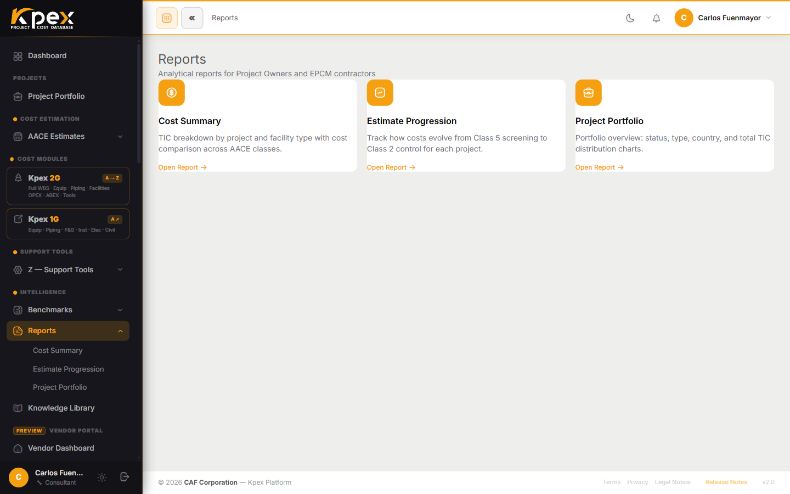

## En esta lección

- Dónde están los reportes de portafolio y qué contiene cada uno.
- Qué reporte elegir según la pregunta que te hagan.
- Por qué los reportes cuentan **estimados** y no proyectos.

## Del estimado individual a la vista de portafolio

Hasta ahora has trabajado un estimado a la vez. Pero un gerente de costos o un director de proyecto rara vez pregunta por un solo número: quiere saber **cuánto suma todo**, **cómo ha evolucionado** y **en qué estado está cada proyecto**. Para eso existen los reportes.

Ve a **Intelligence → Reports** en la barra lateral. Encontrarás tres reportes ya construidos que leen directamente tus estimados:

| Reporte | Qué contiene | Mejor uso |
|---|---|---|
| **Cost Summary** | Desglose de costos consolidado de todos tus estimados: por proyecto, clase, disciplina y elemento de costo. Vista tipo tabla dinámica | Reportar el costo del portafolio a la dirección; resúmenes de costo para clientes |
| **Estimate Progression** | Cómo evoluciona el costo de un proyecto **a medida que avanza de clase** (Clase 5 → 2): un punto por estimado, ubicado por su clase AACE | Ver cómo se estrecha el estimado al madurar el proyecto |
| **Project Portfolio** | Resumen de todos los proyectos activos y archivados: estado, clase AACE, indicadores de alcance del ciclo de vida (CAPEX/OPEX/ABEX) y rangos de exactitud | Visión general de gestión de proyectos; estado de costo a nivel de programa |

> **Nota.** Estos tres son reportes **de portafolio** (varios estimados a la vez). No los confundas con los reportes de **un solo estimado o sesión** que viste en el Módulo 4: el **reporte Kpex 1G** (de la sesión) y el **reporte Kpex 2G** (por estimado), ambos libros de **Excel con tu marca**. Aquí subimos un nivel: del estimado individual al conjunto del portafolio.

## ¿Qué reporte uso?

Una forma práctica de elegir es partir de la pregunta:

- **"¿Cuánto suma todo lo que tenemos en cartera, por disciplina?"** → **Cost Summary**.
- **"¿Cómo cambió el costo al pasar de una clase a la siguiente?"** → **Estimate Progression**.
- **"¿En qué punto está cada proyecto del programa?"** → **Project Portfolio**.

### Cost Summary: la foto consolidada

Funciona como una tabla dinámica: puedes ver el mismo conjunto de estimados agrupado por proyecto, por clase, por disciplina o por elemento de costo. Es el reporte que llevas a una reunión de dirección.

### Estimate Progression: la maduración por clase

Un proyecto madura: empieza como un *screening* Clase 5 y, con más definición, pasa a Clase 3 y luego a Clase 2. Este reporte coloca **cada estimado del proyecto según su clase AACE** (5 → 2) y traza cómo cambia el costo al ganar definición. Un punto nuevo aparece cuando **creas un nuevo estimado de otra clase**, no al editar uno existente. Es tu evidencia cuando un auditor o un cliente pregunta **cómo cambió el número al madurar el proyecto**.

### Project Portfolio: el tablero del programa

Muestra todos los proyectos, activos y archivados, con su estado, su clase AACE, los indicadores de CAPEX/OPEX/ABEX que marcaste en el asistente y el rango de exactitud de cada estimado.

## Estimados, no proyectos

Recuerda lo que viste en el Módulo 4: la clase AACE pertenece al **estimado**, no al proyecto. Un mismo proyecto puede tener un Clase 5 de hoy y un Clase 3 de más adelante. Por eso los reportes y los gráficos de portafolio **agrupan y cuentan estimados por clase**, en lugar de sellar el proyecto con una sola clase. El resultado es una imagen más fiel de dónde está realmente el trabajo.

## Idea clave

> **Cost Summary** responde *cuánto*, **Estimate Progression** responde *cómo cambió* y **Project Portfolio** responde *dónde estamos*. Los tres se alimentan de tus estimados, así que un buen reporte empieza por estimados bien clasificados.

## Pruébalo en Kpex (4 minutos)

1. Abre **Intelligence → Reports → Cost Summary** y localiza el estimado Clase 5 que creaste en el Módulo 4.
2. Si el proyecto tiene más de un estimado (por ejemplo, un Clase 5 y un Clase 4), ábrelos; si no, crea un segundo estimado de otra clase.
3. Abre **Estimate Progression** y observa cómo los estimados del proyecto se ubican por su **clase AACE** (5 → 2).
4. Abre **Project Portfolio** y revisa la clase, el alcance del ciclo de vida y el rango de exactitud de tu proyecto.
