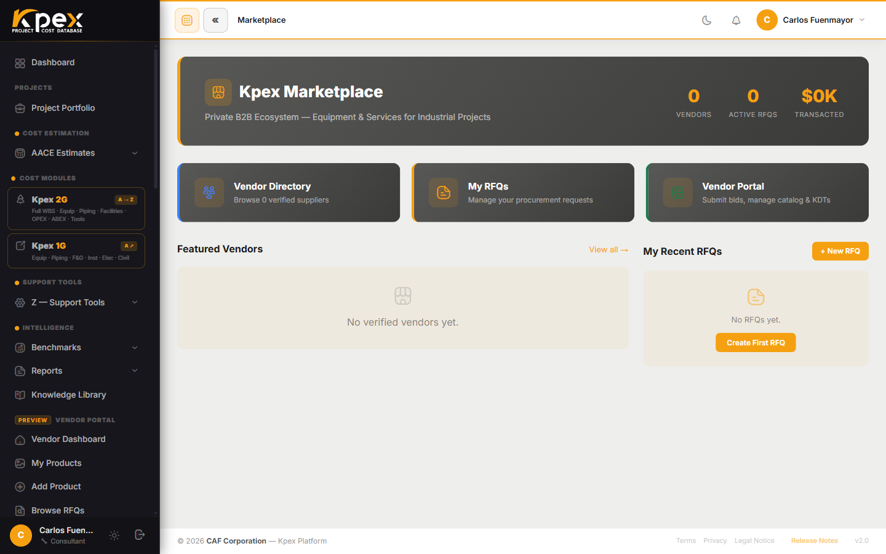

## En esta lección

- Qué es **Kpex Exchange** y por qué es un marketplace de varios lados.
- Los cinco participantes y qué gana cada uno.
- Cómo funciona una **RFQ** (solicitud de cotización) y dónde encaja en tu estimado.

## Del precio paramétrico al precio real

En los módulos anteriores trabajaste con **datos de costo**: curvas, modelos y componentes calibrados por ubicación y tiempo. Son perfectos para las Clases 5 a 3. Pero cuando el proyecto madura hacia las Clases 2 y 1, el estimado necesita algo más: **precios reales de proveedores**.

**Kpex Exchange** es el último eslabón de la cadena que viste en la lección 1.2: el lugar donde el dato paramétrico se **reemplaza por el precio real**. Es un marketplace **de varios lados** de compras y de datos: conecta a los distintos participantes de la plataforma para que cada uno aporte algo y reciba algo a cambio.

## Los cinco participantes

| Participante | Qué hace en el Exchange | Qué gana |
|---|---|---|
| **Owner / Operator** | Emite **RFQs** (solicitudes de cotización) para paquetes de equipos y recibe las cotizaciones de los proveedores a través de la plataforma | Precios competitivos, compras más rápidas y trazabilidad de auditoría |
| **EPC Contractor** | Consulta los precios de proveedores para alimentar las partidas de su estimado. Participa en las RFQs del owner cuando está autorizado | Precios validados por el mercado; comprobación en vivo del costo de componentes |
| **Equipment Vendor** | Publica sus familias de equipos con precios indicativos y responde a RFQs | Acceso directo a compradores calificados con proyectos CAPEX activos |
| **Data Partner** | Aporta conjuntos de datos históricos de costos de proyectos | Reconocimiento como contribuyente a los benchmarks |
| **Estimator** | Accede a precios de proveedores en vivo mientras construye el estimado y usa los benchmarks de los data partners para validar en Clases 5–4 | Precios del mundo real y menos incertidumbre en los estimados tempranos |

El círculo se cierra solo: los owners piden precios, los vendors responden, los data partners enriquecen la historia y los estimadores y EPC usan todo eso para producir números más fiables.

## Cómo funciona una RFQ

Una **RFQ** (*Request for Quotation*) es una solicitud formal de precio para un paquete de equipos:

1. El owner/operator crea la RFQ describiendo el paquete.
2. Los vendors la ven en su portal y envían su cotización.
3. El owner recibe las cotizaciones dentro de Kpex, las compara y conserva el historial.

En el flujo de Clase 2 que viste en el Módulo 3, este es el paso en que **sustituyes costos paramétricos por cotizaciones reales**, concilias las ofertas y congelas la línea base de control.

## Dónde lo encuentras en Kpex

Lo que ves en la barra lateral depende de tu tipo de perfil:

- **Todos los perfiles**: grupo **Kpex Exchange**, con **Exchange Home**, **Product Catalog** y **Vendors**.
- **Owner / Operator**: sección **Procurement**, con **My RFQs** y **New RFQ**.
- **Vendor**: **Vendor Portal**, con **My Products**, **Add Product** y **Browse RFQs**.
- **Data Partner**: su propio portal, con **My Datasets** y **Submit Dataset**.

## Idea clave

> Kpex Exchange convierte la plataforma en un **ecosistema**: el mismo lugar donde estimas es el lugar donde **pides, recibes y comparas precios reales**, y donde la historia de costos crece con cada participante.

## Pruébalo en Kpex (4 minutos)

1. Abre **Kpex Exchange → Exchange Home** y recorre el **Product Catalog**.
2. Entra en **Vendors** y abre la ficha de un proveedor. Anota qué familias de equipos ofrece.
3. Piensa en el estimado que creaste en el Módulo 4: ¿qué equipo principal sería el primero que llevarías a una RFQ cuando el proyecto llegue a Clase 2?
