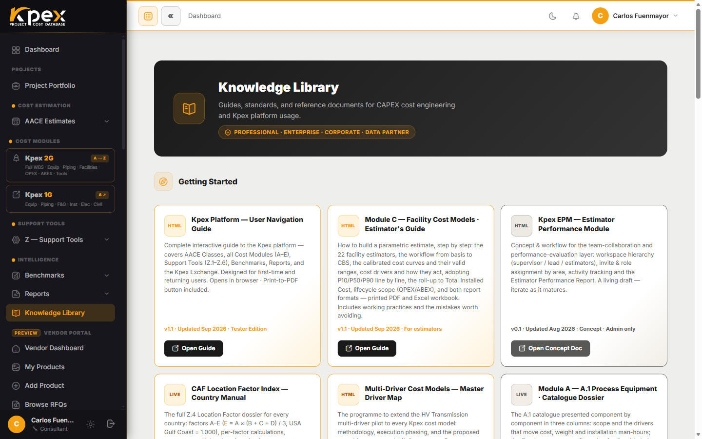

## En esta lección

- A quién escribir según el tipo de pregunta que tengas.
- Dónde encontrar guías y documentos de referencia dentro de Kpex.
- Hacia dónde evoluciona la plataforma.

## Has recorrido la plataforma completa

Llegados a este punto conoces las cinco capas de Kpex: sabes crear un estimado con su clase AACE, alimentarlo con los módulos de costo A–E, calibrarlo con las herramientas Z, compararlo con los benchmarks, reportarlo y llevarlo al Exchange cuando necesitas precios reales. Lo que queda es saber **dónde pedir ayuda** cuando la necesites.

## Canales de soporte

| Canal | Contacto | Úsalo para |
|---|---|---|
| **Soporte general** | support@caf-corporation.com | Acceso a la cuenta, preguntas sobre funciones, facturación |
| **Preguntas de metodología** | methodology@caf-corporation.com | Alineación AACE/PMI, consultas técnicas sobre el LFI o el Cost Index |
| **Sitio web de la plataforma** | caf-corporation.com/kpex | Información del producto, precios, blog |
| **Knowledge Library** | kpex.caf-corporation.com/knowledge | Guías dentro de la plataforma, documentos de referencia AACE, plantillas |
| **Alianzas estratégicas** | partnerships@caf-corporation.com | Cuentas Enterprise/Corporate, acuerdos de Data Partner, alianzas |

Un consejo práctico: cuando escribas a **methodology@**, incluye la clase AACE, el país del proyecto y el mes base del estimado. Son los datos que el equipo técnico necesita para reproducir tu número.

## La Knowledge Library

La **Knowledge Library** aparece en la barra lateral de Kpex. Reúne guías de uso, documentos de referencia AACE y plantillas, y es el primer sitio donde buscar antes de escribir a soporte. Según tu membresía puede aparecer con un candado: en ese caso, al pulsarla verás qué plan la desbloquea.

## Lo que viene

Kpex sigue creciendo. La línea de desarrollo principal son los **estimadores con inteligencia artificial**: asistentes conversacionales que, a partir de la descripción de tu facility o de preguntas en lenguaje de gestión de proyectos, preparan un estimado de orden de magnitud o de factibilidad apoyándose en los mismos módulos que ya conoces (C, A y B) y aplicando automáticamente el Location Factor y el Cost Index. Todo lo que has aprendido en este curso es la base sobre la que funcionarán: entender qué hace la IA te permitirá revisar y defender su resultado.

## Idea clave

> Tienes un canal para cada tipo de duda: **support@** para la cuenta y las funciones, **methodology@** para la técnica, y la **Knowledge Library** como primera parada.

## Tus próximos pasos

1. Guarda los correos de **support@** y **methodology@** en tus contactos.
2. Abre la **Knowledge Library** y marca una guía que te sea útil para tu próximo proyecto.
3. Completa el **examen final** de este curso: es la puerta a tu certificado y a tu beneficio de alumno, que verás en la siguiente lección.
