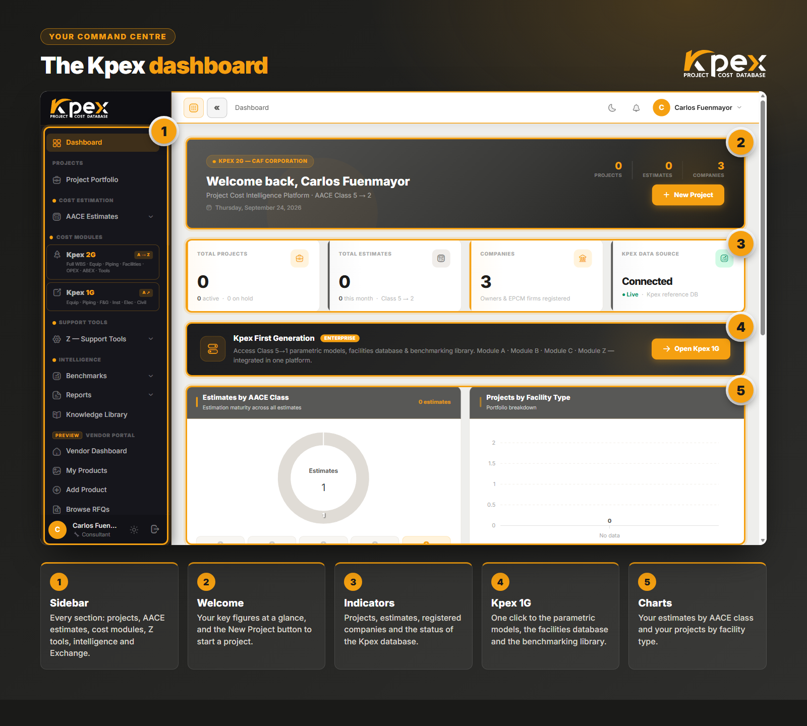

**Kpex** is CAF Corporation's CAPEX cost intelligence platform: a cost database that recalibrates itself for **location** and **time**, inside an estimating environment that covers AACE **Class 5 to Class 2**. This is its official course. In about five hours you go from not knowing the platform to preparing, calibrating and reporting a complete estimate, with hands-on tasks inside Kpex from the very first lesson.

## What you will learn

- **Find your way around the whole platform** from the dashboard: projects, AACE estimates, cost modules, Z tools, intelligence and Exchange.
- **Pick the right tool for each AACE class**: cost curves and facility models at Class 5, component-level data at Classes 3 and 2.
- **Build your first estimate** with the Estimate Wizard, from the cost curve to the PDF report, through a complete 100 MWp solar PV exercise.
- **Use cost modules A to E**: plant components, benchmarks, facilities, OPEX and ABEX.
- **Calibrate every figure** with the Location Factor (LFI), the CAF Cost Index and the PDRI, PEI and CRI assessments.
- **Read benchmarks and portfolio reports**, and use the Kpex Exchange marketplace.

## Who it is for

| If you are… | What you take away |
|---|---|
| **An estimator or cost engineer** | A complete estimating workflow, from curve to report, with the calibration tools |
| **A project manager or director** | How to read a Kpex estimate, its AACE class and its accuracy range |
| **An EPC or consultancy** | The cost modules and reports to prepare and defend bids |
| **An owner or operator** | Benchmarks, OPEX and ABEX to decide on the full life cycle |

No previous Kpex experience is needed. Knowing the basics of cost estimating helps; the course explains every concept as it comes up.

## Course modules

| Module | Topic | Lessons |
|---|---|---|
| **0** | Welcome and activating your trial account | 2 |
| **1** | What Kpex is | 3 |
| **2** | Getting started: access, dashboard and profiles | 3 |
| **3** | AACE classes in Kpex | 2 |
| **4** | Your first estimate (with a Class 5 exercise) | 4 |
| **5** | Cost modules A, B, C, D and E | 4 |
| **6** | Module Z: the calibration tools | 4 |
| **7** | Intelligence, reports and Exchange | 3 |
| **8** | Wrap-up and certification | 2 |

## What's included

- **27 lessons** with real platform screenshots and **24 "Try it in Kpex" tasks** to practise on the platform.
- **7 module quizzes** and a **final exam**, every question with its explanation.
- **15 days of Kpex access** from your enrolment, to do every exercise on the real platform.
- **Certificate of completion** from Akdemy and CAF Corporation, verifiable by QR code, when you pass the final exam.
- **A discount on your Kpex membership** as a course student.
- The course is also available in Spanish.

## Launch price

> **€50** instead of €200, during the launch only. Module 0 and lesson 1.1 are free previews: you can watch them before enrolling.
