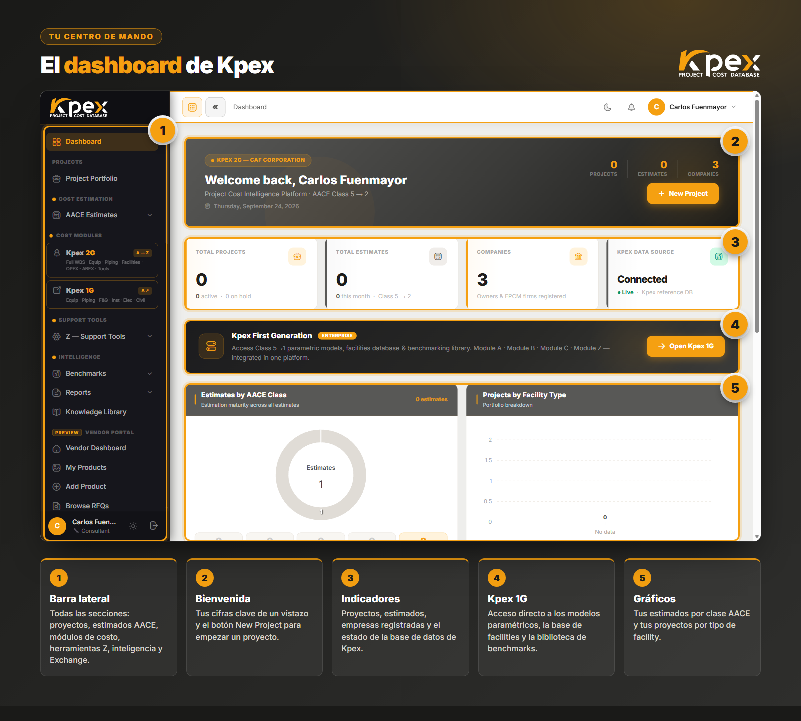

**Kpex** es la plataforma de inteligencia de costos CAPEX de CAF Corporation: una base de datos de costos que se recalibra sola por **ubicación** y por **tiempo**, dentro de un entorno de estimación que cubre de la **Clase 5 a la Clase 2** de AACE. Este es su curso oficial. En unas cinco horas pasas de no conocer la plataforma a preparar, calibrar y reportar un estimado completo, con tareas prácticas dentro de Kpex desde la primera lección.

## Qué vas a aprender

- **Moverte por toda la plataforma** desde el dashboard: proyectos, estimados AACE, módulos de costo, herramientas Z, inteligencia y Exchange.
- **Elegir la herramienta correcta para cada clase AACE**: curvas de costo y modelos de facilities en Clase 5, datos por componente en Clases 3 y 2.
- **Construir tu primer estimado** con el Estimate Wizard, de la curva de costo al reporte PDF, con un ejercicio completo de una planta solar de 100 MWp.
- **Usar los módulos de costo A a E**: componentes de planta, benchmarks, facilities, OPEX y ABEX.
- **Calibrar cada cifra** con el Location Factor (LFI), el CAF Cost Index y las evaluaciones PDRI, PEI y CRI.
- **Leer benchmarks, reportes de portafolio** y usar el marketplace Kpex Exchange.

## Para quién es

| Si eres… | Lo que te llevas |
|---|---|
| **Estimador o ingeniero de costos** | Un flujo completo de estimación, de la curva al reporte, con las herramientas de calibración |
| **Gerente o director de proyecto** | Cómo leer un estimado Kpex, su clase AACE y su rango de precisión |
| **EPC o consultora** | Los módulos de costo y los reportes para preparar y defender ofertas |
| **Dueño u operador** | Benchmarks, OPEX y ABEX para decidir con el ciclo de vida completo |

No necesitas experiencia previa con Kpex. Sí te ayudará conocer lo básico de la estimación de costos; el curso explica cada concepto cuando aparece.

## Módulos del curso

| Módulo | Tema | Lecciones |
|---|---|---|
| **0** | Bienvenida y activación de tu cuenta de prueba | 2 |
| **1** | Qué es Kpex | 3 |
| **2** | Primeros pasos: acceso, dashboard y perfiles | 3 |
| **3** | Las clases AACE en Kpex | 2 |
| **4** | Tu primer estimado (con ejercicio de Clase 5) | 4 |
| **5** | Los módulos de costo A, B, C, D y E | 4 |
| **6** | Módulo Z: las herramientas de calibración | 4 |
| **7** | Inteligencia, reportes y Exchange | 3 |
| **8** | Cierre y certificación | 2 |

## Qué incluye

- **27 lecciones** con capturas reales de la plataforma y **24 tareas "Pruébalo en Kpex"** para practicar en la plataforma.
- **7 quizzes** por módulo y un **examen final**, cada pregunta con su explicación.
- **Acceso a Kpex durante 15 días** desde tu inscripción, para hacer todas las prácticas en la plataforma real.
- **Certificado de finalización** de Akdemy y CAF Corporation, verificable con código QR, al aprobar el examen final.
- **Descuento en tu membresía Kpex** como alumno del curso.
- Curso disponible también en inglés.

## Precio de lanzamiento

> **20 €** en lugar de 100 €, solo durante el lanzamiento. Y **gratis** si ya tienes cualquier plan de Kpex. Las lecciones del Módulo 0 y la lección 1.1 son de vista previa gratuita: puedes verlas antes de inscribirte.
